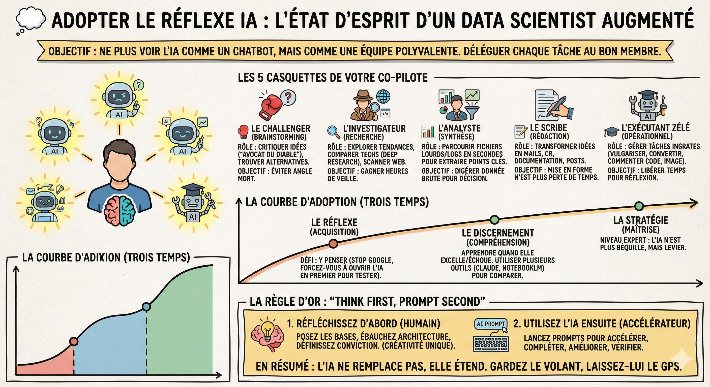

# 🧭 Adopter le réflexe IA

## Objectif

Passer de l'utilisation ponctuelle de l'IA à un réflexe quotidien structuré, en comprenant les cinq rôles que votre co-pilote IA peut jouer et en appliquant la règle "Think First, Prompt Second".

## L'état d'esprit

Maîtriser les outils d'IA est une chose, mais adopter le bon état d'esprit est ce qui fera de vous un data scientist augmenté.

Ne voyez plus Gemini comme un simple chatbot, mais comme une équipe polyvalente assise à côté de vous. Pour chaque tâche, demandez-vous : "À quel membre de mon équipe virtuelle dois-je déléguer cette partie ?"

## Les 5 casquettes de votre co-pilote
Dans mon quotidien, je n'interagis pas avec une seule IA, mais avec 5 personnalités distinctes selon mes besoins :

🥊 Le Challenger (brainstorming) :  
Son rôle : Je lui soumets une idée, et je lui demande de la critiquer ("avocat du diable") ou de trouver 10 alternatives auxquelles je n'aurais pas pensé.  
L'objectif : M'assurer que je n'ai pas d'angle mort.

🕵️‍♂️ L'investigateur (recherche) :  
Son rôle : Il explore les tendances, compare les technologies (via Deep Research) et scanne le web pour valider mes intuitions.  
L'objectif : M'éviter des heures de navigation (benchmarks, veille).

📊 L'analyste (synthèse) :  
Son rôle : Je lui donne des fichiers lourds ou des logs complexes. Il les parcourt en quelques secondes pour extraire les anomalies ou les points clés.  
L'objectif : Digérer la donnée brute pour que je puisse prendre la décision.

✍️ Le scribe (rédaction) :  
Son rôle : Il transforme mes idées en mails, comptes-rendus, documentation ou posts LinkedIn.  
L'objectif : La mise en forme ne doit plus être une perte de temps.

🎓 L'exécutant zélé (opérationnel) :  
Son rôle : Il gère les tâches ingrates : vulgariser un concept, convertir un fichier, commenter du code, créer une image d'illustration.  
L'objectif : Me libérer du temps pour la réflexion à haute valeur ajoutée.

## La courbe d'adoption : du réflexe à la nuance

Intégrer l'IA est un processus en trois temps. Où vous situez-vous ?

1. Le réflexe (acquisition) : Au début, le défi est d'y penser. On continue souvent à Googler par habitude alors que l'IA serait plus rapide. Conseil : Forcez-vous à ouvrir l'IA en premier pour tout, juste pour tester ses limites.

2. Le discernement (compréhension) : On apprend quand l'IA excelle et quand elle échoue (hallucinations, raisonnement circulaire). On commence à utiliser plusieurs outils en parallèle (Claude pour le code, NotebookLM pour la lecture) pour comparer les résultats.

3. La stratégie (maîtrise) : C'est le niveau expert. L'IA n'est plus une béquille, mais un levier.

## La règle d'or : "Think First, Prompt Second"

C'est le point le plus crucial. Paradoxalement, pour bien utiliser l'IA, il faut savoir s'en passer au début. Ne déléguez jamais votre pensée critique. Utilisez l'approche "IA en 2ème étape" :

1. Réfléchissez d'abord par vous-même. Posez les bases de votre raisonnement, ébauchez votre architecture, définissez votre conviction.  
- Pourquoi ? Parce que votre créativité humaine est unique. Si vous laissez l'IA tout faire de A à Z, vous aurez un résultat moyen et standardisé. De plus, vous serez incapable de défendre le projet avec conviction si vous ne l'avez pas conçu vous-même.

2. Utilisez l'IA ensuite. Une fois votre vision claire, lancez les prompts pour accélérer l'exécution, compléter les manques, améliorer le style ou vérifier la technique.

En résumé : L'IA ne remplace pas votre cerveau, elle l'étend. Gardez le volant, laissez-lui le GPS et la radio.

## Ce qu'il faut retenir

- Voyez l'IA comme une équipe de 5 spécialistes : challenger, investigateur, analyste, scribe et exécutant. Choisissez la bonne casquette pour chaque tâche.

- L'adoption se fait en trois temps : le réflexe (y penser), le discernement (savoir quand l'IA excelle ou échoue), puis la stratégie (en faire un levier).

- Think First, Prompt Second : réfléchissez d'abord par vous-même, puis utilisez l'IA pour accélérer l'exécution. Votre créativité humaine reste irremplaçable.

## Pour aller plus loin

- [How I use LLMs](https://youtu.be/EWvNQjAaOHw?si=oDRyuYE--wTbgCsd) — Andrej Karpathy partage comment il intègre les LLMs dans son quotidien de chercheur
- [Ethan Mollick, Co-Intelligence](https://www.oneusefulthing.org/) — le blog de référence sur l'impact de l'IA sur le travail et la productivité
- [AI Productivity Tips for Data Scientists](https://towardsdatascience.com/) — articles et tutoriels pour intégrer l'IA dans un workflow data science
