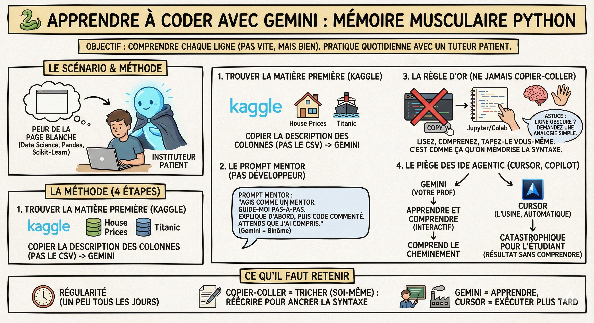

# 🐍 Apprendre à coder

## Objectif

Utiliser Gemini pour construire votre mémoire musculaire en Python. L'objectif n'est pas d'obtenir le script final le plus vite possible, mais de comprendre chaque ligne pour être capable de l'expliquer lors d'une évaluation technique.

## Le scénario

Vous avez des bases en Python, mais vous savez que pour la data science, il faut passer au niveau supérieur (Pandas, Scikit-Learn). Vous avez peur de la page blanche. Au lieu d'attendre le prochain cours, vous allez pratiquer 15 minutes par jour en transformant Gemini en instituteur patient qui regarde par-dessus votre épaule.

## La méthode

1\. Trouver la matière première (Kaggle)  
Pour coder, il faut des données. Ne perdez pas de temps à en chercher.

- L'action : Allez sur [Kaggle](https://www.kaggle.com/), prenez un dataset populaire (ex: "House Prices" ou "Titanic").

- Le transfert : Copiez simplement la description des colonnes (le dictionnaire des données) et collez-la dans Gemini. Pas besoin d'uploader le CSV tout de suite, Gemini a juste besoin de connaître la structure pour vous guider.

2\. Le prompt mentor (pas développeur)  
C'est ici que tout se joue. Si vous demandez "Fais-moi l'analyse", Gemini vous donnera tout le code d'un coup. Vous n'apprendrez rien.

- Le prompt à utiliser : "Je suis débutant en data science. J'ai ce dataset (coller la description). Agis comme un mentor. Guide-moi pas-à-pas pour explorer ces données. Propose-moi d'abord une première étape simple, explique-moi pourquoi on la fait, et donne-moi le code très commenté. Attends que je te dise que j'ai compris avant de passer à la suite."

- Pourquoi ça marche : Vous forcez Gemini à découper le problème. Gemini devient votre binôme.

3\. La règle d'or (ne jamais copier-coller)  
Gemini vous donne un bloc de code. La tentation de cliquer sur "copy" est grande. Ne le faites pas.

- La méthode : Lisez le code, comprenez la logique, puis tapez-le vous-même dans votre Notebook (Jupyter/Colab).

- L'intérêt : C'est en tapant pd.read\_csv ou df.groupby que votre cerveau et vos doigts mémorisent la syntaxe. Si vous copiez-collez, vous saurez lire le code, mais vous serez incapable de l'écrire devant une feuille blanche ou en entretien technique.

- Astuce : Si une ligne est obscure, surlignez-la et demandez : "Explique-moi cette ligne spécifique avec une analogie simple."

4\. Comprendre le piège des IDE agentic (Cursor, Windsurf, GitHub Copilot, etc.)  
Vous entendrez parler d'outils comme Cursor. Ce sont des éditeurs de code surpuissants (agentic IDEs).

- La démo : Si je donne le même prompt à Cursor, il va créer 10 fichiers, configurer l'environnement et écrire 300 lignes de code en 30 secondes.

- Le danger : C'est magique pour la productivité d'un senior, mais catastrophique pour un étudiant. Vous obtenez le résultat sans le cheminement.

- Le verdict : En évaluation, si on vous demande "Pourquoi as-tu utilisé cette méthode ici ?", l'utilisateur de Cursor ne saura pas répondre. L'utilisateur de Gemini (méthode pas-à-pas) aura la réponse, car il aura souffert sur chaque ligne. Gardez Cursor pour plus tard, quand vous serez experts.

## Ce qu'il faut retenir

- Régularité : un peu de Python tous les jours avec Gemini vaut mieux qu'un gros bloc de code généré une fois par semaine.

- Copier-Coller = Tricher (soi-même) : forcez-vous à réécrire le code proposé par Gemini. C'est la seule façon d'ancrer la syntaxe.

- Gemini est votre prof, Cursor est votre usine : utilisez le chat pour apprendre et comprendre (mode interactif). N'utilisez les générateurs de code automatiques que pour les tâches que vous savez déjà faire parfaitement à la main.

## Pour aller plus loin

- [How to Learn Python FAST with AI](https://youtu.be/B9nFM0hpt8I) — stratégie d'apprentissage accéléré du Python avec l'IA comme tuteur
- [Kaggle Learn](https://www.kaggle.com/learn) — parcours gratuits et interactifs pour apprendre Python, Pandas et le Machine Learning
- [Google's Python Class](https://developers.google.com/edu/python) — cours officiel Google pour apprendre Python pas à pas
