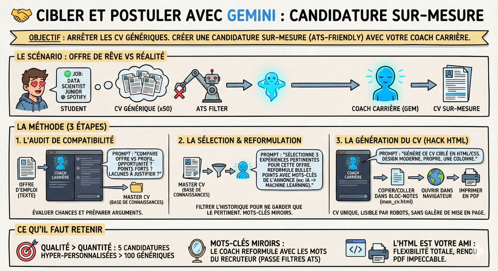

# 🤝 Cibler et postuler

**Objectif :** Arrêter d'envoyer le même CV générique à 50 entreprises (ce qui ne marche pas). Utiliser votre coach pour créer une candidature sur-mesure, qui passe les filtres ATS (robots de tri) et parle le langage exact de l'offre.

**Le scénario**  
Vous avez trouvé l'offre de rêve (ex: "Data Scientist Junior chez Spotify"). Vous avez votre master CV (très complet) et votre Gem "Coach Carrière". Plutôt que d'envoyer votre CV tel quel, vous allez demander à votre Coach de tailler un costume sur mesure pour cette offre spécifique.

**La méthode**

1\. L'audit de compatibilité  
Avant de postuler, évaluez vos chances et préparez vos arguments.

- L'action : Ouvrez votre Gem "Coach Carrière". Collez le texte complet de l'offre d'emploi.

- Le Prompt : "Voici une offre d'emploi. Compare-la avec mon profil (base de connaissances).  
  1. Est-ce une bonne opportunité pour moi ?  
  2. Quels sont mes points forts pour ce poste ?  
  3. Quelles sont mes lacunes ou faiblesses apparentes que je devrai justifier ?"

- L'usage : Si votre coach dit "Il manque du Cloud", vous savez que vous devrez bosser cet argument pour l'entretien.

2\. La sélection  
Un bon CV ne dit pas tout. Il dit ce qui est pertinent pour ce poste.

- Le prompt : "Sélectionne dans mon Master CV les 3 expériences les plus pertinentes pour CETTE offre. Reformule les bullet points pour qu'ils matchent les mots-clés de l'annonce (ex: si l'annonce dit 'Machine Learning', remplace 'IA' par 'Machine Learning')."

- Le résultat : Le coach filtre votre historique pour ne garder que ce qui intéresse le recruteur.

3\. La génération du CV (le hack HTML)  
Fini la galère de la mise en page sur Word.

- Le Prompt : "Génère-moi maintenant ce CV ciblé au format HTML/CSS.  
  Je veux un design moderne, propre, sur une seule colonne. Mets mon nom en gros en haut, et les sections bien espacées."

- L'action :  
  1. Gemini génère le code.  
  2. Copiez le code.  
  3. Collez-le dans un fichier bloc-notes, enregistrez sous mon\_cv.html.  
  4. Ouvrez-le dans votre navigateur → Imprimer → Enregistrer en PDF.

- L'avantage : Vous avez un CV unique et parfaitement lisible par les robots.

**Ce qu'il faut retenir**

- Qualité > Quantité : Il vaut mieux 5 candidatures hyper-personnalisées (grâce à votre coach) que 100 candidatures génériques.

- Mots-clés miroirs : Le coach reformule votre expérience avec les mots du recruteur. C'est la clé pour passer les premiers filtres.

- L'HTML est votre ami : Générer son CV en code permet une flexibilité totale et un rendu PDF impeccable, sans se battre avec les marges d'un traitement de texte.
