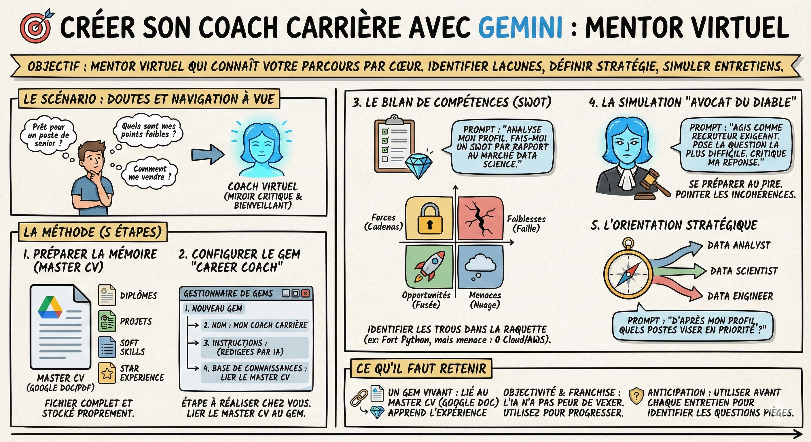

# 🎯 Créer son coach carrière

## Objectif

Ne plus naviguer à vue. Transformer votre master CV en un mentor virtuel qui connaît votre parcours par coeur. Il vous aidera à identifier vos lacunes, définir votre stratégie et simuler des entretiens difficiles.

## Le scénario

Vous avez votre master CV avec toutes vos expériences détaillées. Mais maintenant, vous doutez : "Est-ce que je suis prêt pour un poste de senior ?", "Quels sont mes points faibles ?", "Comment me vendre ?". Au lieu de payer un coach ou de stresser seul, nous allons configurer un Gem dédié qui sera votre miroir critique et bienveillant.

## La méthode

1\. Préparer la mémoire  
Votre coach ne peut être bon que si sa connaissance de vous est parfaite.

- L'action : Assurez-vous que votre fichier master CV (créé à l'étape précédente) est complet et stocké proprement (soit un Google Doc, soit un PDF).

- Le conseil : Ce document doit tout contenir : diplômes, projets techniques, soft skills, langues, et vos expériences format STAR.

2\. Configurer le Gem "Career Coach"  
C'est l'étape à réaliser chez vous pour créer l'outil.

1. Ouvrez le Gestionnaire de Gems dans Gemini.  
2. Cliquez sur "Nouveau Gem".  
3. Nom : "Mon Coach Carrière".  
4. Instructions : Demandez à Gemini de les rédiger pour vous.  
5. Base de connaissances : Cliquez sur "ajouter" (Drive ou Upload) et sélectionnez votre fichier master CV.  
6. Sauvegardez.

3\. Le bilan de compétences (SWOT)  
Utilisez votre nouveau coach pour y voir clair.

- Le Prompt : "Analyse mon profil. Fais-moi une matrice SWOT (Forces, Faiblesses, Opportunités, Menaces) par rapport au marché actuel de la Data Science."

- L'usage : Il va identifier des trous dans votre raquette (ex: "Tu es fort en Python, mais tu n'as aucune expérience en Cloud/AWS, c'est une menace pour des postes seniors").

4\. La simulation "avocat du diable"  
Préparez-vous au pire pour être à l'aise le jour J.

- Le prompt : "Agis comme un recruteur exigeant pour un poste de data scientist. Lis mon CV et pose-moi la question la plus difficile ou déstabilisante que tu pourrais trouver sur mon parcours. Attends ma réponse, puis critique-la."

- L'usage : Il va pointer les incohérences (ex: "Pourquoi ce trou de 6 mois en 2023 ?" ou "Tu dis maîtriser le SQL mais tu ne cites aucun projet complexe l'utilisant").

5\. L'orientation stratégique

- Le prompt : "D'après mon profil, quels types de postes ou d'industries devrais-je viser en priorité ? Suis-je plus profil data analyst, data scientist ou data engineer ?"

## Ce qu'il faut retenir

- Un Gem vivant : votre Coach est lié à votre Master CV. Si vous mettez à jour le fichier Google Doc du CV, le Coach apprend votre nouvelle expérience automatiquement.

- L'objectivité : contrairement à vos amis ou votre famille, l'IA n'a pas peur de vous vexer. Utilisez cette franchise pour progresser.

- L'anticipation : utilisez ce Gem avant chaque entretien pour identifier les questions pièges spécifiques à votre parcours.

## Pour aller plus loin

- [How to Use AI as Your Career Coach](https://youtu.be/R2b3J6nPmYs) — stratégies pour transformer l'IA en coach de carrière personnalisé
- [The SWOT Analysis Explained](https://hbr.org/2024/09/swot-analysis) — comprendre et appliquer la matrice SWOT pour son profil professionnel
- [Google Gemini Gems: Custom AI Assistants](https://blog.google/products/gemini/google-gems/) — documentation officielle sur la création de Gems personnalisés
