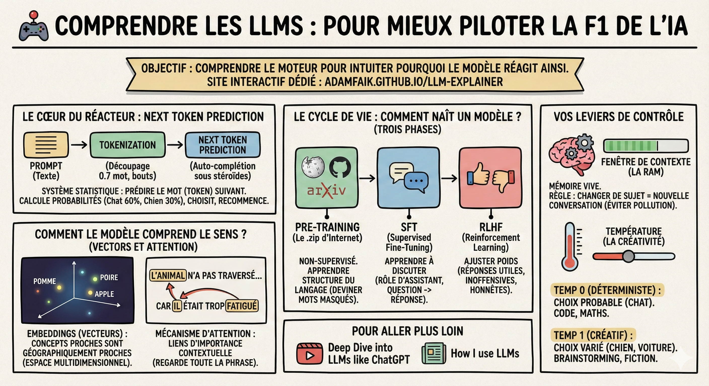

# 🕹️ Comprendre les LLMs

## Objectif

Comprendre les concepts fondamentaux des **LLMs** (Large Language Models — grands modèles de langage) pour mieux piloter vos interactions avec l'IA : tokenization, embeddings, attention, cycle de vie et leviers de contrôle.

## Pourquoi comprendre le moteur

Je vous ai promis de privilégier la pratique, mais pour bien piloter une F1, il faut comprendre comment fonctionne le moteur. En tant que data scientists, ces concepts vous aideront à intuiter pourquoi le modèle réagit de telle ou telle façon.

Mon conseil : pour visualiser ces concepts de manière interactive, j'ai créé avec Gemini un [site dédié qui illustre les principes clés](https://the-ai-thinker.github.io/llm-explainer/).

## Le coeur du réacteur : next token prediction

Oubliez la magie. Un LLM n'est qu'un système statistique hyper-performant conçu pour une seule tâche : prédire le mot (token) suivant.

- Tokenization : Le modèle ne lit pas du texte. Votre prompt est découpé en tokens (bouts de mots, environ 0,7 mot).

- L'auto-complétion sous stéroïdes : Le modèle regarde la suite de tokens en entrée et calcule la probabilité de tous les tokens possibles pour la suite. Il en choisit un, l'ajoute à la suite, et recommence.

## Comment le modèle comprend le sens (vectors et attention)

C'est ici que la magie opère. Comment sait-il que "Pomme" est proche de "Poire" mais aussi de "Apple" ?

- Les embeddings (vecteurs) : Chaque token est converti en un vecteur dans un espace multidimensionnel gigantesque. Dans cet espace, les concepts sémantiquement proches sont géographiquement proches. C'est ce qui permet au modèle de raisonner par analogie et concept, pas juste par mot-clé.

- Le mécanisme d'attention (the "transformer") : C'est la révolution technologique. Contrairement aux anciens modèles qui lisaient mot à mot, le LLM regarde toute la phrase d'un coup. Grâce à l'attention, il calcule des liens d'importance entre les mots, peu importe leur distance.

- Exemple : Dans "L'animal n'a pas traversé la rue car il était trop fatigué", le mécanisme d'attention lie fortement "il" à "animal" (et non à "rue"). C'est ce qui lui donne sa cohérence contextuelle.

## Le cycle de vie : comment naît un modèle

Le modèle que vous utilisez a subi trois phases distinctes (et coûteuses) :

1. Pre-training (Le .zip d'Internet) : On lui fait lire tout le web (Wikipedia, GitHub, ArXiv...). Il apprend la structure du langage et des connaissances factuelles en essayant de deviner les mots masqués. C'est une phase non-supervisée très lourde (tous les X mois).

2. SFT (Supervised Fine-Tuning) : On lui apprend à discuter. On l'entraîne sur des datasets de conversations (Question → Réponse) de haute qualité pour qu'il comprenne qu'on attend de lui un rôle d'assistant, pas juste de compléter une phrase de Wikipédia.

3. RLHF (Reinforcement Learning) : On lui donne un caractère et des garde-fous. Des humains (et maintenant des IA) notent ses réponses (pouce haut/bas). On ajuste les poids pour privilégier les réponses utiles, inoffensives et honnêtes.

## Vos leviers de contrôle

- La fenêtre de contexte (la RAM) : C'est la mémoire vive de la conversation. Tout ce que vous dites et tout ce qu'il répond s'accumule dans cette fenêtre.  
  - La règle : Si vous changez de sujet, ouvrez une nouvelle conversation.  
  - Pourquoi ? Si vous parlez de "Recette de cuisine" puis de "Code Python" dans le même chat, les poids d'attention de la recette vont polluer la génération du code (le modèle cherchera à rester cohérent avec le début). Pour un résultat de meilleure qualité, il faut un contexte neuf.

- La température (la créativité) : C'est un paramètre (souvent caché ou réglable via l'API/AI Studio) qui contrôle le choix du token suivant.  
  - Le modèle génère des probabilités pour le prochain mot (ex: "Chat" 60%, "Chien" 30%, "Voiture" 1%).  
  - Température 0 (déterministe) : Il prend toujours le mot le plus probable (le "Chat"). Idéal pour le Code ou les Maths (on veut de la rigueur).  
  - Température 1 (créatif) : Il va parfois piocher le "Chien" ou la "Voiture" pour varier. Idéal pour le Brainstorming ou l'écriture de fiction.

## Ce qu'il faut retenir

- Un LLM est un système statistique de prédiction du prochain token, pas une intelligence consciente. Comprendre cela vous aide à anticiper ses forces et ses limites.

- Les **embeddings** et le **mécanisme d'attention** sont ce qui donne au modèle sa compréhension contextuelle : il raisonne par proximité sémantique, pas par mots-clés.

- Vous avez deux leviers principaux : la **fenêtre de contexte** (gardez vos conversations thématiques) et la **température** (rigueur vs. créativité).

## Pour aller plus loin

- [Deep Dive into LLMs like ChatGPT](https://youtu.be/7xTGNNLPyMI?si=TLxwzQAx7a87PHG-) — Andrej Karpathy explique en profondeur le fonctionnement interne des LLMs
- [How I use LLMs](https://youtu.be/EWvNQjAaOHw?si=oDRyuYE--wTbgCsd) — retour d'expérience concret sur l'utilisation quotidienne des LLMs
- [LLM Explainer Interactif](https://the-ai-thinker.github.io/llm-explainer/) — site interactif créé pour ce cours, illustrant les principes clés des LLMs
