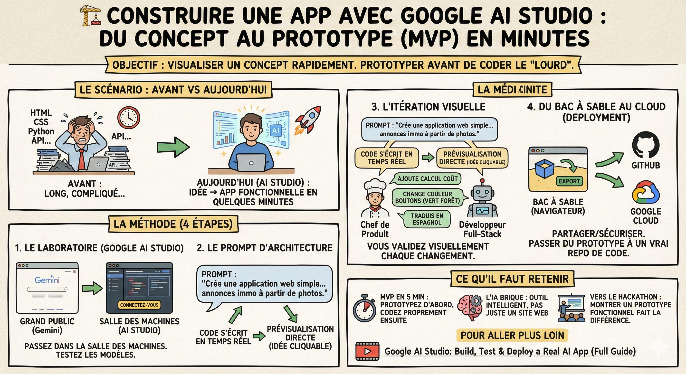

# 🏗️ Construire une app

**Objectif :** Transformer une idée abstraite en une application fonctionnelle en quelques minutes. Ce n'est pas encore du code de production, mais c'est le moyen le plus rapide de visualiser un concept (MVP) avant de se lancer dans le développement lourd.

**Note :** Ce sujet sera approfondi lors du module [Gestion de produit]() et du [TP]().

**Le scénario**  
Vous avez une idée géniale. Avant, il fallait coder le HTML, le CSS, le Python, gérer les API... C'était long. Aujourd'hui, via Google AI Studio, nous allons demander à l'IA de coder l'application entière sous nos yeux.

**La méthode**

1\. Le laboratoire : Google AI Studio  
On quitte l'interface grand public (Gemini) pour passer dans la salle des machines : Google AI Studio.

- L'action : Connectez-vous à [AI Studio](https://aistudio.google.com/). C'est ici que les développeurs testent les derniers modèles.

- Le "J'ai de la chance" : Si vous manquez d'inspiration pour la démo, cherchez les boutons de suggestions ou de prompts aléatoires. C'est un excellent moyen de voir ce que la machine a dans le ventre sans effort.

2\. Le prompt d'architecture  
Au lieu de demander du texte, on demande une App.

- Le prompt : "Crée une application web simple et moderne qui rédige des annonces immobilières à partir de photos."

- Le résultat : Vous voyez le code s'écrire en temps réel. L'outil propose aussi une prévisualisation directe. Votre idée est devenue cliquable.

3\. L'itération visuelle  
La V1 fonctionne, mais elle est moche ou incomplète ? On itère.

- L'action : Continuez la discussion.  
  - "Ajoute une fonctionnalité pour calculer le coût d'emprunt."  
  - "Change la couleur des boutons en vert forêt."  
  - "Traduis l'interface en espagnol."

- Le concept : Vous êtes le chef de produit, l'IA est votre développeur full-stack. Vous validez visuellement chaque changement.

4\. Du bac à sable au cloud (deployment)  
Votre prototype tourne dans le navigateur, mais vous voulez le partager ou le sécuriser.

- L'action : Cherchez le bouton "Export".

- La puissance : Vous pouvez envoyer le code directement vers GitHub ou le déployer sur Google Cloud.

- Pourquoi c'est fort ? Vous passez d'un prototype généré par l'IA à un vrai repository de code sur lequel vous pourrez travailler proprement plus tard.

**Ce qu'il faut retenir**

- MVP en 5 minutes : N'attendez plus de savoir coder parfaitement le CSS pour montrer votre idée. Prototypez d'abord, codez proprement ensuite.

- L'IA brique : Ces applications intègrent nativement l'IA. Vous ne créez pas juste un site web, mais un outil intelligent.

- Vers le hackathon : Gardez cette technique en tête. Lors d'une présentation, c'est ce qui fera la différence entre ceux qui parlent d'une idée et ceux qui la montrent un prototype fonctionnel sur grand écran.

**Pour aller plus loin**  
[Google AI Studio: Build, Test & Deploy a Real AI App (Full Guide)](https://youtu.be/Lnkv0-GLU3w?si=NWlHH9265cMPUNdL)
