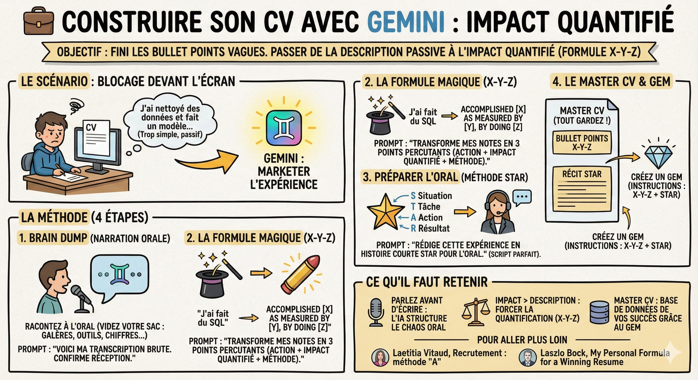

# 💼 Construire son CV

**Objectif :** Ne plus jamais écrire de bullet points vagues ou faibles sur son CV. Passer d'une description passive ("J'ai travaillé sur...") à une démonstration d'impact quantifié ("J'ai amélioré X de Y% en faisant Z").

**Le scénario**  
Vous avez effectué un stage ou un projet. Vous devez l'ajouter à votre CV. Souvent, on se bloque devant son écran à chercher la phrase parfaite, ou on écrit quelque chose de trop simple comme : "J'ai nettoyé des données et fait un modèle." C'est techniquement vrai, mais ça ne vous fera pas embaucher. Nous allons utiliser Gemini pour marketer votre expérience.

**La méthode**

1\. Le brain dump (narration orale)  
On s'exprime souvent mieux à l'oral qu'à l'écrit.

- L'action : Ouvrez Gemini et utilisez la dictée vocale sur PC.

- La consigne : Racontez votre expérience comme si vous parliez à un ami. Ne cherchez pas à structurer. Videz votre sac : les galères, les outils utilisés, les chiffres, ce que vous avez appris, l'équipe… Voici [un exemple de narration]().

- Le prompt initial : "Voici une transcription brute de mon expérience de stage. Ne fais rien pour l'instant, dis-moi juste que tu as bien reçu l'info."

2\. La formule magique de Google (X-Y-Z)  
Les recruteurs cherchent une structure précise : "Accomplished [X] as measured by [Y], by doing [Z]".

- L'action : Demandez à Gemini de reformuler votre narration.

- Le Prompt : "Agis comme un expert en recrutement. Transforme mes notes brutes en 3 points de CV percutants. Utilise la structure : Action forte + Impact mesurable (Chiffres/%) + Méthode technique. Exemple : 'Réduit le temps de traitement de 40% en optimisant les requêtes SQL sur une base de 1To'."

- Le résultat : Vous passez de "J'ai fait du SQL" à une phrase qui prouve votre valeur.

3\. Préparer l'oral (la méthode STAR)  
Ce que vous avez écrit pour le CV servira pour l'entretien. Il faut juste changer le format.

- Le concept : STAR (Situation, Tâche, Action, Résultat). C'est la structure attendue pour répondre à "Parlez-moi d'une fois où...".

- Le prompt : "Maintenant, rédige cette même expérience sous forme d'une histoire courte suivant la méthode STAR. C'est pour préparer ma réponse à l'oral."

- L'usage : Vous obtenez votre script parfait pour l'entretien. Vous n'avez plus qu'à le mémoriser (pas par cœur, mais la structure).

4\. Le master CV  
Vous allez avoir plusieurs expériences. Ne refaites pas les prompts à chaque fois.

- L'assistant : Créez un Gem.

- Les instructions : Demandez à Gemini de vous rédiger les instructions : "À chaque fois que je lui raconte une expérience, il me sors : 1. Les bullet points format X-Y-Z pour le CV. 2. Le récit format STAR pour l'oral.".

- Le concept du master CV : Ne jetez rien ! Copiez tout (les versions longues et courtes) dans un document géant (master CV). C'est dans ce réservoir que le Gem vous aidera à piocher pour faire des CVs ciblés plus tard.

**Ce qu'il faut retenir**

- Parlez avant d'écrire : L'IA est excellente pour structurer le chaos. Donnez-lui de la matière orale riche.

- Impact > Description : Utilisez Gemini pour forcer la quantification (La formule X-Y-Z). Si vous n'avez pas le chiffre exact, demandez à Gemini de vous aider à l'estimer.

- Double usage : Une expérience se traite toujours en deux formats : CV (synthétique) et STAR (narratif pour l'entretien).

- Le master CV : Construisez une base de données de vos succès grâce à votre Gem, vous gagnerez un temps fou pour chaque candidature.

**Pour aller plus loin**  
[Laetitia Vitaud, Recrutement : connaissez-vous la méthode « A » ?](https://www.welcometothejungle.com/fr/articles/who-the-a-method-for-hiring-de-geoff-smart-et-randy-street)  
[Laszlo Bock, My Personal Formula for a Winning Resume](https://www.linkedin.com/pulse/20140929001534-24454816-my-personal-formula-for-a-better-resume/)
