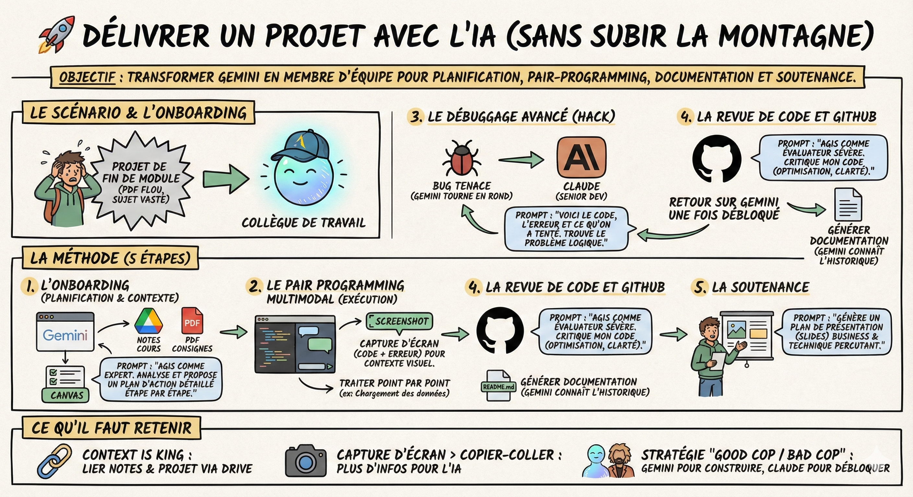

# 🚀 Délivrer un projet

**Objectif :** Ne pas subir la "montagne" du projet de fin de module. Transformer Gemini en un membre supplémentaire de votre équipe qui gère la planification, le pair-programming, la documentation et la préparation de la soutenance.

**Le scénario**  
Le prof vous donne un PDF d'instructions pour un projet (ex: "Prédire le churn bancaire"). Le sujet est vaste, les consignes parfois floues, et vous ne savez pas par quel bout commencer.  
Au lieu de foncer tête baissée dans le code, nous allons onboarder Gemini comme un collègue de travail.

**La méthode**

1\. L'onboarding (planification et contexte)  
Avant de coder, il faut comprendre.

- L'action : Ouvrez Gemini. Utilisez l'intégration Google Drive pour importer :  
  1. Vos notes de cours sur le sujet (le contexte théorique).  
  2. Le PDF des consignes du projet (la mission).

- Le prompt : "Agis comme un membre expert de mon équipe projet. Analyse mes notes et les consignes. Propose-moi un plan d'action détaillé étape par étape pour réaliser ce projet, en tenant compte de mon niveau débutant."

- L'outil : Activez Canvas pour afficher ce plan. C'est votre feuille de route. Validez-le ou ajustez-le avec Gemini.

2\. Le pair programming multimodal (exécution)  
On déroule le plan, action par action.

- La méthode : Ne demandez pas tout le code d'un coup. Traitez le point 1 (ex: "chargement des données").

- L'atout visuel :  
  - Ça marche ? Faites une capture d'écran du résultat (ex: les premières lignes du DataFrame) et collez-la dans le chat : "C'est bon, on passe à la suite ?".  
  - Ça plante ? Ne copiez pas juste l'erreur. Faites une capture d'écran de tout l'IDE (code + erreur) et envoyez-la. Gemini voit le contexte visuel et vous aide à corriger.

3\. Le débuggage avancé  
Il arrive que Gemini tourne en rond sur un bug tenace (il propose 3 fois la même solution qui échoue).

- Le hack : C'est le moment de changer d'interlocuteur. Passez sur Claude (même en version gratuite).

- Le prompt : "Voici mon code, voici l'erreur, et voici ce qu'on a déjà tenté. Tu es un Senior Developer, trouve le problème logique."

- Pourquoi ? Claude a souvent une capacité de raisonnement plus avancée sur le code complexe. Une fois débloqué, revenez sur Gemini pour la suite du projet.

4\. La revue de code et GitHub  
Votre code tourne, mais est-il propre ?

- L'action : Connectez l'extension GitHub ou uploadez vos scripts finaux.

- Le prompt : "Agis comme un évaluateur sévère. Critique mon code. Qu'est-ce qui n'est pas optimisé ? Qu'est-ce qui manque de clarté ?"

- La documentation : Demandez-lui de générer le fichier README.md. Puisqu'il a suivi tout le projet avec vous, il saura parfaitement expliquer l'installation, l'usage et les résultats pour votre repository.

5\. La soutenance  
Le code est fini, mais il faut le vendre. Vous êtes toujours dans la même conversation, donc Gemini connaît tout le contexte.

- L'action : Chargez votre README.md ou le code final.  
- Le prompt : "Je dois présenter ce projet à l'oral. Génère-moi un plan de présentation (slides) qui met en valeur la problématique business et mes choix techniques, sans être ennuyeux."

**Ce qu'il faut retenir**

- Context is king : Liez vos notes de cours au projet via Google Drive pour que Gemini aide à utiliser les méthodes enseignées par votre prof.

- Capture d'écran > Copier-coller : Pour les erreurs, l'image donne plus d'infos à Gemini que le texte.

- La stratégie "good cop / bad cop" : Utilisez Gemini pour construire (le collègue sympa) et Claude pour débloquer les crises (l'expert pointu).  
- La boucle est bouclée : En restant dans la même conversation du début à la fin, la génération de la documentation et des slides devient triviale car Gemini connaît l'historique du projet.
