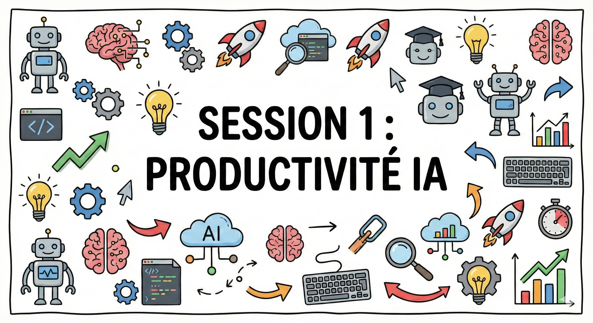
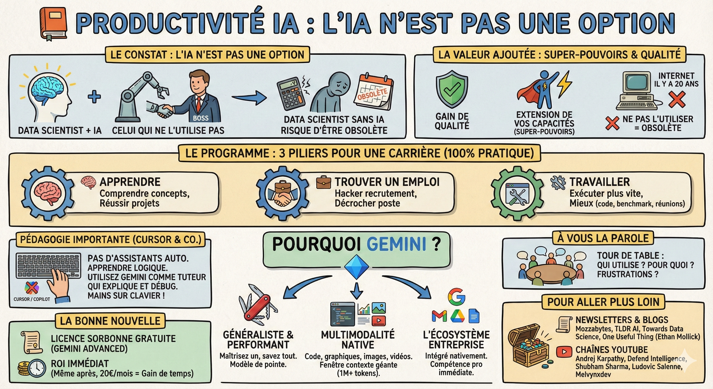

# 📕 Productivité IA

**Le constat : L'IA n'est pas une option**  
Pour être honnête avec vous, j'utilise l'IA dans absolument chacune de mes activités aujourd'hui.

L'objectif de ce module est simple : vous donner les clés pour intégrer l'IA dans votre quotidien.

- La réalité du marché : L'IA ne remplacera pas les data scientists. Par contre, un data scientist qui utilise l'IA remplacera celui qui ne l'utilise pas.

- La valeur ajoutée : Ce n'est pas juste un gain de temps. C'est un gain de qualité et une extension de vos capacités (vos super-pouvoirs). Ne pas l'utiliser aujourd'hui, c'est comme refuser d'utiliser Internet il y a 20 ans : c'est prendre le risque d'être obsolète avant même d'être diplômé.

**Le programme : 3 piliers pour une carrière**  
Ce cours est 100% pratique. Pas de théorie interminable (des vidéos d'Andrej Karpathy sont disponibles dans la section "Pour aller plus loin" pour approfondir). Vous allez découvrir comment l'IA vous accompagne à chaque étape de votre vie :

1. 🧠 Apprendre : Comprendre les concepts complexes et réussir vos projets.

2. 💼 Trouver un emploi : Hacker le processus de recrutement et décrocher le poste.

3. ⚙️ Travailler : Exécuter vos projets Data plus vite et mieux (code, benchmark, réunions).

**Pourquoi Gemini ?**  
Vous entendrez parler de ChatGPT, Claude, Mistral... Alors pourquoi ce focus sur Gemini ?

1. Généraliste et performant : Si vous maîtrisez Gemini, vous saurez tout utiliser. C'est un modèle de pointe. Cf. [classement](https://lmarena.ai/leaderboard).

2. Multimodalité native : En data science, on jongle avec du code, des graphiques, des images et des vidéos. Gemini gère tout ça nativement dans une fenêtre de contexte géante (1M+ tokens).

3. L'écosystème entreprise : La majorité des entreprises utilisent Google Workspace (Gmail, Drive, Docs). Gemini y est intégré nativement. Savoir l'utiliser dans cet environnement est une compétence professionnelle immédiate.

**Un point de pédagogie important (Cursor & co.)**  
Ce module n'utilise pas d'assistants de code automatisés comme Cursor, Windsurf ou GitHub Copilot.

- Pourquoi ? Parce que vous êtes là pour apprendre à coder. Si l'IA écrit tout le code à votre place via un simple Tab, vous ne développerez pas votre logique algorithmique.

- Ma recommandation : Utilisez Gemini comme un tuteur qui explique et débug, mais gardez les mains sur le clavier. Gardez les outils magiques pour plus tard, quand vous serez experts.

**La bonne nouvelle**  
Grâce à votre statut d'étudiant à la Sorbonne, vous avez accès à une licence Gemini Advanced (Google One AI Premium) gratuitement pendant votre année d'étude. Cf. [Centre d'aide Google](https://support.google.com/gemini/answer/16417758?hl=fr).

- Mon conseil : Même après vos études, considérez les 20€/mois. Si l'outil vous fait gagner ne serait-ce que 2h de travail par mois (et il le fera), le retour sur investissement est immédiat.

**Avant de commencer**  
Posez-vous ces deux questions :

1. Utilisez-vous déjà des outils d'IA au quotidien ? Pour quoi faire ?  
2. Avez-vous rencontré des problèmes ou des frustrations spécifiques que vous aimeriez résoudre ?

## Ressources

- [Infographies du cours](https://docs.google.com/presentation/d/1ZzQGKv-WX_eHPan94VOTu3VMChlisap8jiH-4BM5zVw/edit?slide=id.g3b50f16f7bf_1_5#slide=id.g3b50f16f7bf_1_5) — toutes les infographies de la session en un seul document
- [Playlist YouTube](https://youtube.com/playlist?list=PLAO2ui_9t-UTIa9c3ynDyNcSu7B7l-ZnP&si=WF4n6GOK54BSERte) — les vidéos complémentaires de la session

## Pour aller plus loin

L'écosystème de l'IA évolue à une vitesse vertigineuse. Ce qui est vrai aujourd'hui sera peut-être obsolète dans 6 mois. Pour rester à jour sans vous noyer, voici une sélection de ressources de qualité à suivre.

### Newsletters et blogs

- [Mozzabytes](https://mozzabytes.substack.com/) : Une newsletter percutante pour découvrir des cas d'usage concrets et des outils qui boostent la productivité.  
- [TLDR AI](https://tldr.tech/ai) : Le résumé quotidien indispensable (en anglais) pour survoler toute l'actualité de l'IA technique et business en 5 minutes.  
- [Towards Data Science](https://towardsdatascience.com/) : La référence absolue pour des tutoriels techniques, des explications d'algorithmes et des retours d'expérience en Data Science.  
- [One Useful Thing (Ethan Mollick)](https://www.oneusefulthing.org/) : Le blog d'un professeur de la Wharton School qui offre les analyses les plus pertinentes sur l'impact de l'IA sur le travail et l'éducation.

### Chaînes YouTube

- [Andrej Karpathy](https://youtube.com/@andrejkarpathy) : L'ancien directeur de l'IA chez Tesla et chercheur chez OpenAI qui explique le fonctionnement profond des LLMs from scratch.  
- [Defend Intelligence (Anis Ayari)](https://www.youtube.com/@defendintelligence) : Une chaîne française incontournable pour les data scientists, mêlant actualité technique, live coding et analyse critique des modèles.  
- [Shubham Sharma](https://www.youtube.com/@shubham_sharma) : Très prolifique, c'est la chaîne idéale pour découvrir rapidement les derniers outils sortis et l'actualité grand public de l'IA en français.  
- [Ludovic Salenne](https://www.youtube.com/@LudovicSalenne) : Des vidéos focus sur la productivité et l'automatisation grâce aux nouveaux outils d'IA et au no-code.  
- [Melvynxdev](https://www.youtube.com/@melvynxdev) : Une excellente chaîne pour comprendre comment l'IA s'intègre concrètement dans le workflow d'un développeur (code, agents, ingénierie).
