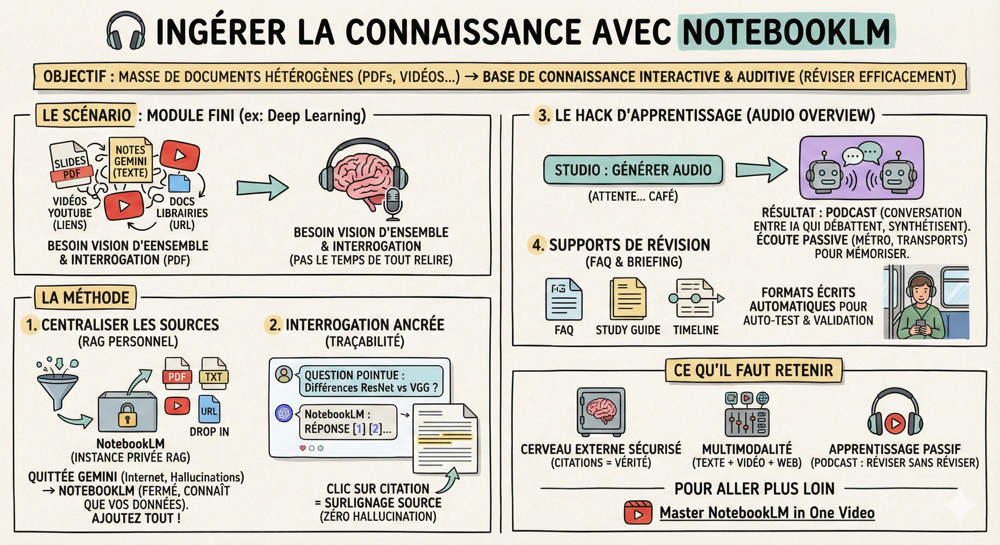

# 🎧 Ingérer la connaissance

## Objectif

Ne plus laisser dormir vos notes dans un dossier. Transformer une masse de documents hétérogènes (PDFs, sites web, vidéos) en une base de connaissance interactive et auditive pour réviser efficacement, même dans le métro.

## Le scénario

Vous venez de finir un module important (ex: "Deep Learning"). Vous avez accumulé :

- Les slides du prof (PDF).  
- Vos notes structurées avec Gemini (Texte).  
- Des liens vers des vidéos YouTube techniques.  
- Des documentations de librairies (URL).

Vous devez réviser pour l'examen ou démarrer un projet, mais vous n'avez pas le temps de tout relire ligne par ligne. Vous avez besoin d'une vision d'ensemble et de pouvoir interroger vos cours.

## La méthode

1\. Centraliser les sources (le RAG personnel)  
C'est ici qu'on change d'outil. On quitte Gemini pour NotebookLM.

- Le concept : Contrairement à Gemini qui connaît tout Internet (et peut halluciner), NotebookLM est fermé. Il ne connaît que ce que vous lui donnez. C'est votre instance privée de RAG (Retrieval Augmented Generation).

- L'action :  
  - Créez un nouveau Notebook "Module Deep Learning".  
  - Cliquez sur le +. Ajoutez vos PDF, copiez vos notes brutes, et collez les liens des vidéos YouTube (oui, il lit les transcripts des vidéos !).

Note : Plus vous mettez de sources pertinentes, plus l'outil sera intelligent sur votre sujet.

2\. L'interrogation ancrée  
Une fois les sources digérées (c'est très rapide), passez au chat.

- Posez une question pointue : "Quelles sont les différences entre ResNet et VGG ?"

- Le résultat : NotebookLM répond et ajoute des petits numéros (citations). En cliquant dessus, il vous surligne le passage exact dans le PDF ou la vidéo source.

- Pourquoi c'est crucial ? Pour un data scientist, la traçabilité est clé. Zéro hallucination permise : si ce n'est pas dans vos sources, il vous le dira.

3\. Le hack d'apprentissage (audio overview)  
C'est la fonctionnalité magique pour l'ingestion passive.

- L'action : Dans le panneau "Studio", cliquez sur "Générer" dans la section "Audio Overview". Attention : Cela prend quelques minutes (lancez-le et allez prendre un café).

- Le résultat : Une conversation audio (type podcast) entre deux IA qui débattent de vos documents. Ils font des liens, utilisent des métaphores et synthétisent le tout.

- Mon usage perso : Je génère ce podcast à la fin de chaque module et je l'écoute dans les transports. C'est imbattable pour mémoriser les concepts.

4\. Les supports de révision (FAQ et briefing)  
NotebookLM propose aussi des formats écrits automatiques.

- L'action : Regardez les puces suggérées. Vous pouvez générer une FAQ (pour vous auto-tester), une "study guide" (fiche de révision), ou une "timeline" (si vos documents ont des dates).

- L'usage : Utilisez ces supports pour valider que vous avez bien compris les points clés identifiés par NotebookLM.

## Ce qu'il faut retenir

- NotebookLM = Votre cerveau externe sécurisé. Il ne répond qu'avec vos sources (citations = vérité).

- Multimodalité : Il mélange texte, vidéo et web pour créer une compréhension unifiée.

- Apprentissage passif : Ne sous-estimez pas le podcast généré. C'est un moyen puissant de "réviser sans réviser" en écoutant deux experts discuter de vos propres cours.

## Pour aller plus loin

- [Master NotebookLM in One Video](https://youtu.be/uKPBIKF5FUI?si=-eZ_79HOvgyznAGf) — tutoriel complet pour maîtriser toutes les fonctionnalités de NotebookLM
- [Google NotebookLM Official Guide](https://notebooklm.google.com/) — la documentation officielle et l'accès direct à l'outil
- [How to Study Effectively with AI](https://youtu.be/Z2aHJF5IWMA) — stratégies de révision augmentées par l'IA pour étudiants
