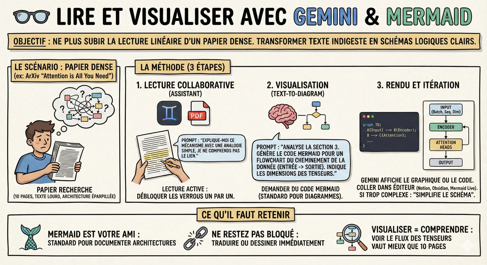

# 👓 Lire et visualiser

**Objectif :** Ne plus subir la lecture linéaire d'un papier de recherche dense. Transformer des paragraphes techniques indigestes en schémas logiques clairs pour comprendre le flux de données d'un coup d'œil.

**Le scénario**  
Vous avez trouvé un papier sur ArXiv (ex: "[Attention is All You Need](https://arxiv.org/pdf/1706.03762)" ou une nouvelle architecture de RAG). Le texte est lourd, les explications de l'architecture sont éparpillées sur 10 pages. Vous n'arrivez pas à visualiser "qui envoie quoi à qui". Au lieu de lire 3 fois la même page, nous allons demander à Gemini de la dessiner.

**La méthode**

1\. La lecture collaborative  
Changez de mentalité : on ne lit plus un papier difficile tout seul. On le lit avec un assistant.

- L'action : Uploadez le PDF dans Gemini.

- L'approche : Ne demandez pas juste un résumé. Lisez le papier de votre côté. Dès que vous bloquez sur un paragraphe technique, surlignez-le (ou copiez-le) et dites à Gemini : "Explique-moi ce mécanisme spécifique avec une analogie simple, je ne comprends pas le lien avec l'étape précédente."

- Le but : C'est de la lecture active. Vous débloquez les verrous de compréhension un par un.

2\. La visualisation (text-to-diagram)  
C'est la fonctionnalité clé pour les ingénieurs. Le texte décrit un processus ; le code le représente.

- Le problème : Les schémas dans les papiers sont parfois flous ou inexistants.

- La solution : Demandez du code [Mermaid](https://mermaid.live/). C'est un langage simple qui transforme du texte en diagrammes.

- Le prompt : "Analyse la section 3 de ce papier qui décrit l'architecture du modèle. Génère-moi le code Mermaid pour un diagramme de flux (flowchart) qui montre le cheminement de la donnée, de l'entrée jusqu'à la sortie. Indique bien les dimensions des tenseurs à chaque étape si elles sont mentionnées."

3\. Le rendu et l'itération

- Le résultat : Gemini va vous donner un bloc de code. Souvent, il affichera même le graphique directement. Si ce n'est pas le cas (ou si vous voulez le garder), copiez le code.

- L'outil externe (si besoin) : Collez ce code dans un éditeur markdown (comme Notion, Obsidian ou GitHub) ou sur le site [Mermaid Live Editor](https://mermaid.live/).

- L'itération : Le diagramme est trop complexe ? Dites : "Simplifie le schéma, regroupe les couches d'encodage en une seule boîte."

**Ce qu'il faut retenir**

- Mermaid est votre ami : Apprenez à demander des diagrammes Mermaid. C'est le standard pour documenter du code et des architectures.

- Ne restez pas bloqué : Si une phrase est obscure, faites-la traduire ou dessiner par l'IA immédiatement.

- Visualiser = Comprendre : Pour un Data Scientist, voir le flux des tenseurs (les dimensions des matrices) dans un diagramme vaut souvent mieux que 10 pages de texte.
