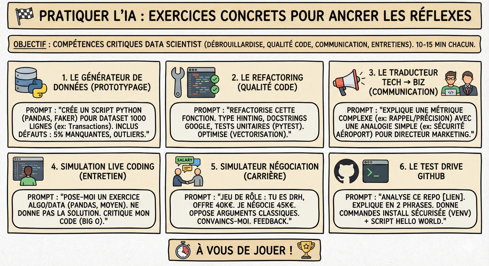

# 🏁 Pratiquer l'IA

## Objectif

Ancrer les réflexes d'utilisation de l'IA dans votre quotidien de data scientist grâce à six défis pratiques de 10 à 15 minutes couvrant le prototypage, la qualité de code, la communication et la préparation aux entretiens.

## Introduction

La théorie ne suffit pas. Pour ancrer l'utilisation de l'IA dans vos réflexes professionnels, il faut pratiquer. Voici des exercices concrets, conçus pour être réalisés en 10 à 15 minutes chacun. Ils couvrent les compétences critiques du data scientist : la débrouillardise technique, la qualité du code, la communication et la préparation aux entretiens.

A vous de jouer !

## Défi 1 : Le générateur de données (prototypage)

Le contexte :  
Vous devez construire un dashboard ou tester un pipeline de nettoyage, mais vous n'avez pas accès aux données réelles (bloquées par le juridique ou inexistantes). Vous ne pouvez pas attendre.

La mission :  
Utiliser Gemini pour générer un script Python qui crée un jeu de données complexe et réaliste.

Le challenge :

1. Demandez à Gemini de créer un script (utilisant pandas et faker).  
2. Le dataset doit contenir 1000 lignes (ex: Transactions bancaires ou Logs serveurs).  
3. La contrainte : Exigez des défauts volontaires. Le dataset doit contenir 5% de valeurs manquantes (NaN) et des anomalies statistiques (outliers) pour tester la robustesse de votre futur code.

Idée de prompt :  
*Agis comme un Data Engineer. Écris un script Python pour générer un dataset synthétique de 1000 lignes sur le thème "Transactions E-commerce". Inclus des colonnes (Date, UserID, Montant, Catégorie). Insère volontairement des données sales : 5% de valeurs manquantes et quelques montants aberrants (négatifs ou très élevés) pour que je puisse m'entraîner à les nettoyer.*  
## Défi 2 : Le refactoring (qualité code)

Le contexte :  
Vous avez écrit un code brouillon pour tester une idée. Il fonctionne, mais il est illisible, sans commentaires et probablement lent.

La mission :  
Transformer un script amateur en code de production "state of the art".

Le challenge :

1. Prenez une fonction Python mal écrite (ou demandez à Gemini d'en générer une très moche).  
2. Demandez une réécriture complète en imposant les standards de l'industrie.  
3. La contrainte : Le code final doit inclure du "Type Hinting" (typage), des Docstrings au format Google, et une classe de tests unitaires (pytest).

Idée de prompt :  
*Voici une fonction Python mal écrite. Agis comme un Senior Software Engineer.*

1. *Refactorise ce code pour le rendre propre, typé et optimisé (vectorisation si possible).*  
2. *Ajoute la documentation complète (Docstrings).*  
3. *Génère les tests unitaires associés pour couvrir les cas limites.*

## Défi 3 : Le traducteur technique vers business (communication)

Le contexte :  
Vous avez entraîné un modèle. Il a une bonne précision globale, mais il fait des erreurs spécifiques (Faux Positifs). Votre manager (non-technique) ne comprend pas pourquoi c'est grave ni ce que veut dire "Rappel" ou "F1-Score".

La mission :  
Expliquer une métrique complexe avec une analogie simple et impactante.

Le challenge :

1. Choisissez un scénario (ex: Détection de fraude ou Diagnostic médical).  
2. Demandez à Gemini de reformuler vos résultats pour un Directeur Marketing ou Financier.  
3. La contrainte : Interdiction d'utiliser du jargon technique. L'explication doit se baser sur une analogie de la vie quotidienne (ex: un filtre anti-spam, un portique de sécurité).

Idée de prompt :  
*Je dois expliquer les résultats de mon modèle à mon Directeur Marketing qui ne connaît rien à la data science.*  
*Mon modèle a un bon Rappel mais une mauvaise Précision (il détecte bien les fraudes, mais il bloque aussi beaucoup de clients honnêtes).*  
*Explique-lui ce problème et l'impact financier en utilisant une analogie simple (comme la sécurité dans un aéroport), sans utiliser de termes mathématiques.*  
## Défi 4 : Simulation de live coding (entretien technique)

Le contexte :  
Vous passez un entretien technique demain. Vous savez qu'on va vous demander de résoudre un problème de code en direct, sans copilote, sous les yeux du recruteur.

La mission :  
Utiliser Gemini comme examinateur pour vous entraîner à coder "à la main" et à expliquer votre pensée.

Le challenge :

1. Demandez à Gemini de vous poser un problème algorithmique (niveau data scientist junior/intermédiaire).  
2. Ne copiez-collez pas la réponse. Écrivez le code vous-même dans votre IDE ou sur papier.  
3. Si vous bloquez, demandez un indice (pas la solution).  
4. À la fin, soumettez votre code à Gemini pour qu'il critique votre complexité algorithmique (Big O).

Idée de prompt :  
*Je m'entraîne pour un entretien technique Python/Data. Pose-moi un exercice de manipulation de données (type LeetCode ou manipulation Pandas) de difficulté moyenne.*  
*Ne me donne pas la solution. Attends que je te propose mon code, puis critique-le sur l'efficacité et la lisibilité.*  
## Défi 5 : Le simulateur de négociation (carrière)

Le contexte :  
Vous avez reçu une offre d'emploi. Le salaire est correct, mais vous savez que vous valez 10% de plus. Vous n'osez pas négocier par peur de braquer le recruteur.

La mission :  
S'entraîner à l'argumentation par jeu de rôle.

Le challenge :

1. Configurez Gemini en mode "RH bienveillant mais ferme".  
2. Lancez la simulation : présentez vos arguments pour demander une revalorisation.  
3. L'IA doit contrer vos arguments (budget serré, grille salariale).  
4. Vous devez insister sans être agressif.

Idée de prompt :  
*Faisons un jeu de rôle. Tu es le DRH qui vient de me faire une offre à 40k€. Je souhaite négocier à 45k€. Oppose-moi des arguments classiques (équité interne, budget). Je vais essayer de te convaincre. À la fin de l'échange, dis-moi si j'ai été convaincant et ce que je dois améliorer dans ma rhétorique.*  
## Défi 6 : Le test drive GitHub

Le contexte :  
Vous avez trouvé un projet Open Source prometteur sur GitHub (une nouvelle librairie ML ou un outil de visualisation). La documentation est aride, le README.md est long et vous avez peur de casser votre environnement Python local en l'installant.

La mission :  
Utiliser Gemini pour comprendre, installer et exécuter un code inconnu en toute sécurité.

Le challenge :

1. Allez sur GitHub et trouvez un repo populaire mais que vous ne connaissez pas (ex: une librairie comme streamlit, rich ou une implémentation d'un papier ArXiv).  
2. Transmettez le lien ou copiez le contenu du README.md dans Gemini.  
3. Demandez à Gemini de vous expliquer à quoi ça sert en 2 phrases simples.  
4. La contrainte : Demandez la procédure d'installation sécurisée (création d'un environnement virtuel) et un script "Hello World" minimal pour vérifier que ça marche chez vous. Si vous rencontrez une erreur d'installation, copiez-la pour qu'il la résolve.

Idée de prompt :  
*Je viens de découvrir ce repository GitHub : [COLLER LIEN OU README]. Agis comme un Senior Developer.*

1. *Explique-moi simplement ce que fait cet outil et pourquoi il est utile pour un Data Scientist.*  
2. *Donne-moi les commandes exactes (terminal) pour l'installer proprement dans un environnement virtuel isolé (pour ne pas casser mon installation Python principale).*  
3. *Génère un petit script Python de démo (Hello World) pour que je puisse tester immédiatement si l'installation a réussi.*

## Ce qu'il faut retenir

- La pratique régulière bat la théorie : 15 minutes de défi quotidien avec l'IA ancrent les réflexes mieux qu'une longue session passive.

- Variez les exercices : prototypage, refactoring, communication, entretien, négociation et exploration de code couvrent tout le spectre du data scientist.

- L'IA est votre partenaire d'entraînement : utilisez-la pour vous challenger (pas pour tricher), exactement comme un sparring partner en sport.

## Pour aller plus loin

- [Kaggle](https://www.kaggle.com/) — plateforme de datasets et de compétitions pour pratiquer la data science en conditions réelles
- [LeetCode](https://leetcode.com/) — exercices de code algorithmique pour préparer les entretiens techniques
- [Exercism Python Track](https://exercism.org/tracks/python) — exercices progressifs en Python avec mentorat communautaire gratuit
