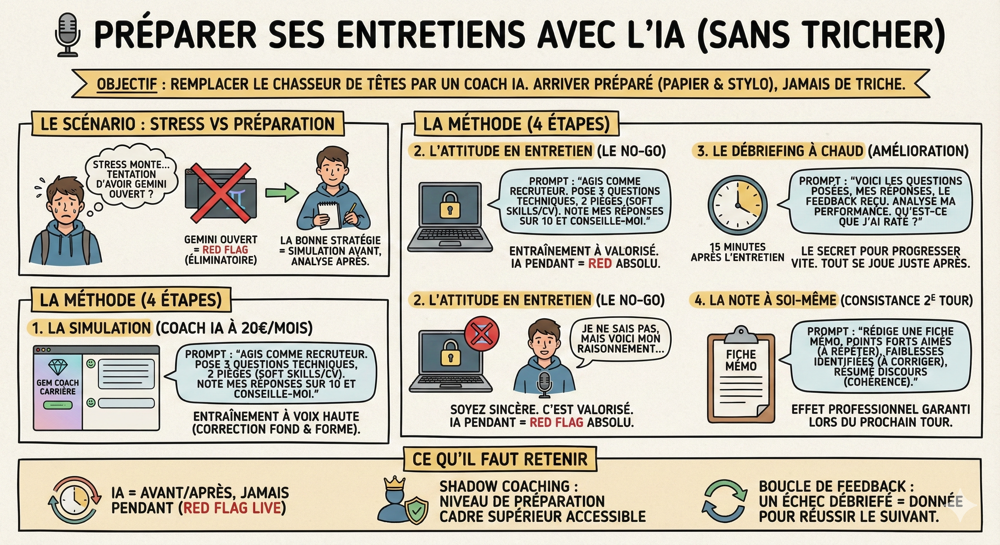

# 🎙️ Préparer ses entretiens

## Objectif

Remplacer les chasseurs de têtes hors de prix par votre Coach IA. L'objectif n'est jamais de tricher pendant l'entretien (ça se voit et c'est éliminatoire), mais d'arriver tellement préparé que vous n'avez besoin que d'un papier et d'un stylo.

## Le scénario

Vous avez décroché l'entretien. Le stress monte. La tentation ? Avoir Gemini ouvert sur un deuxième écran pour souffler les réponses. Mauvaise idée. Si on vous demande d'approfondir en présentiel, vous êtes éliminé.

La bonne stratégie ? Utiliser l'IA pour simuler l'entretien avant, et surtout pour analyser votre performance après.

## La méthode

1\. La simulation d'entretien  
Les grands cabinets de recrutement coachent leurs clients pour anticiper les questions. Votre Coach IA fait pareil pour 20€/mois.

- Le contexte : Vous avez l'offre et votre CV dans la conversation.

- Le prompt : "Je passe l'entretien demain pour ce poste. Agis comme le recruteur.  
  1. Pose-moi les 3 questions techniques les plus probables.  
  2. Pose-moi 2 questions pièges sur mes soft skills ou mes trous de CV.  
     Attends mes réponses, puis note-les sur 10 et dis-moi comment les améliorer."

- L'entraînement : Répondez à voix haute (utilisez le micro). Gemini corrigera votre fond et votre forme.

2\. L'attitude en entretien (le no-go de l'IA)

- Pendant l'entretien : Fermez les onglets Gemini. Prenez du papier et un stylo.

- La règle d'or : Soyez sincère. Si vous ne savez pas, dites : "Je ne connais pas la réponse exacte, mais voici comment je raisonnerais pour la trouver...". C'est valorisé. Une réponse hallucinée ou lue sur un écran se détecte immédiatement (yeux qui bougent, ton monocorde) et brise la confiance.

3\. Le débriefing à chaud (l'amélioration continue)  
C'est le secret des candidats qui progressent vite. Tout se joue dans les 15 minutes après l'entretien.

- L'action : Rouvrez votre Coach Carrière. Videz votre sac (vocalement ou à l'écrit).

- Le Prompt : "Je sors de l'entretien. Voici les questions qu'ils m'ont posées : [Liste].  
  Voici ce que j'ai répondu : [Résumé].  
  Voici le feedback que le recruteur m'a donné à la fin : [Feedback].  
  Analyse ma performance. Qu'est-ce que j'ai raté ? Quelle réponse aurais-je dû faire pour être plus convaincant ?"

4\. La note à soi-même (consistance)  
Si vous passez au 2ème tour (RH → Technique → Manager), vous devez être cohérent.

- Le Prompt : "Rédige-moi une fiche mémo pour le prochain entretien.  
  1. Quels sont les points forts que le premier recruteur a aimés (à répéter) ?  
  2. Quelles sont mes faiblesses identifiées (à corriger) ?  
  3. Résume mon discours pour que je ne me contredise pas au prochain tour."

- L'usage : Vous arrivez au second entretien en disant : "Lors de l'échange précédent, nous avons identifié que [Point faible], j'ai donc travaillé dessus...". Effet professionnel garanti.

## Ce qu'il faut retenir

- IA = Avant/Après, jamais Pendant : sauf autorisation explicite, l'usage live est un red flag absolu.

- Le shadow coaching : vous avez accès à un niveau de préparation (simulation, feedback, stratégie) réservé auparavant aux cadres supérieurs coachés. Profitez-en.

- La boucle de feedback : un entretien raté n'est pas un échec si vous le débriefez avec l'IA. C'est de la donnée pour réussir le suivant.

## Pour aller plus loin

- [Google, Prepare for Your Interview](https://grow.google/certificates/interview-warmup/) — outil gratuit de simulation d'entretien par Google
- [La méthode STAR pour réussir ses entretiens](https://www.welcometothejungle.com/fr/articles/methode-star-entretien) — guide complet pour structurer ses réponses avec la méthode STAR
- [How to Ace Any Job Interview with AI](https://youtu.be/dASxWaP9RhA) — techniques de préparation d'entretien assistées par l'IA
