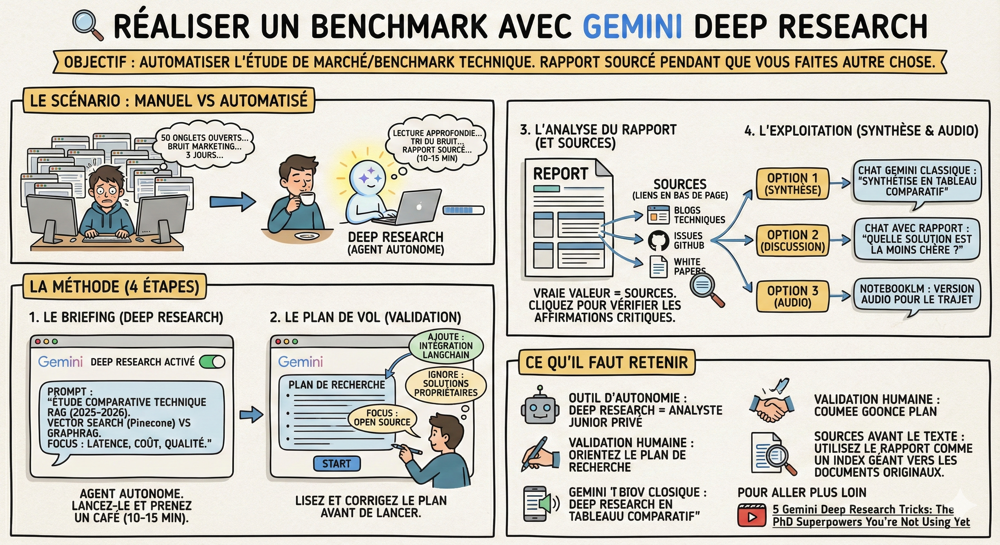

# 🔍 Réaliser un benchmark

## Objectif

Ne pas passer 3 jours à ouvrir 50 onglets pour comparer des technologies. Automatiser la phase de **benchmark** (étude comparative) ou d'étude de marché pour obtenir un rapport sourcé, pendant que vous faites autre chose.

## Le scénario

Contrairement à l'école où les consignes sont claires ("Utilisez Scikit-Learn"), au travail, c'est à vous de choisir. Votre chef vous demande : "On doit mettre en place une architecture RAG. Est-ce qu'on part sur du Vector Search classique ou du GraphRAG ? Fais-moi une note de synthèse avec les pour/contre et les coûts." Vous n'avez pas la réponse. Il va falloir fouiller le web, trier le bruit marketing et trouver la vérité technique. C'est la mission parfaite pour Gemini Deep Research.

## La méthode

1\. Le briefing  
Deep Research n'est pas un chat classique. C'est un agent autonome qui va naviguer sur le web pour vous.

- L'action : Activez le mode "Deep Research" (recherche approfondie).

- Le Prompt : "Réalise une étude comparative technique des architectures RAG actuelles (2025-2026). Compare spécifiquement l'approche Vector Search (ex: Pinecone) vs Knowledge Graphs (GraphRAG). Je veux un focus sur : la latence, le coût d'infrastructure et la qualité de récupération contextuelle."

- Le timing : Attention, ça prend du temps (environ 10-15 minutes). C'est normal, il lit vraiment les pages. Lancez-le et allez prendre un café ou traiter vos mails.

2\. Le plan de vol (validation)  
Avant de partir chasser, Gemini vous propose un plan.

- L'action : Ne cliquez pas aveuglément sur "Start". Lisez le plan.

- L'édition : Si vous voyez qu'il part sur des généralités, corrigez-le : "Ajoute une section spécifique sur l'intégration avec LangChain" ou "Ignore les solutions propriétaires, concentre-toi sur l'Open Source". Vous êtes le chef de projet, il est l'exécutant.

3\. L'analyse du rapport  
Une fois fini, vous recevez un rapport complet.

- Le niveau : Imaginez le travail d'un très bon élève de Terminale ou d'un junior sérieux. C'est structuré, bien écrit, mais ça manque parfois de la nuance d'un senior.

- Les sources : la vraie valeur est souvent dans les liens en bas de page. Deep Research déniche souvent des blogs techniques d'ingénieurs, des issues GitHub ou des white papers que Google Search aurait cachés derrière des pubs.

- Votre job : Cliquez sur ces sources pour vérifier les affirmations critiques.

4\. L'exploitation (synthèse et audio)  
Ce rapport est une base de travail, pas le livrable final.

- Option 1 (synthèse) : Exportez le rapport dans Google Docs, puis réinjectez-le dans une conversation Gemini classique : "Synthétise ce rapport sous forme d'un tableau comparatif pour mon manager."

- Option 2 (discussion) : Restez dans la conversation et chattez avec le rapport : "D'après tes recherches, quelle solution est la moins chère pour une start-up ?"

- Option 3 (audio) : Si vous êtes fatigué de lire, demandez (ou utilisez NotebookLM en parallèle) une version audio pour écouter les conclusions de votre veille sur le trajet du retour.

## Ce qu'il faut retenir

- L'outil d'autonomie : En entreprise, on est jugé sur sa capacité à trouver des solutions. Deep Research est votre analyste junior privé.

- La validation humaine : Le plan de recherche est modifiable. C'est là que vous orientez Gemini.

- Les sources avant le texte : Utilisez le rapport comme un index géant pour trouver les documents techniques originaux.

## Pour aller plus loin

- [5 Gemini Deep Research Tricks: The PhD Superpowers You're Not Using Yet](https://youtu.be/qEe5Zd-pRPo?si=M9NOd0zIitYpPj9R) — astuces avancées pour tirer le maximum de Deep Research
- [How to Do Market Research with AI](https://youtu.be/LwE2pV1AoOk) — guide complet pour automatiser la veille et les études de marché avec l'IA
- [LM Arena Leaderboard](https://lmarena.ai/leaderboard) — classement en temps réel des modèles d'IA pour choisir le bon outil selon la tâche
