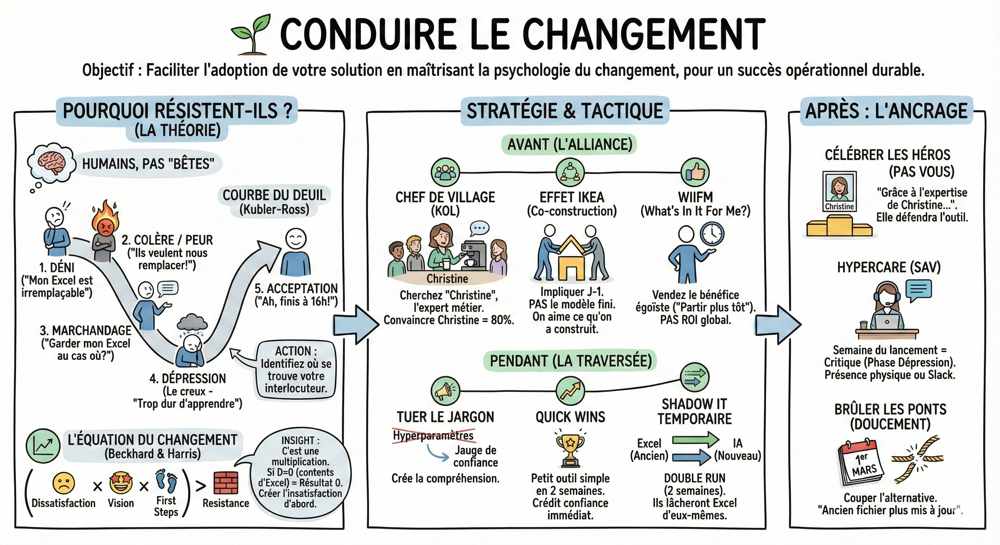
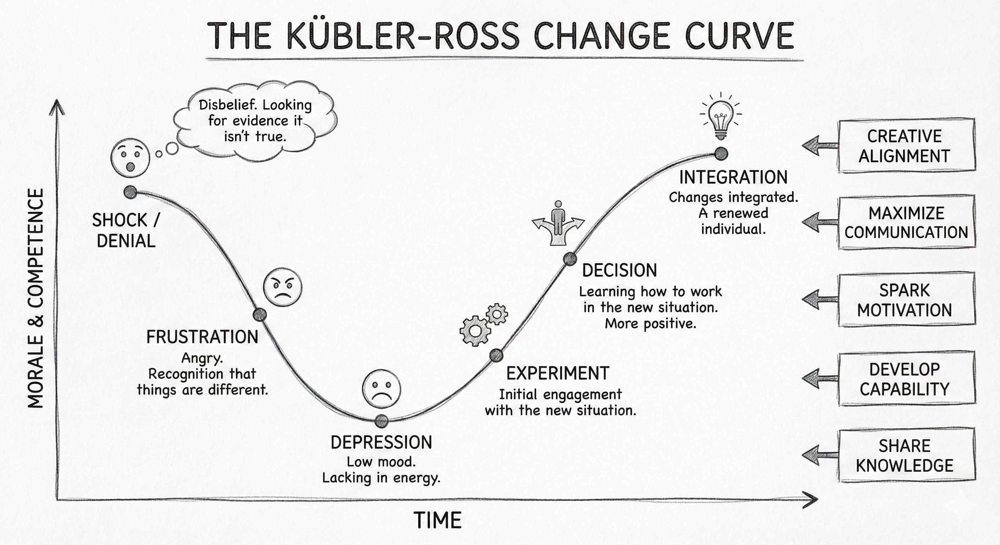

# 🌱 Conduire le changement

## Objectif

Faciliter l'adoption de votre solution en maîtrisant la psychologie du changement, afin de transformer votre réussite technique en un succès opérationnel durable et plébiscité par les utilisateurs.

**La théorie : Pourquoi résistent-ils ?**  
Ce n'est pas parce qu'ils sont "bêtes" ou "rétrogrades". C'est parce qu'ils sont humains.

La courbe du deuil (Kubler-Ross)  
Quand vous annoncez "L'IA va automatiser vos tâches", l'équipe traverse 4 phases inévitables :

1. Le déni : "Leur truc ne marchera jamais, mon Excel est irremplaçable."  
2. La colère / peur : "Ils veulent nous remplacer !" (c'est là que vous recevez des critiques agressives sur le modèle).  
3. Le marchandage : "Ok pour l'IA, mais je peux garder mon Excel au cas où ?" (piège : si vous dites oui indéfiniment, l'adoption échoue).  
4. La dépression (Le creux) : "C'est trop dur d'apprendre, je perds du temps." (zone critique de risque d'abandon).  
5. L'acceptation : "Ah, finalement je finis à 16h grâce à l'outil."

Action : Identifiez où se trouve votre interlocuteur. On ne parle pas à quelqu'un en colère comme à quelqu'un en acceptation.

<!-- TODO: ajouter une image de la courbe du deuil dans docs/assets/images/ -->

L'équation du changement  
D'après Beckhard et Harris. Le changement se produit seulement si :

D x V x F > R

- D (Dissatisfaction) : L'insatisfaction actuelle. Il faut qu'ils détestent leur situation présente.  
- V (Vision) : Un futur désirable. Moins de saisie, plus d'analyse.  
- F (First Steps) : Des premiers pas faciles. Une démo simple, pas une usine à gaz.  
- R (Resistance) : Le coût de l'effort au changement.

Insight : C'est une multiplication. Si D est zéro (ils sont contents de leur Excel), le résultat est zéro. Vous devez d'abord créer l'insatisfaction ("Votre routine actuelle vous fait perdre 4h/semaine").

**Stratégie : Avant le projet (l'alliance)**  
Trouver le chef de village (KOL)  
Ne regardez pas l'organigramme. Cherchez "Christine", l'expert métier que tout le monde écoute à la machine à café.

- Si Christine est contre vous, le projet est mort.  
- Si Christine est avec vous, elle convaincra les autres. Passez 80% de votre temps à convaincre Christine.

L'effet IKEA (co-construction)  
On aime ce qu'on a construit soi-même.

- ❌ Ne revenez pas après 3 mois avec le modèle fini ("Tenez, c'est magique").  
- ✅ Impliquez-les au jour 1. "Sophie, penses-tu qu'on devrait ajouter la météo ?" (Même si vous saviez déjà la réponse).

Le WIIFM (What's In It For Me ?)  
L'entreprise gagne des millions ? L'employé s'en fiche.

- Ne vendez pas le ROI global.  
- Vendez le bénéfice égoïste : "Tu vas arrêter les copier-coller le vendredi soir et partir plus tôt."

**Tactique : Pendant le projet (la traversée)**

Tuer le jargon

- "Hyperparamètres" → crée de la distance → crée de la peur.  
- "Jauge de confiance" → crée de la compréhension.

Les quick wins  
N'attendez pas le modèle parfait. Livrez un petit outil simple en 2 semaines qui leur fait gagner 10 minutes. Créez un crédit confiance immédiat.

Le shadow IT temporaire

- Ne bloquez pas leur Excel tout de suite (cela crée de la colère).  
- Proposez le double run : "Faites les deux en parallèle pendant 2 semaines. On compare vendredi." Quand ils verront que l'IA a raison et va plus vite, ils lâcheront Excel d'eux-mêmes.

**Après : L'ancrage**  
Célébrer les héros (pas vous)  
Dans la présentation finale, mettez la photo de "Christine" (l'expert métier).

- "Grâce à l'expertise de Christine qui nous a aidés à calibrer le modèle..."  
- Christine défendra votre outil bec et ongles quand vous serez parti.

L'hypercare (SAV)  
La semaine du lancement est critique (phase "Dépression").

- Ne lancez pas le projet pour partir en vacances le lendemain.  
- Installez-vous physiquement dans leur bureau (ou channel Slack dédié) pendant 3 jours. Répondez à chaque frustration en temps réel.

Brûler les ponts (doucement)  
Une fois l'adoption lancée, il faut couper l'alternative.

- "À partir du 1er mars, l'ancien fichier Excel ne sera plus mis à jour."

## Ce qu'il faut retenir

- La résistance au changement n'est pas de la bêtise : c'est une réaction humaine prévisible (courbe de Kubler-Ross) que vous devez anticiper.
- Trouvez votre "Christine" (le KOL informel) et passez 80 % de votre temps à la convaincre : elle convaincra les autres.
- Vendez le bénéfice égoïste (WIIFM) et non le ROI global : "Tu partiras plus tôt le vendredi" est plus puissant que "L'entreprise gagne 1M".
- Livrez des quick wins tôt pour créer un crédit confiance avant de demander un changement d'habitude majeur.

## Pour aller plus loin

- [Switch: How to Change Things When Change Is Hard - Chip & Dan Heath](https://heathbrothers.com/books/switch/) — méthode pratique pour conduire le changement en combinant raison et émotion
- [Kotter's 8-Step Change Model](https://www.kotterinc.com/methodology/8-steps/) — le modèle en 8 étapes de John Kotter pour mener la transformation
- [Harvard Business Review - The Real Reason People Won't Change](https://hbr.org/2001/11/the-real-reason-people-wont-change) — article fondateur sur les freins psychologiques au changement
