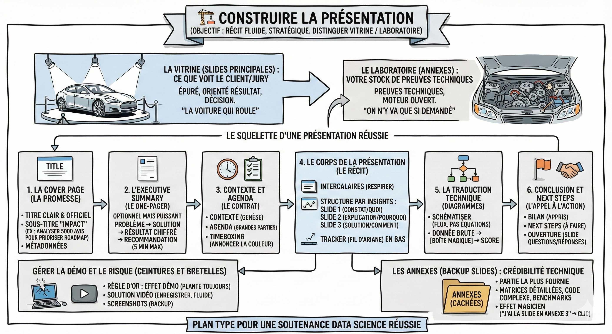

# 🏗️ Construire la présentation

## Objectif

Organiser vos idées pour construire un récit fluide et stratégique, en distinguant clairement ce qui doit être montré (la vitrine) de ce qui doit être prouvé (le laboratoire).

**Exercice pratique**  
Reprenez le même projet "AudioFuture" (analyse de sentiments). Vous avez terminé le code. Vous avez vos graphiques. Maintenant, il faut structurer l'histoire.

À partir des éléments bruts (texte en vrac), construisez le plan de la présentation : une liste ordonnée des slides.

**Un principe important : Vitrine vs laboratoire**  
En data science, la tentation est grande de montrer la complexité (code, équations) pour prouver qu'on a travaillé. C'est une erreur.

- La vitrine (slides principales) : C'est ce que voit le client/jury. C'est épuré, orienté résultat et décision. C'est la voiture qui roule.

- Le laboratoire (annexes) : C'est votre stock de preuves techniques. C'est le moteur ouvert. On n'y va que si on nous le demande.

**Le squelette d'une présentation réussie**  
Une présentation professionnelle suit une structure.

1\. La cover page (la promesse)  
Elle ne sert pas juste à dire "Bonjour". Elle pose le cadre.

- Titre du projet : Clair et officiel.  
- Le Sous-titre "Impact" : Indispensable. Ne dites pas juste "Projet NLP". Dites : "Analyser 5000 avis clients pour prioriser la roadmap produit."  
- Métadonnées : Date, Noms de l'équipe, Logos.

2\. L'executive summary (le one-pager)  
Optionnel mais puissant. C'est le résumé de tout le projet en une seule slide, placée au début.

- Pourquoi ? Si votre interlocuteur n'a que 5 minutes (ou s'il décroche), il a déjà l'essentiel.  
- Contenu : Problème → Solution → Résultat chiffré → Recommandation.

3\. Contexte et agenda (le contrat)

- Contexte : Rappel en 30 secondes de la genèse ("Pourquoi sommes-nous ici ?").  
- Agenda : Les grandes parties (ex: 1. Insights Business, 2. Approche Technique, 3. Next Steps).  
- Timeboxing : Annoncez la couleur : "Nous avons 20 minutes ensemble, dont 5 pour les questions."

4\. Le corps de la présentation (le récit)  
C'est le cœur du réacteur (5 à 8 slides max).

- Intercalaires (section breaks) : Utilisez des slides de transition simples (juste un gros titre sur fond coloré) pour laisser l'audience respirer entre deux parties complexes.

- Structure par Insights : Ne faites pas un chronologique de vos galères. Présentez par enseignements.  
  - Slide 1 : Le constat majeur (le quoi).  
  - Slide 2 : L'explication analytique (le pourquoi).  
  - Slide 3 : La solution technique simplifiée (le comment).

- Le tracker : Une petite barre de navigation (fil d'ariane) en bas des slides pour montrer où on en est (ex: Intro → Résultats → Conclusion).

5\. La traduction technique (diagrammes)  
Comment expliquer une boîte noire ?

- Schématiser : Plutôt qu'une équation, dessinez un flux : Donnée brute → [Boîte Magique] → Score.

- Outils : Un schéma fait à la main sur papier et pris en photo propre est souvent plus clair qu'un diagramme UML complexe. Sinon : [Excalidraw](https://excalidraw.com/), [draw.io](http://draw.io/), ou formes Google Slides.

6\. Conclusion et next steps (l'appel à l'action)  
Ne finissez jamais sur "Merci".

- Bilan : Ce qu'on a appris.  
- Next steps : Ce qu'il reste à faire (V2 du modèle, mise en production, collecte de nouvelles données).  
- Ouverture : C'est la slide qui reste affichée pendant les questions/réponses.

**Gérer la démo et le risque (ceintures et bretelles)**  
Si vous devez montrer votre code ou une application (Streamlit, Web App) :

- La règle d'or : L'effet démo (la démo plante toujours le jour J).  
- La solution vidéo : Enregistrez une capture vidéo de votre démo qui marche (avec QuickTime ou [OBS](https://obsproject.com/)) et insérez-la dans la slide. C'est fluide, commenté, et sans risque de bug ou de wifi lent.  
- Les screenshots : Ayez toujours des captures d'écran des étapes clés de votre application. Si tout plante, vous pouvez raconter l'histoire avec des images statiques.

**Les annexes : Backup slides**  
C'est ici que réside votre crédibilité technique. C'est la partie la plus fournie du deck (parfois 15 slides), mais elle reste cachée.

- Ce qu'on y met : Matrices de confusion détaillées, distribution des variables, code complexe, benchmarks d'algos rejetés.

- L'effet magicien : Quand un juré demande "Avez-vous vérifié l'overfitting ?", vous répondez : "Excellente question, j'ai la courbe d'apprentissage en Annexe 3". Vous cliquez, la slide apparaît. Vous avez gagné.

## Ce qu'il faut retenir

- Séparez la vitrine (slides principales orientées résultat) du laboratoire (annexes techniques) pour ne pas noyer votre audience.
- Structurez votre présentation en 6 blocs : cover page, executive summary, contexte/agenda, corps (5-8 slides max), traduction technique, conclusion/next steps.
- Préparez toujours un plan B pour les démos (vidéo enregistrée + screenshots) car l'effet démo frappe toujours au pire moment.
- Les annexes sont votre arme secrète : elles prouvent votre crédibilité technique quand le jury pose des questions pointues.

## Pour aller plus loin

- [Plan type pour une soutenance data science réussie](https://www.youtube.com/watch?v=rJSdiSoe-TA&list=PLAO2ui_9t-UQiTCLs2yiQO2m9_oq-ItWQ&index=3) — vidéo détaillant la structure idéale d'une soutenance
- [Excalidraw](https://excalidraw.com/) — outil de schéma à main levée idéal pour expliquer des pipelines de données
- [OBS Studio](https://obsproject.com/) — logiciel gratuit pour enregistrer vos démos en vidéo comme plan B
