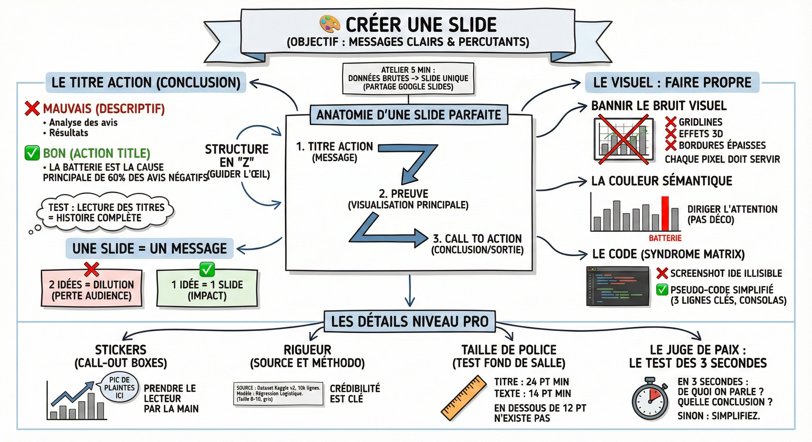

# 🎨 Créer une slide

**Objectif :** Maîtriser les codes du design visuel pour transformer vos résultats bruts en messages clairs et percutants. Chaque slide doit devenir un support de décision évident pour votre audience.

**Atelier pratique**  
Pour cette session, nous allons travailler en temps réel.

1. Lien de partage : Google Slides ici en mode éditeur pour tous.

2. La consigne : Créez une slide vide. À partir des [données brutes du projet]() (88% d'accuracy, problème de batterie identifié), créez une slide unique qui présente ce résultat.

3. La contrainte : Vous avez 5 minutes. Pas plus.

**Anatomie d'une slide parfaite**  
Une fois l'exercice fini, voici les standards à respecter pour transformer vos essais en slides professionnelles.

Le titre action  
C'est l'erreur n°1 en data science. Ne mettez jamais une étiquette en titre. Le titre est votre conclusion.

- ❌ Mauvais (descriptif) : "Analyse des avis négatifs" ou "Résultats du modèle".

- ✅ Bon (action title) : "La batterie est la cause principale de 60% des avis négatifs."

- Le Test : Si on lit juste les titres de votre présentation, on doit comprendre toute l'histoire sans regarder les graphes.

La structure en "Z" (guider l'œil)  
Le cerveau occidental lit en Z. Ne le forcez pas à chercher l'info.

1. Haut-gauche (Départ) : Le titre d'action (Le message).

2. Centre (preuve) : Votre visualisation principale (graphe ou code clé).

3. Bas-droite (sortie) : La conclusion ou le "Call to Action" (ex: "Recommander un changement de fournisseur batterie").

Une slide = Un message  
N'essayez pas de dire "On a nettoyé les données ET entraîné le modèle" sur la même page.

- Si vous avez deux idées, faites deux slides.  
- Si vous diluez le message, vous perdez l'audience.

**Le visuel : Faire propre**

Bannir le bruit visuel  
Chaque pixel doit servir à la compréhension.

- Supprimez les lignes de grille (gridlines) inutiles.  
- Supprimez les effets 3D ou animations.  
- Supprimez les bordures épaisses autour des images.

La couleur sémantique  
N'utilisez pas l'arc-en-ciel pour faire joli. Utilisez la couleur pour diriger l'attention.

Exemple : Sur un Bar Chart de 10 barres, mettez-en 9 en gris clair. Mettez celle qui vous intéresse ("Batterie") en Rouge Vif. L'œil ira directement dessus.

Le code (syndrome matrix)

- ❌ Jamais : De capture d'écran complète de votre IDE (VS Code / Jupyter) illisible.

- ✅ Toujours : Un bloc de "pseudo-code" simplifié. Copiez les 3 lignes essentielles, collez-les dans un bloc texte gris, police Consolas ou Courier New. On ne veut pas voir vos import pandas as pd.

**Les détails niveau pro**

- Les stickers (call-out boxes) : Ne laissez pas le graphique parler seul. Ajoutez une petite flèche ou une bulle avec une phrase courte directement sur le graphe : "Pic de plaintes ici". Prenez le lecteur par la main.

- La rigueur (source et méthodo) : En data science, la crédibilité est clé.  
  - Où ? Tout en bas à gauche, en tout petit (taille 8-10, gris).  
- Quoi ? "Source : Dataset Kaggle v2, 10k lignes. Modèle : Régression Logistique."

- La taille de police (le test du fond de la salle) :  
  - Titre : 24 pt minimum.  
  - Texte : 14 pt minimum.  
  - En dessous de 12 pt, le texte n'existe pas. Si ça ne rentre pas, coupez le texte, ne réduisez pas la police.

**Le juge de paix : Le Test des 3 secondes**  
Affichez votre slide. Fermez les yeux. Rouvrez-les.  
En 3 secondes, est-ce que je comprends :

1. De quoi on parle ?  
2. Quelle est la conclusion ?

Si la réponse est non : Simplifiez.
