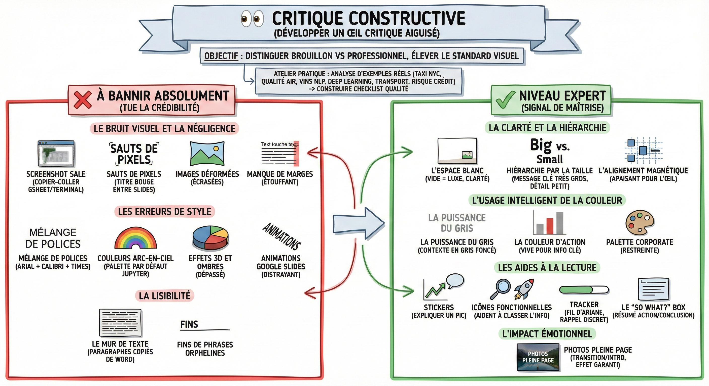

# 👀 Critique constructive

## Objectif

Développer un œil critique aiguisé pour distinguer instantanément le brouillon du professionnel et élever le standard visuel de vos livrables.

**Exercice pratique**  
Analysez les exemples réels de présentations ci-dessous pour aiguiser votre regard critique.

- La méthode : Ouvrez chaque présentation et notez ce qui fonctionne et ce qui ne va pas.

- Le but : Construire votre propre checklist de qualité pour relire vos slides avant le jour J.

- Les présentations :  
  - [Analyse interactive des trajets de taxis à New York](https://docs.google.com/presentation/d/1e9XtZiEoOl0Y-sIj5yp6MR6vQ1Ev3dN5H4vjGeVGh_w/edit?usp=sharing)  
  - [Quels sont les facteurs qui influencent la qualité de l'air à l'échelle mondiale ?](https://docs.google.com/presentation/d/1QjzpAI1io5qP2zDmkkeqBvKjl4oOwaDM/edit?usp=sharing&ouid=105244368786558390133&rtpof=true&sd=true)  
  - [Un système de reco de vins basé sur le traitement du langage naturel (NLP)](https://docs.google.com/presentation/d/1xWIFYjLLfpqlCYCQm_G5XOQfmWTq8J6n/edit?usp=sharing&ouid=105244368786558390133&rtpof=true&sd=true)  
  - [Deep Learning pour la classification de scènes naturelles](https://docs.google.com/presentation/d/1gwanFYHB2klHFXNnVGLix24ug8NFHUIv/edit?usp=sharing&ouid=105244368786558390133&rtpof=true&sd=true)  
  - [Plateforme de données en temps réel sur les services de transport à la demande](https://afa-teaching.github.io/ride-hailing-data-platform/presentation.html)  
  - [Une solution prédictive pour le risque de défaut de paiement sur les prêts](https://afa-teaching.github.io/loan-default-prediction/presentation.html)

**À bannir absolument**  
Ces erreurs tuent votre crédibilité. Si le jury voit ça, il arrête d'écouter le fond pour juger la forme.

Le bruit visuel et la négligence

- Le screenshot sale : Copier-coller un tableau GSheet ou une sortie de terminal sur fond noir, pixellisé.  
  - Correction : Refaites le tableau proprement dans Slides ou exportez une image vectorielle/HD.

- Les sauts de pixels : Quand le titre bouge de 2 millimètres entre la slide 4 et la 5. Cela donne le mal de mer.  
  - Correction : Utilisez la grille et le masque des diapositives. Tout doit être immobile.

- Les images déformées : Une image écrasée en largeur ou hauteur.  
  - Correction : Redimensionnez toujours en maintenant la touche Shift ou en tirant par la diagonale.

- Le manque de marges : Le texte ou les graphiques qui touchent le bord de la slide. C'est étouffant.  
  - Correction : Laissez une "zone de sécurité" vide tout autour de la slide.

Les erreurs de style

- Le mélange de polices : Un titre en Arial, un graphique en Calibri, une légende en Times.  
  - Correction : Une seule police (et ses variantes gras/italique) pour tout le document.

- Les couleurs arc-en-ciel : Les couleurs par défaut sur Jupyter ou Gsheet (bleu, orange, vert vifs).  
  - Correction : Utilisez une palette restreinte.

- Les effets 3D et ombres : Les camemberts en 3D ou les ombres sous le texte. C'est dépassé (années 90).  
  - Correction : Adoptez le flat design (plat et épuré).

- Les animations Google Slides : Textes qui tourbillonnent, transitions en rideaux. Distrayant.  
  - Correction : Animations "apparaître" ou "fondu" uniquement. Sinon, rien.

La lisibilité

- Le mur de texte : Des paragraphes entiers copiés de Word. Personne ne lira.  
  - Correction : Synthétisez en listes à puces (Bullet points).

- Les fins de phrases : Un mot tout seul qui traîne sur une nouvelle ligne en fin de phrase.  
  - Correction : Rédigez plus court ou coupez la ligne différemment pour équilibrer.

**Niveau expert**  
Ces détails subtils signalent que vous maîtrisez votre sujet et respectez votre audience.

La clarté et la hiérarchie

- L'espace blanc : N'ayez pas peur du vide. Le vide est un luxe qui met en valeur l'information restante. Une slide aérée = une pensée claire.

- La hiérarchie par la taille : Le message clé doit être écrit en TRÈS GROS. Le détail technique en petit. On doit savoir où regarder sans chercher.

- L'alignement magnétique : Tout est aligné sur une grille invisible. Le titre s'aligne avec le début du graphique, qui s'aligne avec la source. C'est apaisant pour l'œil.

L'usage intelligent de la couleur

- La puissance du gris : Tout ce qui est contexte (axes des graphiques, historique, légendes) doit être en Gris Foncé, pas en noir.

- La couleur d'action : Réservez la couleur vive (le bleu ou le rouge de votre charte) uniquement pour l'information clé (la barre du graphique qui compte).

- La palette corporate : Utilisez uniquement les 3-4 couleurs de la charte de votre projet/entreprise.

Les aides à la lecture

- Les stickers : Ajoutez une petite bulle ou une flèche sur un graphique pour expliquer un pic : "Lancement de la campagne ici". Prenez le lecteur par la main.

- Les icônes fonctionnelles : Une loupe pour l'analyse, une fusée pour la solution. Les icônes aident le cerveau à classer l'info instantanément.

- Le tracker (fil d'ariane) : Un rappel discret (ex: Contexte → Analyse → Recom) pour situer l'audience dans la progression.

- Le "so what?" box : Un encadré distinct (souvent en bas à droite) qui résume l'action à prendre ou la conclusion finale.

L'impact émotionnel

- Photos pleine page : Pour une slide de transition ou d'intro, utilisez une belle image HD qui prend TOUTE la surface, avec juste un texte blanc par-dessus. Effet garanti.

## Ce qu'il faut retenir

- Le bruit visuel (screenshots sales, images déformées, polices incohérentes) tue votre crédibilité avant même que le jury n'écoute le fond.
- L'espace blanc est un luxe : une slide aérée signale une pensée claire.
- Réservez la couleur vive uniquement pour l'information clé et mettez tout le reste en gris.

## Pour aller plus loin

- [Storytelling with Data - Cole Nussbaumer Knaflic](https://www.storytellingwithdata.com/) — le livre de référence sur le design de visualisations claires et percutantes
- [Presentation Zen - Garr Reynolds](https://www.presentationzen.com/) — les principes du minimalisme appliqués aux présentations
- [Canva Design School](https://www.canva.com/designschool/) — cours gratuits sur les fondamentaux du design visuel
