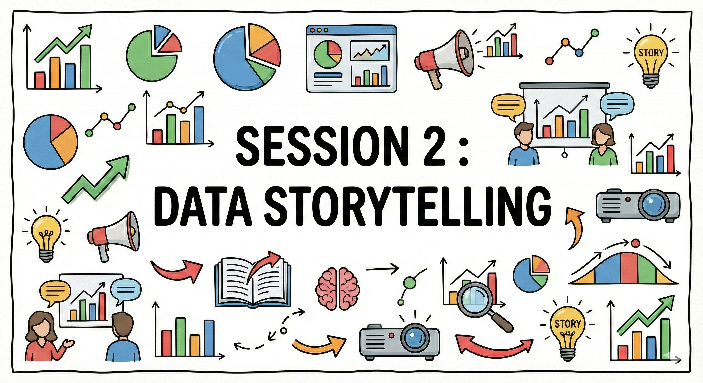
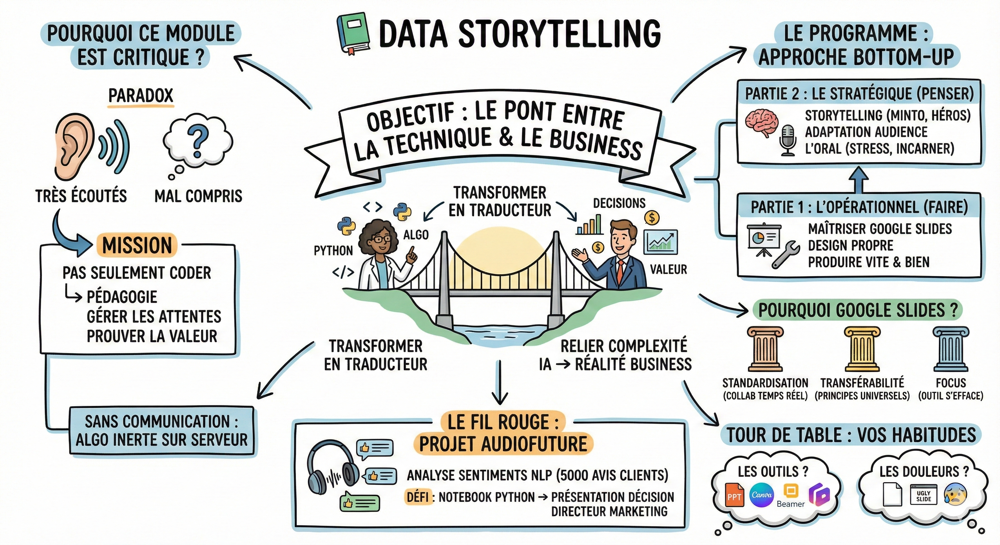

# 📗 Data storytelling

**Objectif :** Comprendre pourquoi la compétence technique seule ne suffit plus et comment ce module va vous transformer en traducteur capable de relier la complexité de l'IA à la réalité du Business.

**Pourquoi ce module est critique pour vous ?**  
Aujourd'hui, l'IA et la Data sont au cœur des décisions stratégiques.

- Le paradoxe : Vous allez être très écoutés, mais potentiellement mal compris. Il y a souvent un fossé entre ce que fait le modèle et ce que le business imagine.  
- Votre mission : Vous n'êtes pas seulement là pour coder. Vous devez faire de la pédagogie, gérer les attentes (éviter l'effet magie) et prouver la valeur.  
- Le pont : Votre rôle est de faire le lien entre la technique (ce qu'il y a sur votre PC/Notebook) et l'impact (ce que ça rapporte à l'entreprise).

Sans communication, le meilleur algorithme du monde restera un fichier inerte sur un serveur.

## Programme

Ce module procède à l'inverse des cours théoriques classiques : du "faire" (opérationnel) vers le "penser" (stratégique).

Partie 1 : L'opérationnel (réussir vos projets de formation)  
L'objectif est immédiat : Vous donner les clés pour avoir d'excellentes notes lors de vos soutenances.

- L'outil : Maîtriser Google Slides sur le bout des doigts.  
- Le design : Créer des slides propres, lisibles et professionnelles.  
- Le process : Comment produire vite et bien.

Partie 2 : Le stratégique (réussir en entreprise)  
Une fois l'outil maîtrisé, on prend de la hauteur.

- Le storytelling : Structurer un récit convaincant (pyramide de Minto, voyage du héros).  
- L'adaptation : Comprendre son audience (culture, profils psychologiques).  
- L'oral : Gérer son stress et incarner son message.

**Pourquoi Google Slides ?**  
Nous utiliserons Google Slides comme standard pour ce module.

- Standardisation : C'est l'outil le plus fluide pour la collaboration en temps réel (indispensable pour vos travaux de groupe).  
- Transférabilité : Les principes de design (alignement, contraste, hiérarchie) sont universels. Si vous savez faire une belle slide sur Google, vous saurez la faire sur PowerPoint ou Keynote.  
- Focus : Ne multiplions pas les outils. L'outil doit s'effacer au profit du message.

**Le fil rouge : Projet AudioFuture**  
Pour éviter la théorie abstraite, nous appliquerons chaque concept sur un scénario fil rouge commun :

- Le projet : Analyse de sentiments (NLP) sur 5000 avis clients pour des écouteurs.  
- Le défi : Transformer un notebook Python et des métriques techniques en une présentation de décision pour un Directeur Marketing.

**Avant de commencer : Vos habitudes**  
Prenez un instant pour réfléchir à vos pratiques actuelles.

1. Les outils : Qu'utilisez-vous aujourd'hui ? (PowerPoint, Canva, Beamer/LaTeX, Gamma.app...) ?  
2. Les douleurs : Quel est votre plus gros cauchemar quand vous devez faire une présentation ? (La page blanche ? Le design moche ? Le stress de l'oral ?).

## Ressources

- [Infographies du module](https://docs.google.com/presentation/d/1ZzQGKv-WX_eHPan94VOTu3VMChlisap8jiH-4BM5zVw/edit?slide=id.g3b50f16f7bf_1_59#slide=id.g3b50f16f7bf_1_59) — toutes les infographies de la session en un seul deck
- [Playlist YouTube](https://youtube.com/playlist?list=PLAO2ui_9t-UQiTCLs2yiQO2m9_oq-ItWQ&si=3LPAKTCQV9vP-iuz) — vidéos complémentaires sur le data storytelling
