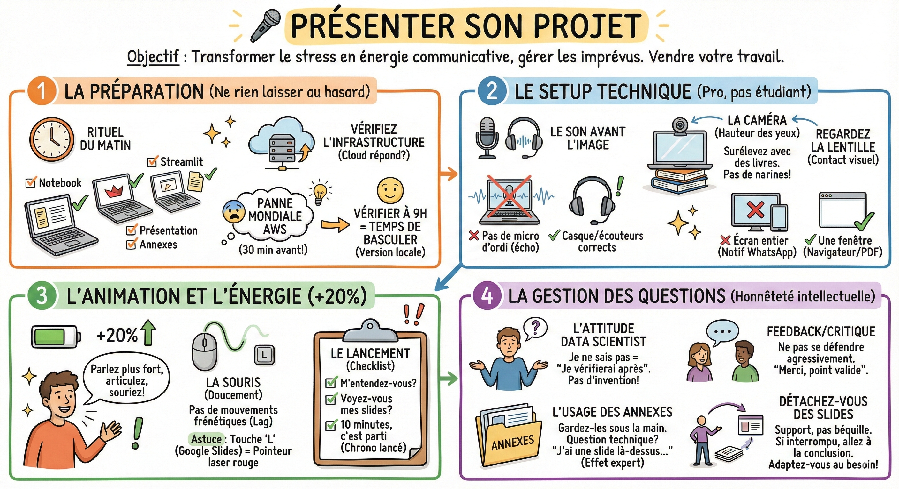

# 🎤 Présenter son projet

## Objectif

Transformer le stress en énergie communicative et gérer les imprévus techniques comme un professionnel. C'est le moment de vendre votre travail.

**La préparation**  
Ne laissez rien au hasard. L'improvisation technique est interdite.

- Le rituel du matin (pas 30 min avant) :  
  - Ouvrez tout : Lancez votre notebook, votre démo Streamlit, votre présentation et vos annexes dès le matin.  
  - Vérifiez l'infrastructure : Assurez-vous que le serveur cloud répond.  
  - L'anecdote vécue : J'ai découvert une panne mondiale d'AWS 30 minutes avant une soutenance car je n'avais pas vérifié le matin. Résultat : panique totale. Si j'avais vérifié à 9h, j'aurais eu le temps de basculer sur une version locale.

**Le setup technique**  
Vous n'êtes plus étudiant, vous êtes présentateur.

- Le son avant l'image :  
  - Une image floue passe, un son qui coupe est insupportable.  
  - ❌ Pas de micro d'ordi (écho, bruit de ventilo).  
  - ✅ Utilisez un casque ou des écouteurs corrects.

- La caméra (le contact visuel) :  
  - Hauteur des yeux : Surélevez votre ordi avec des livres. On ne veut pas voir vos narines ni le plafond.  
  - Regardez la lentille : Quand vous parlez, ne regardez pas l'écran, regardez le point vert de la webcam. C'est le seul moyen de regarder les gens "dans les yeux".

- Le partage d'écran :  
  - ❌ Ne partagez jamais votre "écran entier" (Notification WhatsApp "On mange où ?" en plein milieu).  
  - ✅ Partagez uniquement "une fenêtre" (celle de votre navigateur/PDF).

**L'animation et l'énergie**  
La visio mange 20% de votre énergie. Il faut compenser.

- Le dynamisme (+20%) : Parlez un peu plus fort, articulez plus, souriez plus. Si vous avez l'impression d'en faire trop, pour eux, ce sera juste dynamique.

- La souris (doucement) : N'agitez pas votre souris frénétiquement autour d'un point. Avec le lag vidéo, ça donne le tournis.  
  - Astuce : Dans Google Slides, tapez sur la touche L pour activer le pointeur laser rouge.

- Le Lancement (checklist) :  
  1. "Est-ce que vous m'entendez bien ?"  
  2. "Est-ce que vous voyez mes slides ?"  
  3. "Nous avons 10 minutes, c'est parti." (Lancez votre chronomètre à côté).

**La gestion des questions**  
C'est là qu'on juge votre honnêteté intellectuelle.

- L'attitude data scientist :  
  - Si vous ne savez pas, dites-le. "Je n'ai pas la réponse exacte là maintenant, je vérifierai après la séance." C'est mieux que d'inventer n'importe quoi.  
  - Si on vous fait une critique (feedback) : Ne vous défendez pas agressivement. Dites : "Merci, c'est un point valide, je n'y avais pas pensé sous cet angle."

- L'usage des annexes :  
  - Gardez vos notes manuscrites et vos slides techniques (annexes) sous la main.  
  - Si une question pointe vers un détail technique, sortez la slide d'annexe : "J'ai justement une slide sur l'architecture..." (Effet expert garanti).

**Détachez-vous des slides**  
Les slides sont un support, pas une béquille.

- Si le jury vous interrompt pour aller directement à la conclusion : Faites-le. Ne dites pas "Attendez, j'y arrive dans 3 slides". Sautez les slides et adaptez-vous. Vous êtes là pour répondre à leur besoin, pas pour réciter un poème.

## Ce qu'il faut retenir

- Vérifiez toute votre infrastructure technique le matin (pas 30 minutes avant) pour avoir le temps de basculer sur un plan B.
- En visio, parlez 20 % plus fort et ne partagez jamais votre écran entier : partagez uniquement la fenêtre de votre présentation.
- Si vous ne savez pas répondre à une question, dites-le honnêtement : c'est une marque d'intégrité intellectuelle qui inspire confiance.

## Pour aller plus loin

- [Google Slides - Mode Présentateur](https://support.google.com/docs/answer/1696787) — documentation officielle du mode présentateur avec notes et chrono
- [OBS Studio](https://obsproject.com/) — logiciel gratuit pour enregistrer vos démos en vidéo comme plan de secours
- [Logitech Spotlight](https://www.logitech.com/fr-fr/products/presenters.html) — télécommandes de présentation pour se libérer du clavier
