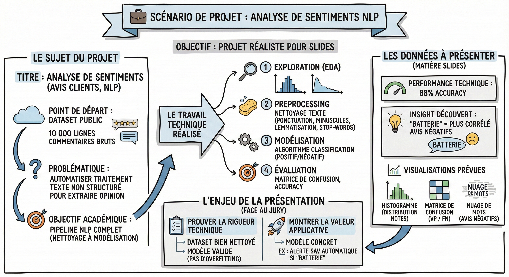

# 💼 Scénario de projet

## Objectif

Disposer d'un projet de référence réaliste qui servira de fil rouge tout au long de ce module pour illustrer chaque concept de data storytelling.

**Le sujet du projet**

- Titre du projet : "Analyse de sentiments sur les avis clients (NLP)".

- Le point de départ : Un dataset public (type Kaggle ou Amazon Reviews) contenant 10 000 lignes de commentaires bruts sur des produits électroniques.

- La problématique : Comment automatiser le traitement d'une grande quantité de texte non structuré pour en extraire l'opinion des utilisateurs ?

- L'objectif académique : Mettre en œuvre un pipeline de Natural Language Processing (NLP) complet, du nettoyage à la modélisation.

**Le travail technique réalisé**

- Exploration (EDA) : Analyse de la distribution des notes (étoiles) et de la longueur des commentaires.

- Preprocessing : Nettoyage du texte (suppression de la ponctuation, minuscules, lemmatisation, retrait des stop-words).

- Modélisation : Entraînement d'un algorithme de classification (ex: régression logistique ou naive bayes) pour prédire si un avis est "positif" ou "négatif".

- Évaluation : Mesure de la performance via la matrice de confusion et l'accuracy.

**Les données à présenter (matière pour les slides)**  
Pour l'exercice, nous utiliserons ces résultats fictifs :

- Performance technique : Le modèle atteint 88% d'Accuracy (précision globale).

- Insight découvert : Le modèle a permis d'identifier que le mot "batterie" est le plus corrélé aux avis négatifs.

- Visualisations prévues :  
  - Histogramme de la distribution des notes (déséquilibre des classes).  
  - Matrice de confusion (vrai positifs / faux négatifs).  
  - Nuage de mots (wordcloud) des avis négatifs.

**L'enjeu de la présentation**  
Vous devez réussir un double exercice face au jury :

- Prouver la rigueur technique : Montrer que le dataset a été bien nettoyé et que le modèle est valide (pas d'overfitting).

- Montrer la valeur applicative : Démontrer que ce modèle "théorique" pourrait servir concrètement (ex : "Grâce à ce modèle, on peut alerter le SAV automatiquement si un avis parle de batterie").

## Ce qu'il faut retenir

- Le projet AudioFuture est un cas réaliste d'analyse de sentiments NLP sur 10 000 avis clients, avec un modèle à 88 % d'accuracy.
- L'enjeu de la présentation est double : prouver la rigueur technique et montrer la valeur applicative pour le business.
- Le mot "batterie" est l'insight clé découvert par le modèle, illustrant comment une analyse technique peut déboucher sur une recommandation concrète.

## Pour aller plus loin

- [Kaggle - Amazon Product Reviews](https://www.kaggle.com/datasets) — des datasets réels d'avis clients pour s'exercer au NLP
- [Scikit-learn - Text Classification](https://scikit-learn.org/stable/tutorial/text_analytics/working_with_text_data.html) — tutoriel officiel pour classifier du texte avec Python
- [Towards Data Science - Sentiment Analysis Guide](https://towardsdatascience.com/) — articles pratiques sur l'analyse de sentiments
