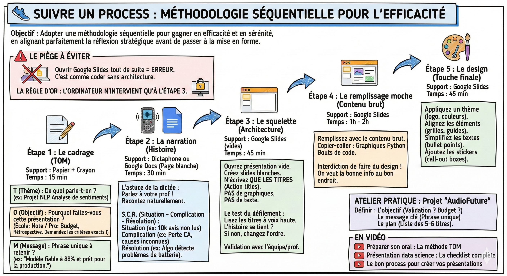

# 👟 Suivre un process

## Objectif

Adopter une méthodologie séquentielle pour gagner en efficacité et en sérénité, en alignant parfaitement la réflexion stratégique avant de passer à la mise en forme.

**Le piège à éviter**  
Le réflexe naturel est d'ouvrir Google Slides tout de suite. C'est une erreur.  
C'est comme commencer à coder sans avoir réfléchi à l'architecture. Vous allez écrire, effacer, changer la couleur d'un bouton pendant 20 minutes, pour finalement vous rendre compte que cette slide ne sert à rien.

**La règle d'or :** L'ordinateur n'intervient qu'à l'étape 3.

**Étape 1 : Le cadrage**  
Avant toute chose, vous devez définir le contrat de la présentation. Utilisez la méthode TOM.

Support : Papier + Crayon  
Temps : 15 min

- T (Thème) : De quoi parle-t-on ? (ex: Projet NLP Analyse de sentiments).

- O (Objectif) : Pourquoi faites-vous cette présentation ?  
  - Contexte école : L'objectif est d'avoir une bonne note.  
    - Action : Demandez à votre prof ses critères exacts (Veut-il voir du code ? Juste les résultats ? La démarche ?). Ne devinez pas, demandez.  
  - Contexte pro (exemples) :  
    - Obtenir un budget : L'objectif est de prouver le retour sur investissement (ROI).  
    - Rétrospective : L'objectif est d'expliquer ce qu'on a appris d'un échec.

- M (Message) : Quelle est la phrase unique que l'audience doit retenir en sortant de votre présentation ?  
  - Exemple : "Le projet est terminé, le modèle est fiable à 88% et prêt pour la production."

**Étape 2 : La narration**  
Ne pensez pas en slides, pensez en histoire.

Support : Dictaphone ou Google Docs (Page blanche)  
Temps : 30 min

- L'astuce de la dictée : Si vous bloquez devant la page blanche, utilisez la dictée vocale de votre téléphone. Imaginez que votre prof est en face de vous et racontez-lui tout :  
  - "Alors voilà, j'ai commencé par prendre le dataset, mais il était sale... donc j'ai dû nettoyer... ensuite j'ai testé tel modèle..."  
  - Cela rend votre discours naturel et fluide.

- Structurer avec le S.C.R. (Situation - Complication - Résolution) :  
  - Situation : Le contexte connu de tous. "On a 10 000 avis clients non lus."  
  - Complication : Le problème qui fait mal. "On ne sait pas pourquoi les clients sont mécontents, et on perd du chiffre d'affaires."  
  - Résolution : Votre projet. "J'ai créé un algo qui détecte automatiquement les problèmes de batterie."

**Étape 3 : Le squelette**  
C'est ici que l'efficacité opère. C'est l'étape de l'architecture.

Support : Google Slides (vides)  
Temps : 45 min

1. Ouvrez une présentation vide.  
2. Créez 10 slides blanches.  
3. N'écrivez QUE LES TITRES (les fameux "action titles"). Ne mettez aucun graphique, aucun texte.  
4. Le test du défilement : Passez les slides en lisant uniquement les titres à voix haute.  
- Slide 1 : L'analyse manuelle des avis est impossible.  
- Slide 2 : Pourtant, les plaintes augmentent de 20%.  
- Slide 3 : Notre modèle NLP identifie la cause racine en 3 secondes.  
- Slide 4 : La "Batterie" est le coupable identifié.  
- …  
- Si l'histoire se tient, votre plan est validé. Sinon, changez l'ordre des slides vides (c'est instantané).

Avantage pour le travail de groupe : Validez ce squelette avec votre équipe ou votre prof avant de commencer à travailler le contenu. Vous évitez de travailler pour rien.

**Étape 4 : Le remplissage moche**  
Maintenant que le plan est solide, il faut le prouver.

Support : Google Slides  
Temps : 1h - 2h

- Remplissez les slides avec le contenu brut.  
- Copiez-collez vos graphiques depuis Python.  
- Copiez-collez vos bouts de code.  
- Interdiction de faire du design : On s'en fiche que ce soit mal aligné ou que la police soit moche. On veut juste mettre la bonne info au bon endroit.

**Étape 5 : Le design**  
C'est la touche finale. Mettez votre casquette de designer.

Support : Google Slides  
Temps : 45 min

- Appliquez un thème de présentation (logo, couleurs).  
- Alignez les éléments (grilles et guides).  
- Simplifiez les textes (transformez les paragraphes en bullet points).  
- Ajoutez les stickers (call-out boxes) pour guider l'œil.

**Exercice pratique**  
Reprenez le projet "AudioFuture" (avis clients). Définissez :

1. L'objectif : Que voulez-vous obtenir du jury ? (Validation technique ? Budget ?)  
2. Le message clé : La phrase unique.  
3. Le plan : La liste des 5 à 6 titres de vos slides.

## Ce qu'il faut retenir

- L'ordinateur n'intervient qu'à l'étape 3 : cadrage et narration se font d'abord sur papier ou en dictée vocale.
- Le squelette (étape 3) est la clé : si l'histoire se tient en lisant uniquement les titres, votre plan est validé.
- Séparez le remplissage brut (étape 4) du design (étape 5) pour ne pas perdre du temps à aligner des pixels sur du contenu qui va changer.
- Validez le squelette avec votre équipe avant de commencer le contenu pour éviter de travailler pour rien.

## Pour aller plus loin

- [Préparer son oral : La méthode TOM](https://www.youtube.com/watch?v=y91Z4hMqMBQ&list=PLAO2ui_9t-UQiTCLs2yiQO2m9_oq-ItWQ&index=7) — vidéo sur la méthode Thème, Objectif, Message
- [Présentation data science : La checklist complète](https://www.youtube.com/watch?v=XXcGwJ38ueE&list=PLAO2ui_9t-UQiTCLs2yiQO2m9_oq-ItWQ&index=2) — vidéo couvrant tous les points de vérification
- [Le bon process pour créer vos présentations](https://www.youtube.com/watch?v=p2K0tx4vkkE&list=PLAO2ui_9t-UQiTCLs2yiQO2m9_oq-ItWQ&index=2) — vidéo détaillant le processus étape par étape
