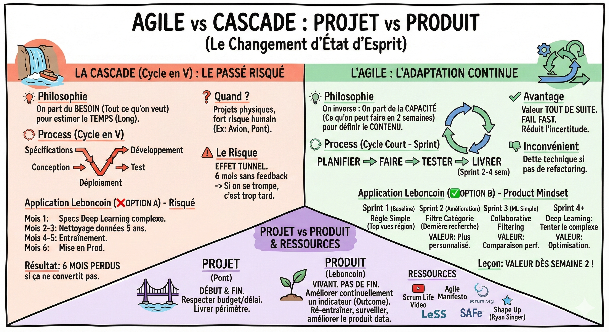
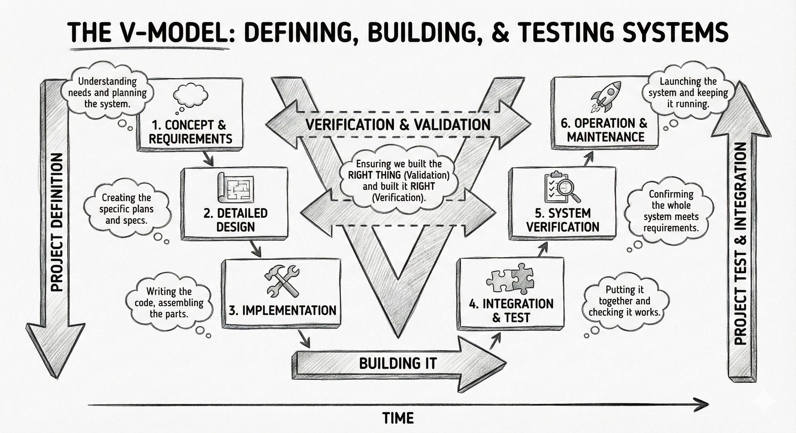

# ⚡ Agile vs Cascade

## Objectif

Comprendre la différence entre l'approche projet (cascade) et l'approche produit (agile), et savoir pourquoi l'agile est plus adapté à la data science.

## Projet vs produit : le changement d'état d'esprit

Avant de parler de méthode, parlons de l'objectif.

- Un projet a un début et une fin (ex: construire un pont). Le but est de livrer le périmètre prévu en respectant le budget et le délai.  
- Un produit n'a pas de fin (ex: Leboncoin). Il est vivant. Le but est d'améliorer continuellement un indicateur de valeur (outcome). Tant que le produit existe, on l'optimise.

En tant que data scientist : Vous ne livrez pas un modèle pour l'oublier ensuite. Vous gérez un produit data qui devra être ré-entraîné, surveillé et amélioré.

## La méthode cascade (Cycle en V)

C'est la méthode classique. On fait les étapes une par une, sans retour en arrière possible.

![][image3]

- Process : Spécifications détaillées ➡️ Conception ➡️ Développement ➡️ Test ➡️ Déploiement.  
- Philosophie : On part du Besoin (tout ce qu'on veut faire) pour estimer le temps (souvent très long).  
- Quand l'utiliser ? Pour les projets physiques ou à fort risque humain où l'itération est impossible.  
  * *Exemple : Construire un avion. On ne peut pas construire un demi-avion pour voir si ça vole.*  
- Le risque : L'effet tunnel. Passer 6 mois à développer un modèle complexe pour réaliser à la fin que les données sont sales ou que le besoin client a changé.

## La méthode agile

C'est la méthode adaptée pour le Digital. On découpe le projet en petites boucles (itérations).

- Process : On répète un cycle court (Sprint de 2 à 4 semaines) : Planifier ➡️ Faire ➡️ Tester ➡️ Livrer.  
- Philosophie : On inverse la logique. On part de la Capacité (ce qu'on peut faire en 2 semaines) pour définir le contenu.  
  * Question clé : **Sachant qu'on a 2 semaines, quelle est la chose la plus utile qu'on peut livrer ?**  
- Avantage : On livre de la valeur tout de suite. Si on se trompe, on le sait vite (fail fast).  
- Inconvénient : Peut créer de la dette technique (code vite fait, mal fait) si on ne prend pas le temps de refactoriser.

## Application au cas Leboncoin

Voyons la différence concrète sur notre projet de Recommandation Homepage.

❌ Option A : En cascade (risqué)

- Mois 1 : Rédaction des specs mathématiques d'un modèle Deep Learning complexe.  
- Mois 2-3 : Nettoyage des données historiques sur 5 ans.  
- Mois 4-5 : Entraînement et fine-tuning du modèle.  
- Mois 6 : Mise en production.

Résultat : Pendant 6 mois, l'utilisateur n'a rien vu. Si le modèle ne convertit pas, on a perdu 6 mois.

✅ Option B : En agile (product mindset)  
L'objectif est d'avoir quelque chose en production à la fin de chaque Sprint.

- Sprint 1 (la baseline) :  
  - Action : On implémente une règle simple : "Afficher les annonces les plus vues dans la région de l'utilisateur".  
  - Valeur : C'est en ligne. On vérifie que le pipeline de données fonctionne. C'est mieux que rien.  
- Sprint 2 (l'amélioration) :  
  - Action : On ajoute un filtre par catégorie préférée (basé sur la dernière recherche).  
  - Valeur : C'est un peu plus personnalisé.  
- Sprint 3 (le ML simple) :  
  - Action : On teste un algo de collaborative filtering simple (matrix factorization).  
  - Valeur : On compare la performance par rapport au Sprint 1.  
- Sprint 4+ (le deep learning) :  
  - Action : Maintenant qu'on a des métriques, on tente le modèle complexe.

**Leçon :** En agile, on a de la valeur dès la semaine 2. On réduit l'incertitude petit à petit.

## Ce qu'il faut retenir

- Un **projet** a une fin, un **produit** vit et s'améliore en continu.
- La cascade fonctionne pour les projets physiques ; l'agile est adapté au digital et à la data science.
- En agile, on livre de la valeur dès le premier sprint et on réduit l'incertitude petit à petit.
- Ne promettez pas un résultat ("90% de précision"), promettez une activité ("explorer cet algorithme et livrer les résultats").

## Pour aller plus loin

- [Scrum Life, Mode projet ou mode produit ?](https://youtu.be/-BiHmdJroXs?si=v3spsXM698AvP-i-) — les differences fondamentales entre les deux approches
- [Principles behind the Agile Manifesto](https://agilemanifesto.org/principles.html) — les 12 principes fondateurs de l'agilite
- [Scrum.org](https://www.scrum.org/) — le site officiel de Scrum avec guides et certifications
- [Large-Scale Scrum (LeSS)](https://less.works/) — framework pour appliquer Scrum a grande echelle
- [Scaled Agile Framework (SAFe)](https://framework.scaledagile.com/) — framework d'agilite a l'echelle de l'entreprise
- [Ryan Singer, Shape Up](https://basecamp.com/shapeup) — methode alternative a Scrum par Basecamp
