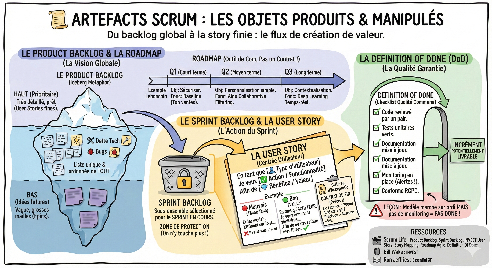

# 📦 Artefacts

## Objectif

Comprendre les artefacts Scrum (product backlog, roadmap, sprint backlog, user stories, definition of done) et savoir les utiliser au quotidien.

Maintenant que vous connaissez les rituels (comme expliqué dans [la fiche Rituels](rituels.md)), regardons les objets que l'équipe produit et manipule.

## Le product backlog

C'est la liste unique et ordonnée de tout ce qui pourrait être fait sur le produit.  
Imaginez un iceberg :

- Le haut (prioritaire) : Très détaillé, prêt à être codé (user stories fines).  
- Le bas (idées futures) : Vague, grosses mailles (Epics).

**Note data :** Votre backlog ne contient pas que des features. Il contient aussi de la dette technique (refactoring de code), de l'exploration (spikes) et des bugs.

## La roadmap

Le backlog est une liste plate. La **roadmap** est une projection dans le temps.  
Même en agile, le business a besoin de prévisibilité ("Quand aura-t-on le nouvel algo ?").  
C'est un outil de communication, pas un contrat. La roadmap évolue.

Exemple de roadmap de la recommandation Leboncoin :

| Période | Objectif (outcome) | Fonctionnalité clé (output) |
| :---- | :---- | :---- |
| Q1 (court terme) | Sécuriser la donnée | Mise en place du tracking et règle métier top ventes par région (Baseline). |
| Q2 (moyen terme) | Personnalisation simple | Algo de collaborative filtering (ceux qui ont vu ça ont vu ça). |
| Q3 (Long terme) | Contextualisation | Recommandation temps-réel Deep Learning (session-based). |

## Le sprint backlog

C'est le sous-ensemble du Product Backlog sélectionné pour le sprint en cours.  
Une fois le sprint lancé, on n'y touche plus (sauf urgence absolue). C'est votre zone de protection contre les demandes intempestives en milieu de semaine.

## La user story

C'est le format standard pour décrire une demande.  
Au lieu de rédiger un cahier des charges de 50 pages, on écrit une phrase simple centrée sur l'utilisateur.

Le format usuel :  
En tant que \[type d'utilisateur\]  
Je veux \[action / fonctionnalité\]  
Afin de \[bénéfice / valeur\]

Pourquoi est-il important de respecter ce format ?  
Les data scientist ont tendance à écrire des technical tasks :  
*En tant que data scientist, je veux entraîner le modèle pour réduire la loss function.*  
C'est faux. L'utilisateur final n'accorde pas directement de l'importance à votre loss function.

Exemple Leboncoin (mauvais vs bon) :

- 🔴 Mauvais (orienté tâche) :  
  - *Créer un modèle XGBoost sur les logs de vue.* (C'est une tâche technique, pas une story).  
- 🟢 Bon (orienté valeur) :  
  - *En tant qu' acheteur régulier (user),*  
  - *Je veux voir des annonces similaires à ma dernière recherche sur la home page (action),*  
  - *Afin de ne pas avoir à refaire mes filtres à chaque visite (bénéfice).*

**Les critères d'acceptation :**  
C'est le contrat qui définit quand la story est finie. Pour la data, c'est vital d'être précis.

- Exemple pour la story ci-dessus :  
- [ ] *L'algo répond en moins de 200ms (latence).*  
- [ ] *Si l'utilisateur est nouveau (cold start), on affiche les top ventes.*  
- [ ] *La précision offline est supérieure à la Baseline de 5%.*

## La definition of done

C'est la checklist qualité commune à toute l'équipe. Une user story n'est pas finie tant que toutes les cases ne sont pas cochées.  
Exemple de DoD pour une équipe Data :

- [ ] *Code reviewé par un pair.*  
- [ ] *Tests unitaires verts.*  
- [ ] *Documentation mise à jour.*  
- [ ] *Monitoring en place (Alertes si le modèle plante).*  
- [ ] *Conforme RGPD (Pas de données perso exposées).*

**Leçon :** Si le modèle marche sur votre ordi mais qu'il n'y a pas de monitoring, la story n'est pas Done.

## Ce qu'il faut retenir

- Le **product backlog** est la liste unique de tout ce qui pourrait être fait ; le **sprint backlog** est votre zone protégée pour 2 semaines.
- La **roadmap** est un outil de communication, pas un contrat : elle évolue avec le produit.
- Écrivez des **user stories** orientées valeur utilisateur, pas des tâches techniques.
- La **definition of done** est la checklist qualité collective : sans monitoring, votre modèle n'est pas "Done".

## Pour aller plus loin

- [Scrum Life, Product Backlog](https://youtu.be/gkxd5KH6HdM?si=LF-OZlHBi8MMdNpj) — les outils pour construire un bon product backlog
- [Scrum Life, Sprint Backlog](https://youtu.be/oqCCbelijLI?si=SC1KeJkbSVSeH9uj) — fonctionnement du backlog de sprint
- [Scrum Life, INVEST : qu'est-ce qu'une bonne User Story ?](https://youtu.be/PO4vDYkezgY?si=PJ8FQgqU4Otz1zbN) — critères de qualité d'une user story
- [Scrum Life, User Story Mapping](https://youtu.be/dvnU_R0mu98?si=zH3nN8v9Yhly-1lR) — le storytelling au service du backlog
- [Scrum Life, Roadmap Agile](https://youtu.be/0_1j_Jml9Ko?si=eJ_RCVWq7KiVrfah) — comment réussir l'exercice de roadmap
- [Scrum Life, Definition of Done](https://youtu.be/DCh5G5u--4E?si=LlCjuk2R50QyQC-s) — astuces pour une meilleure DoD
- [Bill Wake, INVEST in Good Stories, and SMART Tasks](https://xp123.com/invest-in-good-stories-and-smart-tasks/) — le framework INVEST pour écrire de bonnes stories
- [Ron Jeffries, Essential XP: Card, Conversation, Confirmation](https://ronjeffries.com/xprog/articles/expcardconversationconfirmation/) — les 3C des user stories
