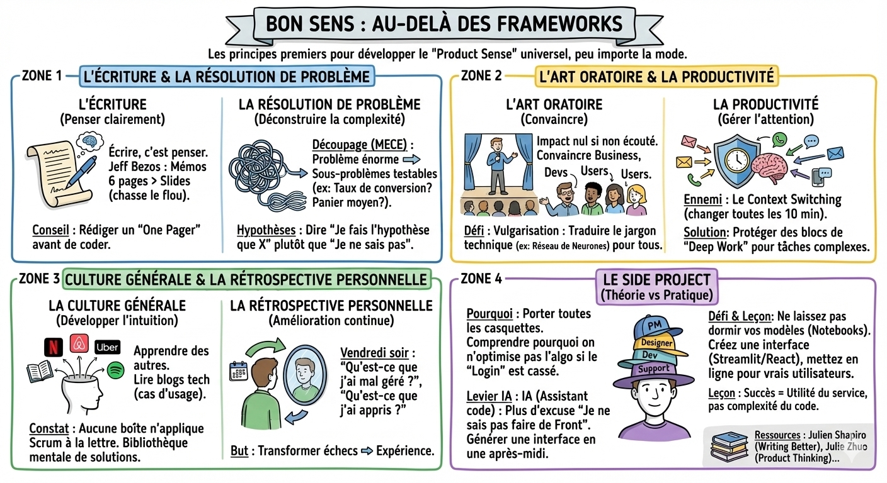

# 🧠 Bon sens

## Objectif

Développer les compétences transverses (écriture, résolution de problème, art oratoire, productivité, culture générale) qui fondent le bon sens produit.

## Au-delà des frameworks

Vous pouvez apprendre Scrum, Lean Startup et Design Thinking par coeur. Cela ne fera pas de vous un bon product manager.

Ce qui compte, ce sont les principes premiers. Ce sont les fondations universelles qui s'appliquent partout, peu importe la mode du moment.

Voici quelques super-pouvoirs à développer pour acquérir ce fameux bon sens produit.

## L'écriture

On pense souvent que l'écriture est une tâche administrative. C'est faux.

Écrire, c'est penser.

- Si vous n'arrivez pas à écrire clairement le problème que votre algorithme résout en 3 phrases, c'est que vous ne l'avez pas compris.  
- Jeff Bezos a interdit les PowerPoint chez Amazon au profit de mémos écrits de 6 pages. Pourquoi ? Parce que les slides permettent de cacher le flou. L'écriture ne pardonne pas.  
- Conseil : Forcez-vous à rédiger. Avant de coder, écrivez un one pager qui explique le pourquoi et le comment.

## La résolution de problème

Un PM est une machine à déconstruire la complexité.

Inspirez-vous des méthodes de conseil (type McKinsey/BCG) :

- Découpage (MECE) : Prenez un problème énorme ("Le revenu baisse") et découpez-le en sous-problèmes testables ("Est-ce le nombre de visiteurs ? Le taux de conversion ? Le panier moyen ?").  
- Hypothèses : Ne dites pas "Je ne sais pas". Dites "Je fais l'hypothèse que X, et voici comment je vais le vérifier".

## L'art oratoire

Vous allez passer votre vie à devoir convaincre : convaincre le business d'investir, convaincre les devs de la solution, convaincre les utilisateurs de tester.

- Si vous êtes un génie technique mais que personne ne vous écoute, votre impact est nul.  
- Vulgarisation : Votre défi de data scientist est d'expliquer un réseau de neurones à un directeur commercial sans utiliser de jargon. C'est un exercice de traduction constant.

## La productivité

Le métier de PM ou DS est fragmenté. Vous aurez 5 projets en parallèle et 10 réunions.

- Le context switching (changer de sujet toutes les 10 min) est votre ennemi.  
- Apprenez à gérer votre temps et votre attention. Protégez des blocs de deep work pour les tâches complexes (l'écriture ou l'analyse) et groupez les réunions.

## La culture générale

Comment développer son intuition ? En apprenant de celle des autres.

- Lisez 1h par jour. Pas forcément des livres théoriques, mais des cas d'usage.  
- Lisez les blogs tech de Netflix, Airbnb, Uber, Spotify.  
- Le constat frappant : Vous verrez qu'aucune de ces boîtes n'applique Scrum ou le Design Thinking à la lettre. Elles ont inventé leur propre process innovant face à un problème spécifique.  
- C'est en accumulant cette bibliothèque mentale de "Comment les autres ont fait" que vous saurez instinctivement quoi faire quand vous aurez un problème similaire.

## La rétrospective personnelle

L'amélioration continue ne s'applique pas qu'au produit ou à l'équipe, elle s'applique à vous.

- Ne laissez pas passer une semaine sans vous poser la question le vendredi soir :  
  - "Qu'est-ce que j'ai mal géré cette semaine ?"  
  - "Qu'est-ce que j'ai appris ?"

C'est la seule façon de transformer vos échecs en expérience.

## Le side project

La théorie, c'est bien. La pratique, c'est plus dur (mais formateur). Il n'y a pas de meilleure école de produit que d'essayer de construire et de lancer votre propre petite application.

- Pourquoi ? Quand c'est votre projet, vous portez toutes les casquettes. Vous êtes le PM, le Designer, le Dev, et le Support Client. Vous comprendrez instantanément pourquoi on ne peut pas passer 3 semaines à optimiser un algo si le bouton "Login" ne marche pas.  
- L'effet levier de l'IA : Il y a 5 ans, un data scientist pouvait dire "Je ne sais pas faire de Front-end / CSS". Cette excuse n'existe plus.  
  - Avec les assistants de code (Claude, ChatGPT, Cursor...), vous pouvez générer une interface utilisateur correcte en une après-midi.  
  - Votre défi : Ne laissez pas vos modèles dormir dans des notebooks Jupyter. Créez une petite interface (Streamlit ou React généré), mettez-la en ligne, et donnez-la à de vrais utilisateurs.  
- La leçon : Vous apprendrez que le succès ne dépend pas de la complexité du code, mais de l'utilité du service rendu. C'est l'essence du product sense.

## Ce qu'il faut retenir

- Les frameworks sont des béquilles pour apprendre ; le **bon sens produit** est ce qui reste quand on les maîtrise.
- **Écrire, c'est penser** : si vous ne pouvez pas expliquer votre problème en 3 phrases, vous ne l'avez pas compris.
- Protégez des blocs de **deep work** pour les tâches complexes ; le context switching est votre ennemi.
- Lancez un **side project** : c'est la meilleure école de produit, surtout avec l'IA qui élimine les excuses techniques.

## Pour aller plus loin

- [Julian Shapiro, Writing Better](https://www.julian.com/guide/write/intro) — guide pratique pour améliorer son écriture
- [Julie Zhuo, The Power of Product Thinking](https://future.com/product-thinking/) — développer sa pensée produit
- [Cal Newport, Deep Work](https://calnewport.com/deep-work-rules-for-focused-success-in-a-distracted-world/) — stratégies pour protéger sa concentration
