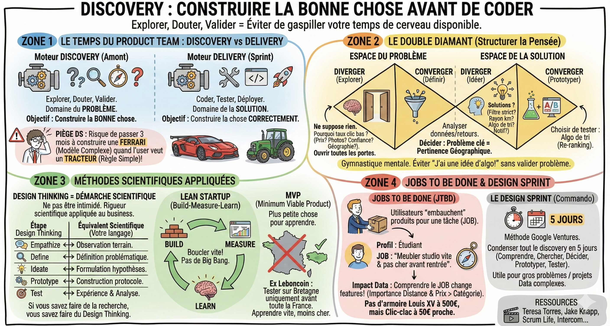
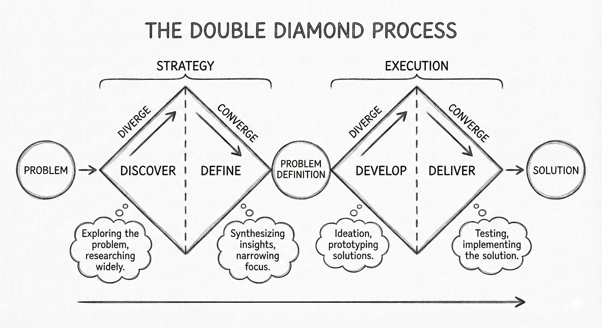
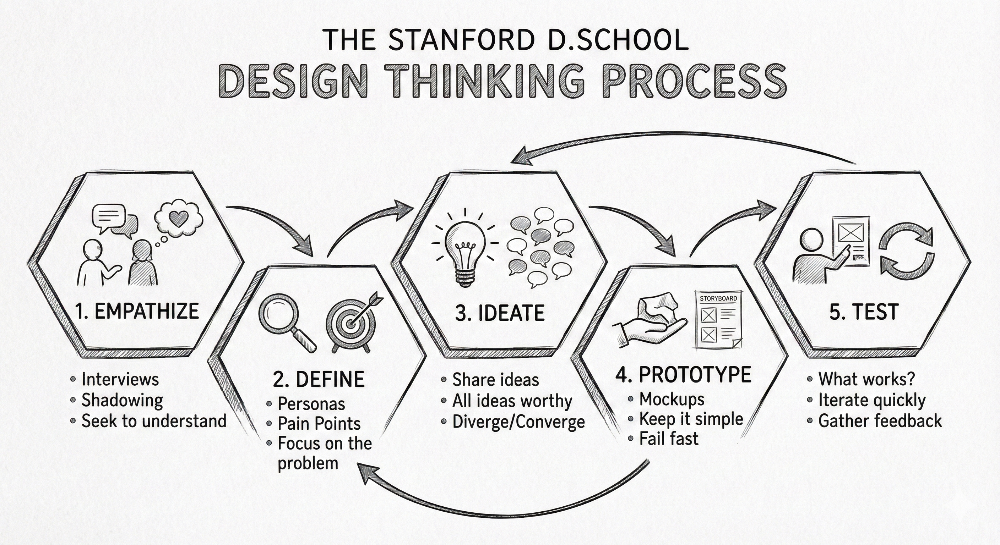
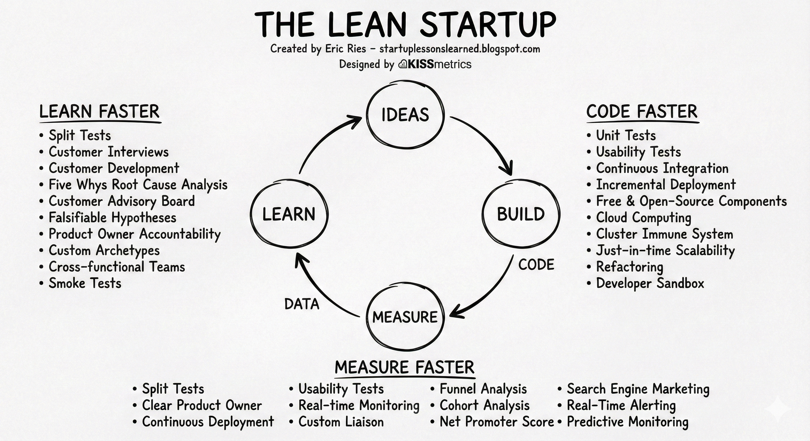
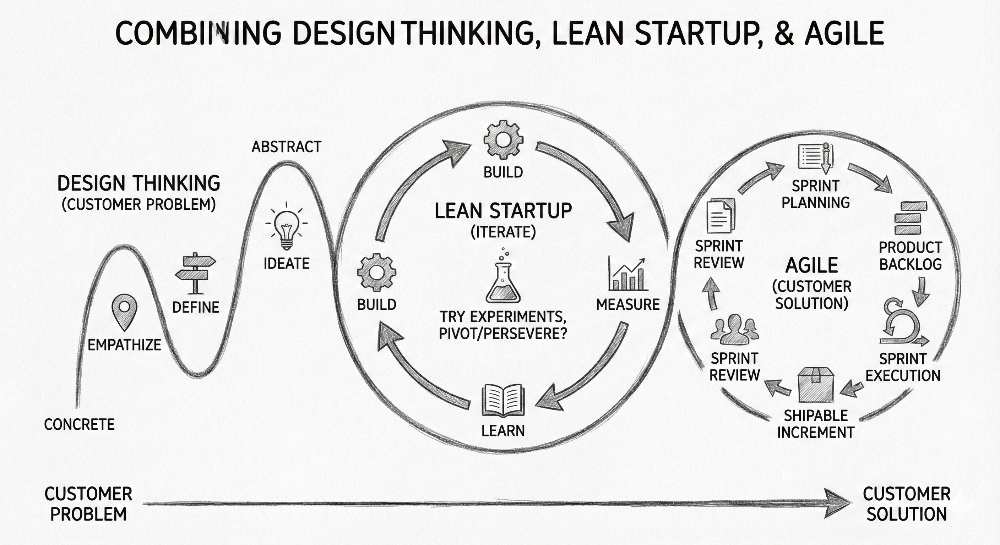
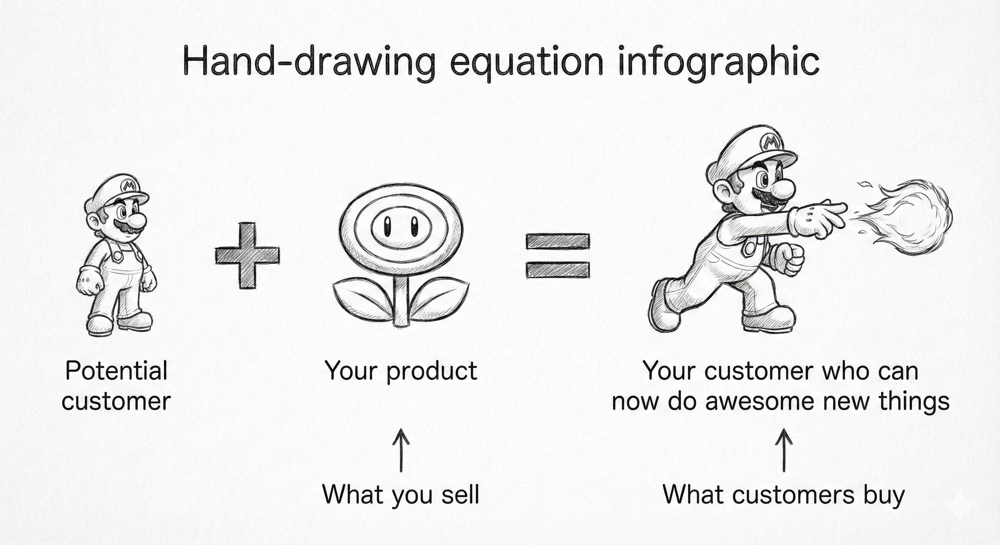
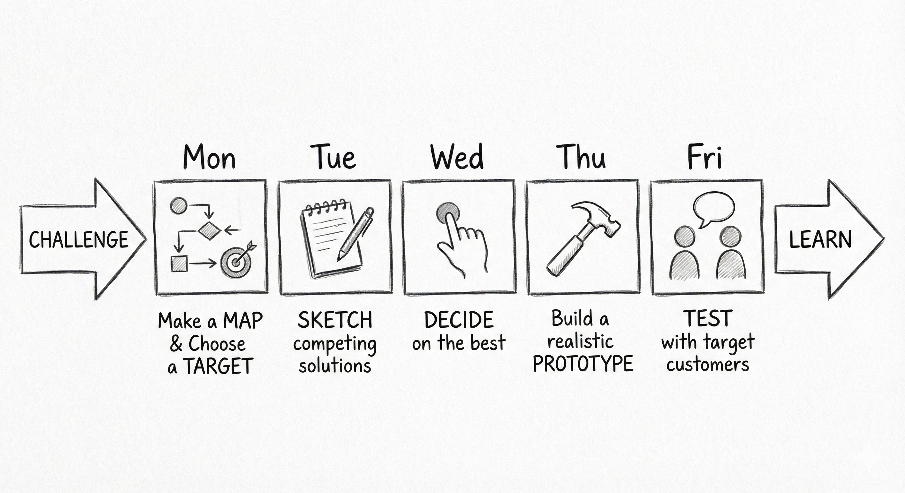

# 🔍 Discovery

## Objectif

Comprendre la phase de discovery (double diamant, design thinking, lean startup, JTBD, design sprint) et savoir pourquoi elle est essentielle avant de coder.

## Discovery vs delivery

Dans une équipe produit, il y a deux moteurs qui tournent en permanence, mais pas à la même vitesse :

- Le delivery (construire la chose correctement) : C'est ce qu'on fait pendant le sprint. On code, on teste, on déploie. C'est le domaine de la solution.  
- La discovery (construire la bonne chose) : C'est ce qu'on fait en amont. On explore, on doute, on valide. C'est le domaine du problème.

**Le piège du data scientist :** Vous êtes formés pour être des champions du delivery (optimiser le code/modèle). Le risque est de passer 3 mois à construire une Ferrari (un modèle complexe) alors que l'utilisateur avait besoin d'un "Tracteur" (une règle simple).

La discovery sert à éviter de gaspiller votre temps de cerveau disponible.

## Le double diamant

C'est le modèle mental fondamental pour structurer votre pensée et éviter de sauter sur la première idée venue. Il se compose de deux phases (deux diamants) d'expansion (divergence) et de sélection (convergence).

![][image5]

- 💎 Diamant 1 : L'espace du problème  
  - Diverger (explorer) : On ne suppose rien. Pourquoi le taux de clic est bas sur la Home Page ? (Prix ? Photos ? Confiance ? Géographie ?). On ouvre toutes les portes.  
  - Converger (définir) : On analyse les données et les retours. On décide que le problème clé est la pertinence géographique.  
- 💎 Diamant 2 : L'espace de la solution  
  - Diverger (Idéer) : Quelles solutions existent ? (Un filtre strict ? Un rayon kilométrique ? Un algo de tri ? Une notif ?).  
  - Converger (Prototyper) : On choisit de tester l'algo de tri (Re-ranking).

**Réalité du terrain :** Personne ne suit ça à la lettre avec des post-its de couleurs parfaitement alignés. Mais c'est une gymnastique mentale pour éviter de dire "J'ai une idée d'algo !" alors qu'on n'a pas validé le problème.

## Design thinking = démarche scientifique

Ne vous laissez pas intimider par le terme. C'est simplement l'application de la rigueur scientifique au monde du business.

![][image6]

| Étape Design Thinking | Équivalent Scientifique (Votre langage) |
| :---- | :---- |
| Empathize (comprendre l'utilisateur) | Observation du phénomène (terrain). |
| Define (cadrer le problème) | Définition de la problématique. |
| Ideate (trouver des solutions) | Formulation d'hypothèses. |
| Prototype (maquetter) | Construction du protocole expérimental. |
| Test (valider) | Expérience et analyse des résultats. |

Si vous savez faire de la recherche, vous savez faire du design thinking.

## Le lean startup

Populaire dans les startups, ce concept s'applique parfaitement à la data science expérimentale.

![][image7]

Le principe : Build ➡️ Measure ➡️ Learn.

- Au lieu de faire un big bang (Lancer le modèle parfait après 6 mois), on cherche à boucler ce cycle le plus vite possible.  
- MVP (Minimum Viable Product) : Quelle est la plus petite chose que je peux construire pour apprendre quelque chose ?  
  - Exemple Leboncoin : Au lieu d'entraîner un modèle sur toute la France, on le teste sur la Bretagne uniquement. Si ça ne marche pas en Bretagne, ça ne marchera pas ailleurs. On a appris vite pour moins cher.

## Le lien entre design thinking, lean startup et agile

![][image8]

## Jobs To Be Done (JTBD)

C'est une théorie puissante pour définir le besoin. Elle dit que les utilisateurs n'achètent pas des produits, ils les embauchent pour accomplir une tâche (job).

![][image9]

- Le concept : On se fiche du profil démographique (Homme, 35 ans, CSP+). On s'intéresse à la mission.  
- Exemple Leboncoin :  
  - Profil : "Étudiant cherche meuble".  
  - Job to be done : "Je veux meubler mon studio rapidement et pour pas cher avant la rentrée".  
- Impact data : Si vous comprenez le "job", vous ne recommanderez pas une armoire Louis XV à 500€, même si elle est populaire. Vous recommanderez un clic-clac à 50€ à 2 km de chez lui.  
  - Insight : Cela change vos features pour le modèle (importance de la distance et du prix > Importance de la catégorie).

## Le design sprint

C'est une méthode commando inventée chez Google Ventures.

![][image10]

- Le principe : Condenser tout le processus de discovery (comprendre, chercher, décider, prototyper, tester) en 5 jours consécutifs.  
- C'est utile pour débloquer un gros problème complexe ou lancer un nouveau gros projet Data.

## Ce qu'il faut retenir

- La **discovery** sert à construire la bonne chose ; le **delivery** sert à la construire correctement.
- Le **double diamant** structure la réflexion : d'abord comprendre le problème, ensuite chercher la solution.
- Le **lean startup** (Build, Measure, Learn) vous pousse à tester vite et à apprendre vite.
- Le **JTBD** (Jobs To Be Done) vous rappelle que les utilisateurs n'achètent pas des produits mais "embauchent" des solutions pour accomplir une tâche.

## Pour aller plus loin

- [Scrum Life, Lean Startup (Eric Ries)](https://youtu.be/VEWiJniocDg?si=12T-TNmr7lOXRaD0) — introduction au lean startup en français
- [Scrum Life, C'est quoi un MVP ?](https://youtu.be/gzbZoy8IYw0?si=59UV5qqp8RvX-hay) — rationaliser le succès avec le lean startup
- [Noé, Mener une discovery efficace avec Rémi Guyot](https://youtu.be/_IHJ0Y9Orfs?si=kRfkV3Go2aZIBcTd) — retour d'expérience sur la discovery
- [Teresa Torres, Opportunity Solution Trees](https://www.producttalk.org/opportunity-solution-trees/) — framework pour structurer la discovery
- [Todd Jackson, How to validate your startup idea](https://www.lennysnewsletter.com/p/validating-your-startup-idea) — guide de validation d'idées
- [Kromatic, What Type of Lean Startup Experiment Should I Run?](https://medium.com/@Kromatic/what-type-of-lean-startup-experiment-should-i-run-3360d89596fe) — choisir le bon type d'expérimentation
- [Itamar Gilad, Testing Product Ideas](https://itamargilad.com/resources/idea-testing-ebook/) — ebook gratuit sur le test d'idées produit
- [Stanford d.school, Design Thinking Bootleg](https://dschool.stanford.edu/tools/design-thinking-bootleg) — boîte à outils design thinking de Stanford
- [AJ&Smart, What Is Design Thinking?](https://youtu.be/gHGN6hs2gZY?si=2K5d2D2v37tQ3_K0) — introduction vidéo au design thinking
- [Google, Design Sprint Kit](https://designsprintkit.withgoogle.com/) — kit officiel Google pour les design sprints
- [Jake Knapp, The Design Sprint](https://www.thesprintbook.com/the-design-sprint) — le livre de référence sur le design sprint
- [Intercom, Jobs-to-be-Done](https://www.intercom.com/resources/books/intercom-jobs-to-be-done) — guide Intercom sur le JTBD
- [Anthony W. Ulwick, JTBD: Theory to Practice](https://jobs-to-be-done-book.com/) — le JTBD de la théorie à la pratique
