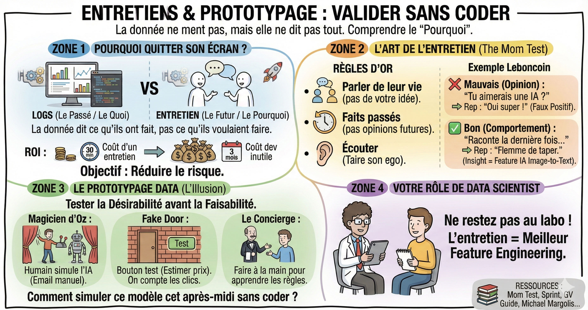

# Entretiens utilisateurs

**Pourquoi quitter son écran ?**  
En data science, on a tendance à croire que la donnée ne ment pas. C'est vrai, mais la donnée (les logs) ne raconte que le passé. Elle vous dit ce que l'utilisateur a fait, mais jamais pourquoi il l'a fait, ni ce qu'il aurait aimé faire.

L'objectif de cette phase n'est pas de faire du social, mais de réduire le risque.

- Coût d'un entretien : 30 minutes.  
- Coût de développement d'un modèle inutile : 3 mois de salaire + coûts Cloud.

**L'art de l'entretien**  
Le piège classique : demander "Est-ce que tu aimerais une fonctionnalité de recommandation ?". L'utilisateur répondra "Oui" pour vous faire plaisir. C'est un faux positif.

Pour obtenir de la donnée qualitative fiable, utilisez la méthode du Mom Test (Rob Fitzpatrick).

Les 3 règles d'or :

1. Parlez de leur vie, pas de votre idée. Ne pitchez pas votre solution.  
2. Demandez des faits passés, pas des opinions futures.  
3. Taisez-vous et écoutez.

Exemple concret Leboncoin :

- ❌ Mauvaise approche (opinion) :  
  - "Si on ajoutait une IA qui analyse tes photos pour pré-remplir l'annonce, tu aimerais ?"  
  - Réponse biaisée : "Oh oui, ça a l'air super cool !" (Mais il ne l'utilisera peut-être jamais).

- ✅ Bonne approche (comportement passé) :  
  - "Raconte-moi la dernière fois que tu as déposé une annonce."  
  - "Qu'est-ce qui a été le plus pénible ?"  
  - "Combien de temps ça t'a pris ?"  
  - Réponse réelle : "J'ai mis 3 jours à le faire parce que j'avais la flemme de taper la description sur mon téléphone."  
  - Insight pour le DS : Le problème est la saisie de texte. Une IA "Image-to-text" a donc une vraie valeur ici.

**Le prototypage data**  
Comment prototyper un algorithme sans le coder ? Le but est de tester la désirabilité (est-ce qu'ils le veulent ?) avant la faisabilité (est-ce qu'on peut le coder ?).

Voici 3 techniques pour les data scientists :

Le magicien d'Oz  
L'utilisateur croit interagir avec une IA, mais c'est un humain qui opère en coulisses.

- Le test : Vous voulez valider une recommandation personnalisée par email.  
- L'action : Au lieu de coder le modèle, prenez 10 utilisateurs. Regardez manuellement leur historique. Sélectionnez vous-même 3 annonces pertinentes. Envoyez-leur un mail "Notre sélection pour vous".  
- La mesure : S'ils ne cliquent pas sur une sélection faite par un humain intelligent, ils ne cliqueront jamais sur une sélection faite par une IA imparfaite. Abandonnez l'idée.

La fake door  
Tester l'intérêt avant de construire le produit.

- Le test : Une fonctionnalité d'estimation de prix immo ("Estimer mon bien").  
- L'action : Ajoutez le bouton sur la Home Page. Si l'utilisateur clique, affichez une page : "Bravo, vous avez trouvé une future fonctionnalité ! Inscrivez-vous pour être prévenu de sa sortie."  
- La mesure : Comptez les clics. Si personne ne clique, le besoin n'existe pas. Inutile de collecter des données immo.

Le concierge  
Faire le service manuellement et totalement personnalisé pour un utilisateur unique, pour comprendre les règles métier.

- Le test : Un algo qui aide à mieux vendre.  
- L'action : Asseyez-vous à côté d'un vendeur professionnel. Aidez-le à rédiger ses annonces pendant 2 heures. Notez toutes les règles que vous appliquez instinctivement (ex: "Il manque des photos", "Le titre est trop court").  
- L'impact : Ces notes deviendront les "règles" de votre future Baseline (Heuristique).

**Votre rôle en tant que data scientist**  
Ne laissez pas le product manager ou le designer faire ça tout seul.

- Participez aux entretiens : Entendre la frustration d'un utilisateur vaut mieux que 1000 graphiques. Cela vous donnera des idées de features pour vos modèles (feature engineering).  
- Soyez créatifs sur le prototype : Votre défi technique n'est pas "Comment coder ce modèle ?", mais "Comment simuler ce modèle cet après-midi sans coder ?".

**Pour aller plus loin**  
[Michael Margolis, User Research, Quick 'n' Dirty](https://youtu.be/WpzmOH0hrEM?si=mWasITspuSnmsnNG)  
[GV, From 'Sprint': The Five-Act Interview](https://youtu.be/U9ZG19XTbd4?si=N4I2QUxCBBk0z05o)  
[Michael Margolis, GV's Guide to UX Research for Startups](https://library.gv.com/gv-guide-to-uxresearch-for-startups-b6d0c8ac81b3)  
[Michael Margolis, Learn More Faster](https://www.learnmorefaster.com/)  
[Tomer Sharon, Asking better questions that can help with your startup](https://youtu.be/8tiuWYs5Z-A?si=aGGSJpP1K5Fr-fLE)  
[Tomer Sharon, The UX Research Plan That Stakeholders Love](https://www.smashingmagazine.com/2012/01/ux-research-plan-stakeholders-love/)  
[Steve Krug, Things a therapist would say](https://sensible.com/download-files/)
