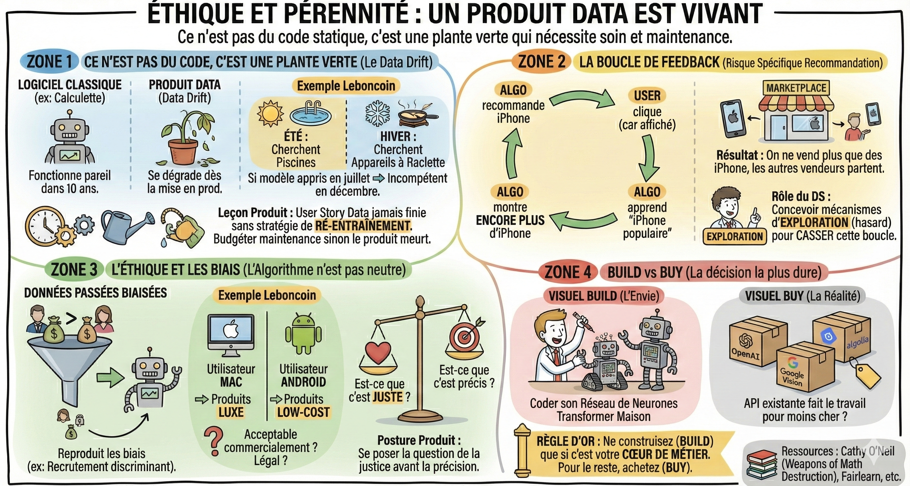

# ⚖️ Éthique et pérennité

## Objectif

Comprendre les risques spécifiques aux produits data (data drift, boucles de feedback, biais) et savoir quand construire vs acheter.

## Ce n'est pas du code, c'est une plante verte

Un logiciel classique (ex : une calculette) fonctionnera pareil dans 10 ans.  
Un produit Data se dégrade dès l'instant où il est mis en production.

- Le **data drift** (dérive des données) : Le comportement des utilisateurs change.  
  - Exemple Leboncoin : En été, les gens cherchent des piscines. En hiver, des appareils à raclette. Si votre modèle a appris sur les données de juillet, il sera incompétent en décembre.  
- La leçon produit : Une user story data n'est jamais finie sans une stratégie de ré-entraînement. Le PM doit budgéter du temps pour la maintenance, sinon le produit meurt.

## La boucle de feedback

C'est un risque spécifique aux systèmes de recommandation.

- L'algo recommande l'iPhone.  
- L'utilisateur clique sur l'iPhone (parce qu'il est affiché, pas forcément par choix).  
- L'algo apprend que "L'iPhone est populaire" et le montre encore plus.  
- Résultat : Au bout d'un mois, on ne vend plus que des iPhone et les autres vendeurs partent.

**Le rôle du DS :** Vous devez concevoir des mécanismes d'exploration (montrer des objets au hasard parfois) pour casser cette boucle.

## L'éthique et les biais

Un algorithme n'est pas neutre. Il reproduit les biais des données passées.

- Le cas classique : Si, historiquement, les hommes ont des salaires plus élevés, un algo de recrutement mal conçu peut discriminer les femmes.  
- Chez Leboncoin : Imaginez que votre algo de recommandation affiche des produits de luxe uniquement aux utilisateurs sur Mac, et des produits low-cost aux utilisateurs sur Android. Est-ce acceptable commercialement ? Est-ce légal ?

**La posture produit :** Se demander "Est-ce que c'est juste ?" avant de se demander "Est-ce que c'est précis ?"

## Build vs buy

C'est la décision produit la plus dure pour un data scientist.

* L'envie : Coder son propre réseau de neurones Transformer maison.  
* La réalité : Est-ce qu'une API existante (OpenAI, Google Vision, Algolia) ne fait pas déjà le travail pour moins cher ?  
* Règle d'or : Ne construisez (Build) que si c'est votre coeur de métier. Pour le reste, achetez (Buy).

## Ce qu'il faut retenir

- Un produit data se dégrade dès sa mise en production : prévoyez une stratégie de **ré-entraînement**.
- Les **boucles de feedback** peuvent enfermer votre algo dans un cercle vicieux : intégrez des mécanismes d'exploration.
- Posez-vous la question "Est-ce que c'est **juste** ?" avant "Est-ce que c'est **précis** ?".
- Ne construisez que si c'est votre coeur de métier ; pour le reste, achetez (Build vs Buy).

## Pour aller plus loin

- [Google, Rules of Machine Learning](https://developers.google.com/machine-learning/guides/rules-of-ml) — les bonnes pratiques ML de Google, y compris la gestion du drift
- [Cathy O'Neil, Weapons of Math Destruction](https://weaponsofmathdestructionbook.com/) — les dangers des algorithmes biaisés appliqués à grande échelle
- [MIT Technology Review, The Algorithm](https://www.technologyreview.com/topic/algorithms/) — articles de fond sur l'éthique algorithmique
