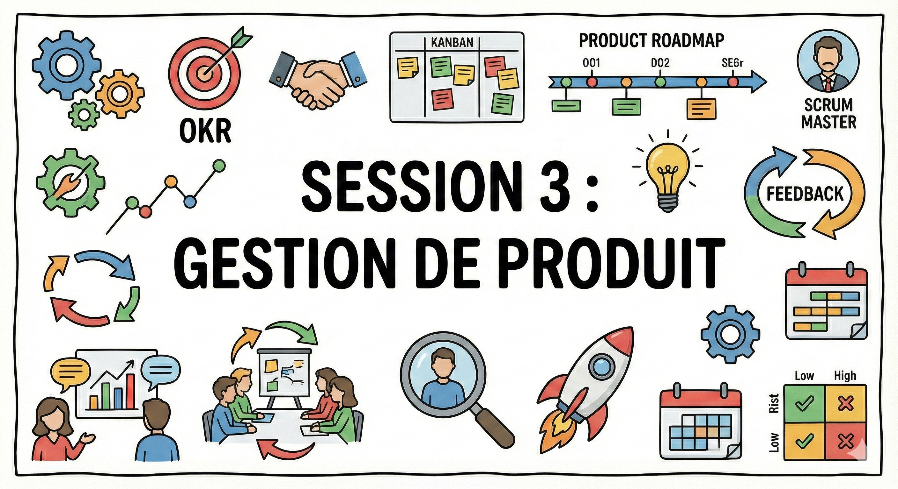
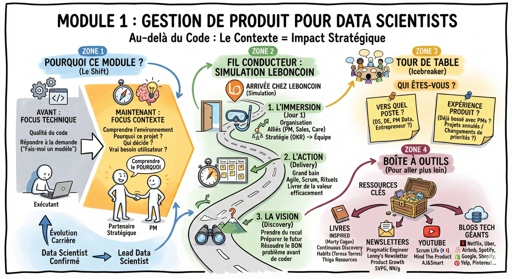

# 📘 Gestion de produit

**Pourquoi ce module ?**  
Jusqu'à présent, vous avez travaillé sur la technique. Dans ce module, nous allons parler de contexte.

Lorsque vous rejoindrez une entreprise, la qualité de votre code ne sera qu'une partie de l'équation. Votre impact dépendra surtout de votre capacité à comprendre l'environnement dans lequel vous évoluez.

- Pourquoi ce projet a-t-il été choisi ?  
- Qui décide des priorités ?  
- Comment s'assurer que notre algorithme répond au vrai besoin de l'utilisateur ?  
- …

Les data scientists les plus pertinents sont ceux qui ne se contentent pas de répondre à une demande ("Fais-moi un modèle"), mais qui comprennent le pourquoi derrière.

C'est ce qui vous permettra de ne pas être de simples exécutants, mais de devenir des partenaires stratégiques capables de challenger les demandes et de proposer des solutions plus intelligentes (et souvent plus simples).

C'est aussi ce recul qui différencie un data scientist confirmé d'un lead data scientist.

**Le fil conducteur de la session**  
Ce module ne suit pas un format théorique descendant. Il simule votre arrivée dans une entreprise (fil rouge : Leboncoin) et suit votre parcours chronologique :

1. **L'immersion :** Vous arrivez le premier jour. Vous découvrirez comment l'entreprise est organisée, qui sont vos alliés (PM, sales, care...) et comment la stratégie de l'entreprise (OKR) redescend jusqu'à votre équipe.  
2. **L'action (delivery) :** Vous êtes dans le grand bain. Vous verrez comment s'organiser au quotidien pour livrer de la valeur efficacement (agile, scrum, rituels) sans sacrifier la qualité.  
3. **La vision (discovery) :** Vous prenez du recul. Vous verrez comment on prépare le futur, comment on s'assure qu'on résout le bon problème avant de coder, et comment développer ce fameux bon sens produit.

**Questions pour vous situer**

- Vers quel poste vous orientez-vous apres ce cursus ? (data scientist, data engineer, product manager data, entrepreneur... ?)  
- Votre experience du produit : avez-vous deja travaille avec des product managers ? Avez-vous deja ete confrontes a des changements de priorites ou des projets annules faute de besoin ?

## Ressources

- [Infographies du module](https://docs.google.com/presentation/d/1ZzQGKv-WX_eHPan94VOTu3VMChlisap8jiH-4BM5zVw/edit?slide=id.g3b50f16f7bf_1_107#slide=id.g3b50f16f7bf_1_107) — les supports visuels de la session
- [Playlist YouTube](https://youtube.com/playlist?list=PLAO2ui_9t-UT313sz27IIOJvSf08_Atpq&si=_hjG9ZJ8SNIgaaCq) — les videos complementaires de la session

## Pour aller plus loin

### Livres et guides (pour démarrer)

- Marty Cagan, *INSPIRED* — la bible absolue du product management, expliquant comment Google, Netflix et Tesla construisent des produits
- Teresa Torres, *Continuous Discovery Habits* — le guide pratique pour ne jamais perdre le contact avec la réalité
- [Thiga Ressources](https://www.thiga.co/fr/nos-ressources) — livres blancs et blog très qualitatifs sur le product management

### Newsletters et blogs

- [The Pragmatic Engineer](https://newsletter.pragmaticengineer.com/) — pour comprendre ce qui se passe côté Engineering Management (très lu par les CTO)
- [Lenny's Newsletter](https://www.lennysnewsletter.com/) — la référence mondiale actuelle avec des études de cas très fouillées
- [Product Growth](https://www.news.aakashg.com/) — des formats courts et percutants sur les stratégies des géants tech
- [SVPG Articles](https://www.svpg.com/articles/) — les articles fondateurs du product management moderne
- [NN/g (Nielsen Norman Group)](https://www.nngroup.com/articles/) — la référence scientifique sur l'UX et l'utilisabilité

### YouTube

- [Scrum Life](https://youtube.com/@scrumlife) — Jean-Pierre Lambert vulgarise l'agilité sans langue de bois (en français)
- [Mind The Product](https://www.youtube.com/@mindtheproducttv) — conférences de haut niveau sur le product management
- [AJ&Smart](https://youtube.com/@ajsmart) — pour comprendre le Design Sprint et les méthodes de facilitation

### Blogs d'entreprises

- [Netflix Tech Blog](https://netflixtechblog.com/) — retours d'expérience engineering et data de Netflix
- [eBay Tech](https://innovation.ebayinc.com/tech/) — innovation et engineering chez eBay
- [X Engineering](https://blog.x.com/engineering/) — articles techniques de l'équipe X (ex-Twitter)
- [Spotify Engineering](https://engineering.atspotify.com/) — culture engineering et organisation produit chez Spotify
- [Instacart Tech](https://tech.instacart.com/) — data science et engineering appliqués au e-commerce
- [Shopify Engineering](https://shopify.engineering/) — articles techniques sur le commerce en ligne
- [Yelp Engineering](https://engineeringblog.yelp.com/) — recommandation et search chez Yelp
- [Pinterest Engineering](https://medium.com/pinterest-engineering) — data science et recommandation visuelle
- [LinkedIn Engineering](https://www.linkedin.com/blog/engineering) — machine learning et data à grande échelle
- [Uber Engineering](https://www.uber.com/en-FR/blog/paris/engineering/) — data science et systèmes temps réel
- [Airbnb Engineering](https://medium.com/airbnb-engineering) — expérimentation et data products chez Airbnb
