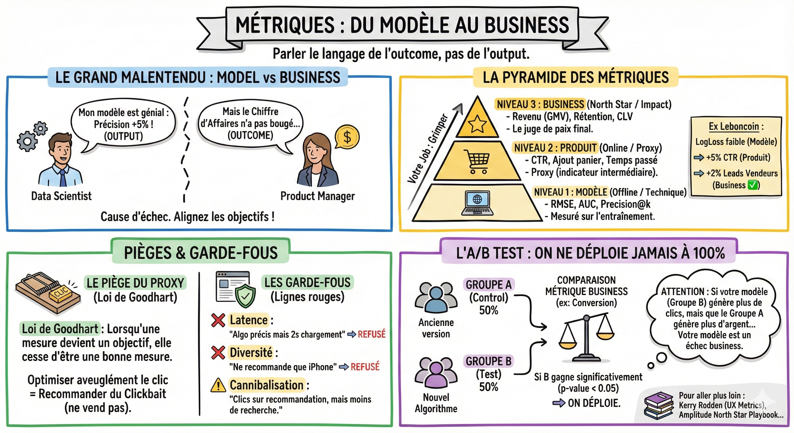

# 📊 Métriques

## Objectif

Savoir distinguer les métriques modèle, produit et business, et comprendre comment mesurer le vrai impact de vos algorithmes.

## Le grand malentendu : model vs business

C'est une cause fréquente d'échec des projets data.

- Le data scientist dit : "Mon modèle est génial, j'ai amélioré la précision de 5% !"  
- Le PM répond : "Le chiffre d'affaires n'a pas bougé."

Pour réussir, vous devez parler le langage de l'outcome (résultat), pas de l'output (performance du modèle).

## La pyramide des métriques

Il faut voir les métriques comme une échelle. Votre job est de grimper les échelons.

- Niveau 1 : Métriques modèle (offline / technique)  
  - Ce que c'est : Mesuré sur votre ordinateur pendant l'entraînement (Test Set).  
  - Exemples : RMSE, AUC, Precision@k, Recall.  
  - Utilité : Savoir si l'algorithme apprend.  
  - Limite : Un modèle parfait sur le passé peut être nul dans le futur.  
- Niveau 2 : Métriques produit (online / proxy)  
  - Ce que c'est : Mesuré en production sur le comportement immédiat de l'utilisateur.  
  - Exemples : Taux de Clic (CTR), Taux d'ajout au panier, Temps passé.  
  - Utilité : C'est un Proxy (un indicateur intermédiaire) pour savoir si la feature intéresse les gens.  
- Niveau 3 : Métriques business (north star / impact)  
  - Ce que c'est : Ce qui paye vos salaires.  
  - Exemples : Revenu (GMV), Rétention (L'utilisateur revient-il le mois prochain ?), Customer Lifetime Value (CLV).  
  - Utilité : C'est le juge de paix final.

L'application Leboncoin :

- Model : Mon algo prédit bien les clics passés (LogLoss faible).  
- Produit : Les gens cliquent plus sur la home page (+5% CTR).  
- Business : Les gens envoient plus de messages aux vendeurs (+2% Leads). C'est ça qu'on veut.

## Le piège du proxy et la loi de Goodhart  
Pourquoi ne pas mesurer directement le Business ? Parce que c'est long et bruité (il faut attendre des mois pour mesurer la rétention). On utilise donc un proxy (le clic) en supposant que clic = intérêt.

**Attention risque :** Si vous optimisez aveuglément le clic, vous allez recommander des titres clickbait ou des objets bizarres qui attirent l'œil mais ne se vendent pas.

**Loi de Goodhart :** Lorsqu'une mesure devient un objectif, elle cesse d'être une bonne mesure.

## Les garde-fous

Pour éviter de casser le site en optimisant votre algo, vous devez définir des métriques de protection. Ce sont les lignes rouges à ne pas franchir.

- Latence : "L'algo est super précis mais il met 2 secondes à charger." ➡️ Refusé.  
- Diversité : "L'algo ne recommande que des iPhone car c'est populaire." ➡️ Refusé (Il faut aussi montrer des canapés).  
- Cannibalisation : "Les gens cliquent sur la recommandation, mais du coup ils n'utilisent plus la barre de recherche." ➡️ Est-ce ce qu'on veut ?

## L'A/B test

En data product, on ne déploie jamais à 100% du jour au lendemain. On fait une expérience contrôlée.

- Groupe A (Control) : 50% des utilisateurs voient l'ancienne version (ou rien).  
- Groupe B (Test) : 50% des utilisateurs voient votre nouvel algorithme.

On compare la métrique Business (ex: conversion) entre A et B.  
Si le Groupe B gagne de manière statistiquement significative (p-value < 0.05), alors on déploie. Sinon, on jette (ou on itère).

**Exercice mental :** Si votre modèle (Groupe B) génère plus de clics, mais que le Groupe A (sans modèle) génère plus d'argent... Votre modèle est un échec business, même s'il est techniquement brillant.

## Ce qu'il faut retenir

- Parlez le langage de l'**outcome** (résultat business), pas de l'**output** (performance du modèle).
- Les métriques forment une pyramide : modèle (offline) < produit (online/proxy) < business (north star).
- **Loi de Goodhart** : lorsqu'une mesure devient un objectif, elle cesse d'être une bonne mesure. Définissez des **garde-fous**.
- L'**A/B test** est la méthode standard pour valider un impact : si le groupe B (votre algo) ne bat pas le groupe A de manière statistiquement significative, on itère ou on jette.

## Pour aller plus loin

- [Kerry Rodden, How to choose the right UX metrics for your product](https://library.gv.com/how-to-choose-the-right-ux-metrics-for-your-product-5f46359ab5be) — guide pour choisir les bonnes métriques UX
- [Amplitude, North Star Playbook](https://amplitude.com/books/north-star/amplitudes-north-star-metric-and-inputs) — comment définir et utiliser une North Star Metric
- [Ronny Kohavi, Trustworthy Online Controlled Experiments](https://experimentguide.com/) — la référence sur l'A/B testing par l'ancien VP de Microsoft
