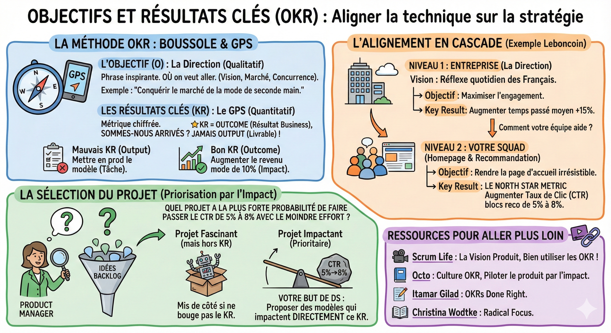

# Objectifs et résultats clés (OKR)

Vous arrivez dans l'équipe et vous voyez une liste de 10 idées de modèles possibles (recommandation par prix, par géolocalisation, par historique...). Pourquoi travaille-t-on sur le projet A et pas le B ?

Le product manager est responsable de cette priorisation. Mais en tant que data scientist, comprendre la logique derrière cette décision est ce qui fera de vous un partenaire stratégique et non un simple exécutant.

**La méthode OKR (Objectives & Key Results)**  
Les entreprises matures (comme Google, Amazon, Spotify) n'avancent pas au hasard. Elles utilisent les OKR pour aligner tout le monde, du PDG au stagiaire.

L'objectif (O) : La direction (qualitatif)  
C'est une phrase inspirante qui dit OÙ on veut aller. Elle découle de la vision de l'entreprise, de l'analyse du marché et de la concurrence.

*Exemple : "Conquérir le marché de la mode de seconde main."*

Les résultats clés (KR) : Le GPS (quantitatif)  
C'est une métrique chiffrée qui nous dit si on est arrivé.  
Règle d'or : Un KR est un Outcome (résultat business), jamais un Output (livrable).

*Mauvais KR : "Mettre en prod le nouveau modèle" (C'est une tâche).*  
*Bon KR : "Augmenter le revenu mode de 10%" (C'est un impact).*

**L'alignement en cascade (exemple Leboncoin)**  
Comment cela descend-il jusqu'à votre clavier ?

Niveau 1 : Entreprise (La direction)

- Vision : Devenir le réflexe quotidien des Français.  
- Objective : Maximiser l'engagement des utilisateurs.  
- Key Result : Augmenter le temps passé moyen par jour de +15%.

Votre équipe se demande : "Comment peut-on aider à atteindre ces +15% ?"

Niveau 2 : Votre squad (Homepage & Recommandation)

- Objective : Rendre la page d'accueil irrésistible et pertinente.  
- Key Result : Augmenter le Taux de Clic (CTR) sur les blocs de recommandation de 5% à 8%.

**La sélection du projet**  
C'est là que le Product Manager (avec votre aide) priorise.  
Il regarde le backlog d'idées et se pose une seule question :

*Quel projet a la plus forte probabilité de faire passer le CTR de 5% à 8% avec le moindre effort ?*

C'est pour cela que parfois, un projet techniquement fascinant est mis de côté : s'il ne bouge pas le KR, il n'est pas prioritaire.

En tant que Data Scientist, votre but est de proposer des modèles qui impactent directement ce KR.

**Scrum Life**  
[La Vision Produit](https://youtu.be/5gOxSjWiVPc?si=FYZw4mkQlPy_NxeZ)  
[Bien utiliser les OKR ! Objective Key Results selon "Radical Focus" de Christina Wodtke](https://youtu.be/cJ3nALTiMdU?si=uZzh07ynrWV6HTGg)

**Pour aller plus loin**  
[Octo, Culture OKR](https://publication.octo.com/culture-okr)  
[Octo, Piloter le produit par l'impact](https://publication.octo.com/fr/piloter-produit-impact-okr)  
[Itamar Gilad, OKRs Done Right](https://itamargilad.com/ebook-okr/)
