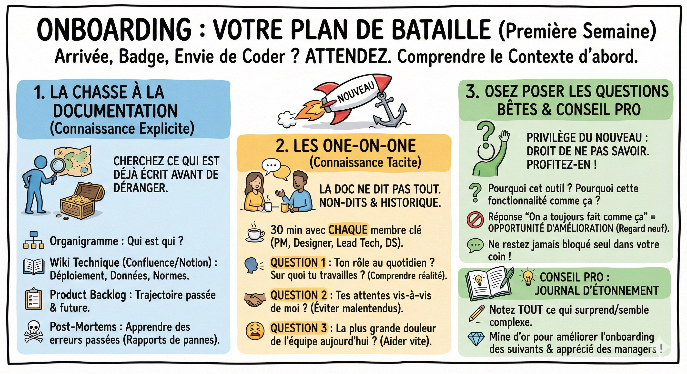

# 🚪 Onboarding

## Objectif

Savoir structurer votre première semaine en entreprise pour comprendre le contexte avant de coder.

Vous venez d'arriver, votre badge fonctionne à peine, et vous avez envie de coder tout de suite. Attendez.

Les erreurs de débutant viennent souvent d'une mauvaise compréhension du contexte ("Pourquoi on fait ça comme ça ?").

Voici votre plan de bataille pour la première semaine.

## La chasse à la documentation (connaissance explicite)

Avant de déranger tout le monde, cherchez ce qui est déjà écrit.

- L'organigramme : Qui est qui ?  
- Le wiki technique (Confluence/Notion) : Comment on déploie ? Où sont les données ? Quelles sont les normes de code ?  
- Le product backlog : Regardez les tickets passés et futurs pour comprendre la trajectoire de l'équipe.  
- Les post-mortems : Lisez les rapports des pannes précédentes. On apprend énormément des erreurs passées de l'entreprise.

## Les one-on-one (connaissance tacite)

La documentation ne dit pas tout. Il y a beaucoup de non-dits et de contextes historiques.  
Prenez 30 minutes avec chaque membre clé de votre squad (PM, Designer, Lead Tech, autres DS) pour poser ces 3 questions :

1. Quel est ton rôle au quotidien et sur quoi travailles-tu en ce moment ? (Pour comprendre leur réalité).  
2. Quelles sont tes attentes vis-à-vis de moi ? (Pour éviter les malentendus).  
3. Quelle est la plus grande douleur de l'équipe aujourd'hui ? (Pour identifier où vous pourrez aider vite).

## Osez poser les questions bêtes

C'est le privilège du nouveau : vous avez le droit de ne pas savoir pendant quelques semaines. Profitez-en !

- Pourquoi utilise-t-on cet outil et pas un autre ?  
- Pourquoi cette fonctionnalité marche comme ça ?

Souvent, la réponse "On a toujours fait comme ça" cache une opportunité d'amélioration que votre regard neuf peut déceler. Ne restez jamais bloqué seul dans votre coin par peur de déranger.

**💡 Conseil Pro :** Tenez un journal d'étonnement. Notez tout ce qui vous surprend ou vous semble complexe. C'est une mine d'or pour améliorer l'onboarding des suivants (et c'est très apprécié par les managers).

## Ce qu'il faut retenir

- Avant de coder, passez votre première semaine à comprendre le contexte (documentation, one-on-one, questions).
- Les **post-mortems** et le **product backlog** sont les meilleurs documents pour comprendre la trajectoire de l'équipe.
- Posez les questions "bêtes" tant que vous êtes nouveau : ce privilège ne dure que quelques semaines.
- Un **journal d'étonnement** est un outil simple mais très apprécié par les managers.

## Pour aller plus loin

- [Michael D. Watkins, The First 90 Days](https://hbr.org/books/watkins) — stratégies pour réussir sa prise de poste dans une nouvelle organisation
- [Laszlo Bock, Work Rules!](https://www.workrules.net/) — les pratiques RH de Google, y compris l'onboarding
- [GitLab Handbook](https://handbook.gitlab.com/) — exemple concret de documentation exhaustive dans une entreprise full-remote
