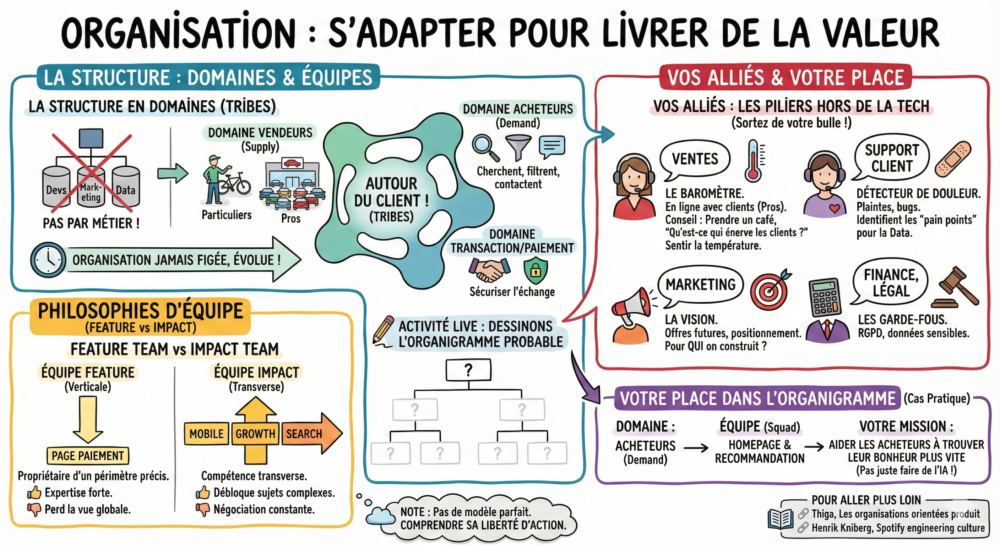

# 🏢 Organisation

## Objectif

Comprendre comment une entreprise tech s'organise en domaines et en équipes, et identifier votre place dans cet écosystème.

## La structure en domaines

Une entreprise tech comme Leboncoin ne s'organise pas par métier (tous les devs ensemble, tous les marketeux ensemble), mais autour du client. C'est ce qu'on appelle souvent des **tribes** ou des **domaines**.

L'organisation n'est jamais figée, elle évolue constamment pour s'adapter à la stratégie.

Exemple d'organisation possible chez Leboncoin :

- Domaine vendeurs (supply) :  
  - Sous-groupe particuliers : "Je vends mon vieux vélo".  
  - Sous-groupe pros : "Je suis un concessionnaire qui vend 50 voitures/mois" (besoins très différents !).  
- Domaine acheteurs (demand) :  
  - Ceux qui cherchent, filtrent, contactent.  
- Domaine Transaction/Paiement :  
  - Sécuriser l'échange.

**✍️ Exercice :** Essayez de dessiner l'organigramme probable de Leboncoin pour situer votre équipe.

## Feature team vs impact team

En naviguant dans l'entreprise, vous croiserez deux philosophies d'équipe :

- L'équipe feature (verticale) :  
  - Elle est propriétaire d'un périmètre fonctionnel précis (ex: "La page de paiement").  
  - Avantage : Expertise forte sur son sujet.  
  - Inconvénient : Peut perdre de vue l'expérience globale.

- L'équipe impact (transverse) :  
  - Elle a une compétence transverse qui lui permet d'intervenir partout (ex: "l'équipe mobile" ou une "growth team"). Elle n'est pas limitée à une page du site.  
  * Avantage : Peut débloquer des sujets complexes.  
  * Inconvénient : Doit sans cesse négocier avec les autres équipes pour toucher à leur code.

**Note :** Il n'y a pas de modèle parfait. L'important est de savoir dans quel type d'équipe vous êtes pour comprendre votre liberté d'action.

## Vos alliés : les piliers hors de la Tech

En tant que data scientist, votre réflexe est de rester avec les développeurs. Erreur. Pour comprendre le produit, vous devez parler à ceux qui sont au front.

- Les ventes (sales) : Le baromètre  
  - Ils sont en ligne toute la journée avec les clients (surtout les Pros).  
  - Conseil : Allez à l'étage des commerciaux prendre un café. Demandez : "Qu'est-ce qui énerve les clients en ce moment ?". C'est la meilleure façon de sentir la température réelle du business (bien plus vite que d'analyser des logs).

- Le support client (care) : Le détecteur de douleur  
  - Ils reçoivent les plaintes, les bugs, les incompréhensions.  
  - Si une feature est mal conçue, c'est eux qui souffrent. Ils sont une mine d'or pour identifier les "pain points" à résoudre avec la Data.

- Le marketing : La vision  
  - Ils définissent les offres futures et le positionnement. Ils vous aident à comprendre pour qui vous construisez le modèle.

- Finance, légal : Les garde-fous  
  * Indispensables si vous touchez à des données sensibles (RGPD) ou des produits internes.

## Votre place dans l'organigramme

Revenons au cas pratique Leboncoin. Où êtes-vous ?

- Domaine : Acheteurs (demand).  
- Équipe (squad) : Homepage & Recommandation.  
- Votre mission : Vous n'êtes pas là pour faire de l'IA, vous êtes là pour aider les acheteurs à trouver leur bonheur plus vite dès l'ouverture de l'app.

## Ce qu'il faut retenir

- Les entreprises tech s'organisent autour du client (domaines), pas autour des métiers.
- Savoir si vous êtes dans une **feature team** ou une **impact team** détermine votre liberté d'action.
- Vos meilleurs alliés pour comprendre le produit sont hors de la Tech : les ventes, le support client et le marketing.

## Pour aller plus loin

- [Thiga, Les organisations orientées produit](https://www.thiga.co/fr/nos-ressources/livre-organisations-produit) — livre blanc sur les modèles d'organisation produit
- [Henrik Kniberg, Spotify engineering culture - Part 1](https://engineering.atspotify.com/2014/03/spotify-engineering-culture-part-1) — la culture d'ingénierie chez Spotify, partie 1
- [Henrik Kniberg, Spotify engineering culture - Part 2](https://engineering.atspotify.com/2014/9/spotify-engineering-culture-part-2) — la suite sur les squads, tribes et guildes
