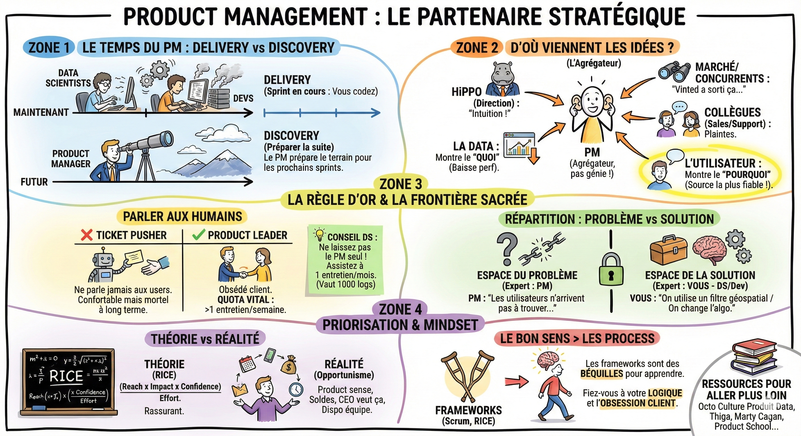

# 💼 Product management

## Objectif

Comprendre le rôle du product manager au quotidien, ses sources d'idées, et comment la priorisation fonctionne en pratique.

## Que fait le PM pendant le sprint ?

Pendant que vous, data scientists et développeurs, êtes concentrés sur le code du sprint en cours (le **delivery**), le product manager, lui, doit se projeter dans le futur.  
Son rôle est de préparer le terrain pour les sprints suivants. C'est ce qu'on appelle le discovery.

## D'où viennent les idées ?

On pense souvent que le PM est un génie créatif qui a des illuminations sous sa douche. Faux.  
Le PM est un agrégateur. Il collecte des signaux de partout :

- **HiPPO** (Highest Paid Person's Opinion) : La direction a une intuition ("Il nous faut de l'IA partout !").  
- Le marché et concurrents : "Vinted a sorti cette feature, on est en retard."  
- Les collègues : Les commerciaux et le support client qui remontent les plaintes.  
- La data : Les tableaux de bord qui montrent une baisse de performance.  
- L'utilisateur : La source la plus fiable, mais paradoxalement la moins écoutée.

## La règle d'or : parler aux humains

Il existe deux types de PM (et par extension, d'équipes produit) :

- ❌ Le ticket pusher : Il prend les demandes de son chef, rédige les specs, et vous les donne. Il ne parle jamais aux utilisateurs. Il livre des fonctionnalités, mais crée peu de valeur. C'est confortable à court terme, mais mortel à long terme.  
- ✅ Le product leader : Il est obsédé par le client.  
  - Le quota vital : Au moins 1 entretien utilisateur par semaine. C'est le minimum syndical.  
  - Pourquoi ? La data vous dit ce qui se passe (le "quoi"). L'entretien vous dit pourquoi ça se passe.

**Conseil pour data scientist :** Ne laissez pas le PM faire ça tout seul. Demandez à assister à un entretien par mois. Entendre un utilisateur galérer sur le site vaut 1000 lignes de logs.

## La répartition des rôles : problème vs solution

C'est la frontière la plus importante à respecter dans une squad équilibrée.

- Le PM est l'expert du PROBLÈME.  
  - Il identifie le besoin ("Les utilisateurs n'arrivent pas à trouver des objets proches de chez eux").  
- L'équipe (vous) est l'experte de la SOLUTION.  
  - Vous identifiez la meilleure réponse technique ("On va utiliser un filtre géospatial" ou "On va changer l'algo de tri").

**Exemple :** Si le PM arrive en disant "codez-moi un réseau de neurones" (solution), il fait votre travail. S'il arrive en disant "Les utilisateurs ne cliquent pas" (problème), il fait le sien.  
## La priorisation : théorie vs réalité

Le PM a 50 idées dans son sac, mais vous ne pouvez en développer que 3. Comment choisir ?

La théorie (RICE)  
Les personnes les plus structurées adorent les matrices mathématiques pour rassurer et communiquer. La plus connue est le score RICE :

- Reach (Combien de gens touchés ?)  
- Impact (Quel effet sur le business ?)  
- Confidence (Est-on sûr de nous ?)  
- Effort (Combien de temps ça prend ?)  
- Score = (R x I x C) / E

La réalité (L'opportunisme stratégique)  
Dans la vraie vie, on sort rarement la calculatrice. La priorisation se fait souvent au product sense et à l'opportunité :

- "Il y a les soldes le mois prochain, il faut sortir ça maintenant."  
- "Le CEO veut absolument ça pour la conférence annuelle."  
- "L'équipe Data est dispo cette semaine, profitons-en pour faire ce projet technique."

## Le bon sens > les process

Avec l'expérience, vous verrez que les meilleurs product managers et data scientists ne sont pas ceux qui appliquent les méthodes by the book.  
Ce sont ceux qui font preuve de pragmatisme.

- Inutile de faire une priorisation RICE complexe pour un bug évident.  
- Inutile de faire 20 entretiens pour valider que le site est lent.

Les frameworks (Scrum, RICE, etc.) sont des béquilles pour apprendre. Une fois que vous savez marcher, fiez-vous à votre logique et à votre obsession de la valeur client.

## Ce qu'il faut retenir

- Le PM est un **agrégateur** de signaux, pas un génie créatif : il collecte les besoins de la direction, du marché, des collègues, de la data et des utilisateurs.
- Le PM est l'expert du **problème**, l'équipe est l'experte de la **solution** : si le PM vous dit "codez un réseau de neurones", il fait votre travail.
- La priorisation **RICE** (Reach, Impact, Confidence, Effort) est un outil utile, mais en pratique le bon sens et l'opportunisme stratégique comptent tout autant.
- Demandez à assister à au moins un entretien utilisateur par mois : entendre un utilisateur galérer vaut 1000 lignes de logs.

## Pour aller plus loin

- [Scrum Life, Data-Driven : piloté par la mesure](https://youtu.be/2aTfQNSHPy0?si=YW5uuwA0O92vR8mc) — construire une culture de la mesure pour éviter les HiPPO
- [Octo, Culture Produit](https://publication.octo.com/fr/fr/telechargement-livre-blanc-culture-produit) — livre blanc sur la culture produit en entreprise
- [Octo, Culture Produit Data](https://publication.octo.com/culture-produit-data) — guide sur les produits data
- [Thiga, Les Clés du Product Management](https://www.thiga.co/fr/nos-ressources/livre-cles-product-management) — guide complet du product management
- [Thiga, Les produits data science](https://f.hubspotusercontent30.net/hubfs/6380433/FR_Product%20Academy%20and%20public%20assets/Product%20Academy%20-%20Produits%20Data%20Science.pdf) — spécificités des produits data science
- [Sachin Rekhi, The Art of Product Management](https://youtu.be/huTSPanUlQM?si=qNMkS0YlGT3Lpphn) — conférence sur l'art du product management
- [Shreyas Doshi, The Art of Product Management](https://youtu.be/YP_QghPLG-8?si=CKQOqcwKENLH3_2R) — vision stratégique du rôle de PM
- [Carl Shan, The Product Manager Handbook](https://producthq.org/wp-content/uploads/2020/05/PMHQ-Product-Manager-Handbook.pdf) — guide pratique pour les PM
- [Product School, The Product Book](https://productschool.com/resources/ebooks/the-product-book) — ebook gratuit d'introduction au product management
- [Intercom, Product Management](https://www.intercom.com/resources/books/intercom-product-management) — guide Intercom sur le product management
- [Jeff Gothelf, Lean, Agile, & Design Thinking](https://youtu.be/MesYt7PhLFQ?si=NdE_VH8kKnPDpBTd) — comment combiner les trois approches
- [Jonny Schneider, Understanding Design Thinking, Lean, and Agile](https://pges.org.pa/wp-content/uploads/UDTLA-July-2017.pdf) — comparaison des trois méthodologies
