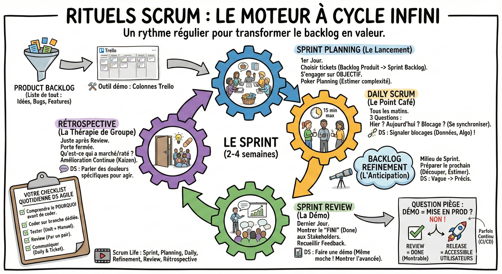

# Rituels

**Le moteur scrum : Un cycle infini**  
Imaginez le Scrum comme un moteur à 4 temps qui tourne toutes les 2 semaines.  
Tout part du product backlog : la liste de tout ce qu'on voudrait faire un jour (bugs, features, idées).

**🛠 Outil démo :** Regardons ensemble [notre backlog Trello](https://trello.com/invite/b/69555f5b6de2878638d926fc/ATTIdf5520730c9a690fc9f12a6ba1e43a62BED0C9A6/backlog-squad-homepage). Vous voyez ces colonnes ?

**Le sprint planning : Le lancement**

- Quand ? Le premier jour du Sprint.  
- Quoi ? On choisit les tickets du backlog produit qu'on va mettre dans le backlog de sprint (notre panier pour 2 semaines).  
- Le but : S'engager sur un objectif de sprint.  
- La pratique : On estime la complexité (poker planning).  
  * *Exemple Leboncoin : Est-ce que "Nettoyer les logs de 2024" vaut 3 points ou 8 points de complexité ?*  
- Votre rôle de DS : Lever la main si un ticket est irréaliste (*"Non, entraîner ce modèle prendra 5 jours, pas 2 heures"*).

**Le daily scrum : Le point café**

- Quand ? Tous les matins à la même heure (15 min max).  
- Quoi ? 3 questions :  
  1. Qu'ai-je fait hier ?  
  2. Que vais-je faire aujourd'hui ?  
  3. Ai-je un blocage ?  
- Le but : Se synchroniser, pas se fliquer. Si vous êtes bloqué, c'est le moment de demander de l'aide.  
- Votre rôle de DS : Dire si vos données sont corrompues ou si votre algo ne converge pas. Ne restez pas bloqué seul !

**Le backlog refinement : L'anticipation**  
Ce n'est pas un rituel officiel Scrum, mais tout le monde le fait.

- Quand ? Au milieu du sprint en cours.  
- Quoi ? On regarde les tickets du prochain sprint. On les découpe, on les estime.  
- Le but : Éviter d'arriver au Planning du lundi suivant sans savoir quoi faire.  
- Votre rôle de DS : C'est crucial. C'est là que vous transformez une idée vague du PM ("Faire de l'IA") en tâches techniques précises ("Créer un script de feature engineering").

**La sprint review : La démo**

- Quand ? Le dernier jour du sprint.  
- Quoi ? On montre ce qu'on a fait aux parties prenantes (Business, Ventes, Marketing).  
- Le but : Recueillir du feedback. "Ah, je pensais que le bouton serait bleu", "Ah, la recommandation me propose des trucs bizarres".  
- Votre rôle de DS : Faire une démo, même si c'est moche. Montrez un graphique, un tableau de résultats, ou l'appli qui tourne. Prouvez que vous avez avancé.

**La rétrospective : La thérapie de groupe**

- Quand ? Juste après la review.  
- Quoi ? On ferme la porte (que l'équipe). On discute de ce qui a marché ou raté.  
- Le but : L'amélioration continue (Kaizen).  
- Votre rôle de DS : Parler des douleurs spécifiques (*"J'ai perdu 3 jours car je n'avais pas accès au serveur"*). On en fait une action pour que ça ne se reproduise plus.

**La question piège : Démo = Mise en prod ?**  
Non.

- Sprint review : On montre que c'est "Fini" (Done) selon nos critères.  
- Release (déploiement) : On rend la fonctionnalité accessible aux vrais utilisateurs.  
  Parfois, on déploie à chaque fin de sprint. Parfois, on attend d'avoir cumulé 3 sprints pour avoir une fonctionnalité complète.

**Note :** Dans certaines organisations, on déploie en continu (CI/CD), plusieurs fois par jour.

**Votre checklist quotidienne de data scientist agile**

1. Comprendre le ticket avant de coder (le "pourquoi").  
2. Coder sur une branche dédiée.  
3. Tester (unit tests + test manuel).  
4. Review (faire relire son code par un pair).  
5. Communiquer (au daily et sur le ticket).

**Scrum Life**  
[Sprint : le cycle principal de Scrum](https://youtu.be/XWbIaqqTPDU?si=l9dWuHVkYMwEEsFV)  
[Sprint Planning Meeting - Des astuces pour un planning plus efficace](https://youtu.be/Ix2qM0QI4pQ?si=p_KfQ63AwK14G_Vw)  
[C'est quoi le Daily / Stand Up ? (Scrum)](https://youtu.be/qndfgBkUars?si=B0NKV3A9EdteRNJw)  
[Avoir des US vraiment Ready grâce à l'Example Mapping - Scrum Life 18](https://youtu.be/gID0boETxJQ?si=RzLFlEXeDFdrP0aN)  
[Sprint Review  🛠️🔥: C'est l'événement SCRUM qu'on préfère ? On vous explique TOUT EN DETAILS !](https://youtu.be/RXFUTSVnDC4?si=xYfPspVoSjYMZAqv)  
[La Rétrospective - Scrum Life 6](https://youtu.be/uGxc3xeW3q0?si=94XMjmyKiVYbMwuz)
