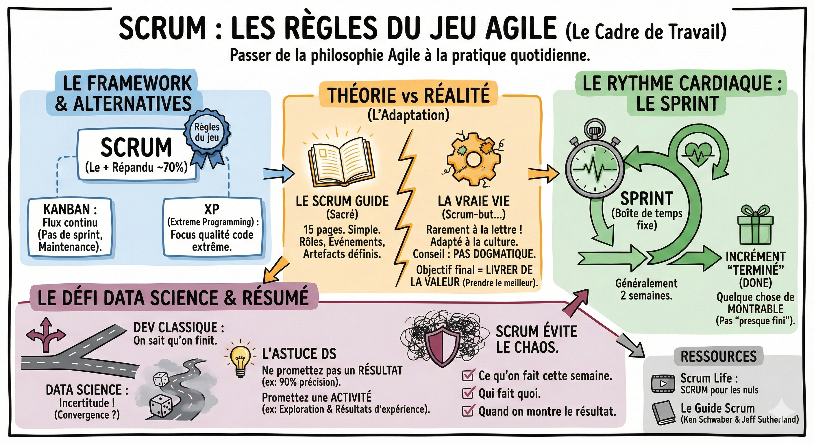
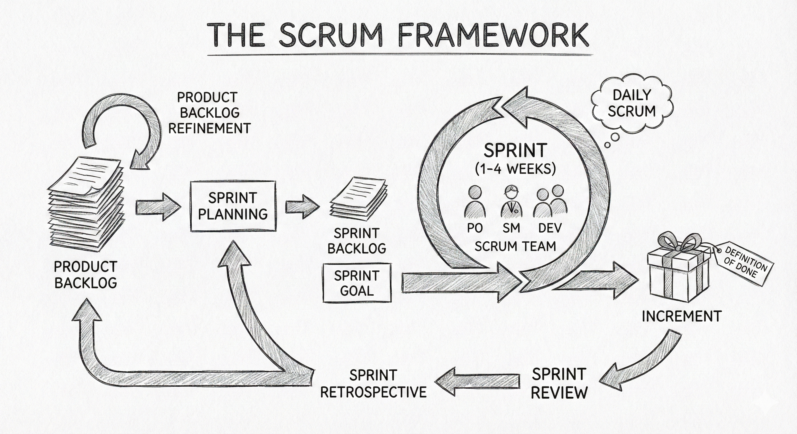

# Scrum

**Le cadre de travail (framework)**  
Nous avons choisi d'être Agile. Mais "être Agile" est une philosophie. Pour l'appliquer au quotidien, il faut des règles du jeu. C'est là qu'intervient Scrum.

C'est la méthode la plus répandue dans la Tech (utilisée par ~70% des équipes).

Cependant, sachez qu'il en existe d'autres :

- Kanban : Pas de sprint, juste un flux continu de tâches (très utilisé par les équipes de maintenance ou de support).  
- XP (Extreme Programming) : Focus extrême sur la qualité du code.

**La théorie vs la réalité**  
Si vous voulez comprendre la théorie pure, il existe un document sacré : le Scrum Guide.

- Le contenu : 15 pages seulement. C'est simple, concis.  
- Le principe : Des rôles, des événements (rituels) et des artefacts définis pour créer de la valeur de manière itérative.

![][image4]

**⚠️ Remarque**  
J'ai rarement vu une entreprise appliquer le Scrum à la lettre.  
Chaque organisation adapte la méthode à sa culture. Vous verrez souvent des hybrides (du Scrum-but → "On fait du Scrum, mais on garde des deadlines fixes de 6 mois...").  
Mon conseil : Ne soyez pas dogmatique. L'objectif n'est pas de faire du bon Scrum, l'objectif est de livrer de la valeur. Prenez le meilleur du framework, adaptez le reste.

**Le rythme cardiaque : Le sprint**  
Dans Scrum, le temps est découpé en boîtes de temps fixes appelées Sprints.

- Durée : Généralement 2 semaines (parfois 3 ou 4).  
- Le but : À la fin du sprint, on doit avoir un incrément de produit "Terminé" (Done). Pas un "truc presque fini", mais quelque chose de montrable.

**Le défi pour le data scientist**  
En développement logiciel classique, on sait qu'on peut finir une page web en 2 semaines.  
En data science, on ne sait pas si le modèle va converger.  
L'astuce : Ne promettez pas un résultat ("Le modèle aura 90% de précision"), promettez une activité ("Je vais explorer cet algorithme et livrer les résultats de l'expérience").

**En résumé**  
Scrum est le rythme de l'équipe.  
C'est ce qui évite le chaos et permet à tout le monde de savoir :

1. Ce qu'on fait cette semaine.  
2. Qui fait quoi.  
3. Quand est-ce qu'on montre le résultat.

**Scrum Life**  
[SCRUM pour les nuls](https://youtu.be/kZx_vrMZxGk?si=ekqBAKC_uTvIFZR7)

**Pour aller plus loin**  
[Ken Schwaber & Jeff Sutherland, Le Guide Scrum](https://scrumguides.org/docs/scrumguide/v2020/2020-Scrum-Guide-French.pdf)
