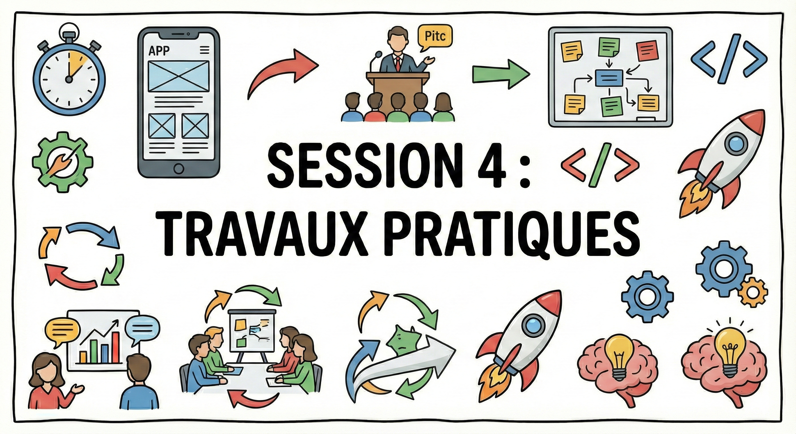
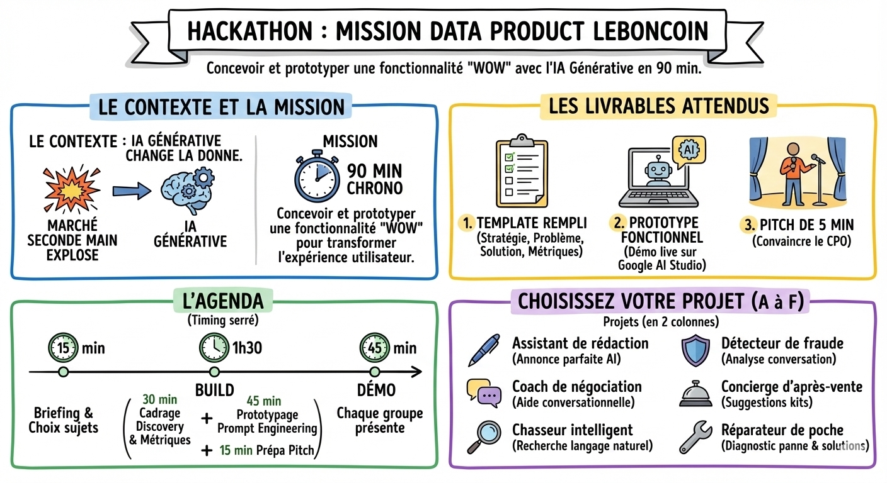

# 📙 Travaux Pratiques

Ce TP vous met dans la peau d'une **squad data product** chez Leboncoin. Le marché de la seconde main explose, mais l'**IA Générative** change la donne. Votre mission : concevoir et prototyper une fonctionnalité "wow" basée sur l'IA pour transformer l'expérience utilisateur.

Mon conseil : c'est un exercice très proche de ce que vous ferez en entreprise. Prenez-le au sérieux, et surtout amusez-vous.

## Programme

**Les livrables attendus :**

1. Le template rempli : votre stratégie (problème, solution, métriques).
2. Un prototype fonctionnel : une démo sur Google AI Studio montrant que votre system prompt fonctionne sur des exemples réels.
3. Un pitch de 5 min : pour convaincre le CPO de lancer le développement.

**L'agenda recommandé :**

- 15 min : briefing et choix des sujets.
- 1h30 : build.
    - 30 min : cadrage (discovery et métriques).
    - 45 min : prototypage (prompt engineering).
    - 15 min : préparation du pitch.
- 45 min : démo. Chaque groupe présente.

Consultez la [checklist détaillée](todo.md) pour suivre les étapes pas à pas, puis utilisez le [canvas](canvas.md) comme template de travail.

**Choisissez votre projet :**

Projet A : L'assistant de rédaction

- La douleur : vendre c'est embêtant. Il faut écrire un titre, une description, choisir la catégorie…
- Le défi : l'utilisateur uploade une photo (ou 3 mots clés) → l'IA génère l'annonce parfaite, optimisée pour le SEO, avec un ton vendeur et chaleureux.

Projet B : Le coach de négociation

- La douleur : les acheteurs ont peur de négocier. Les vendeurs détestent les offres ridicules.
- Le défi : un assistant conversationnel qui aide l'acheteur à formuler une offre polie mais ferme, ou aide le vendeur à refuser sans perdre le client.

Projet C : Le chasseur intelligent

- La douleur : les filtres classiques (prix, ville) sont trop rigides. "Je cherche un appart lumineux avec du charme" ne marche pas.
- Le défi : transformer une requête en langage naturel ("Je veux meubler mon studio ambiance industrielle pour 200 €") en une liste de critères de recherche structurés.

Projet D : Le détecteur de fraude contextuel

- La douleur : les arnaques deviennent sophistiquées.
- Le défi : analyser une conversation entre acheteur et vendeur pour détecter des signaux faibles de fraude (changement de ton, demande de PayPal, pression psychologique) et alerter l'utilisateur avec pédagogie.

Projet E : Le concierge d'après-vente

- La douleur : j'ai acheté une guitare d'occasion, mais je ne peux pas en jouer car je n'ai ni médiator, ni ampli, ni prof. Je dois refaire 3 recherches manuelles.
- Le défi : une fois la transaction principale conclue, l'IA analyse l'objet acheté et suggère proactivement un "Kit de survie" composé d'autres annonces pertinentes (accessoires ou services) en expliquant pourquoi (ex : "Pour cette guitare électrique, il vous manque un câble Jack, voici 3 annonces à moins de 5 km").

Projet F : Le réparateur de poche

- La douleur : mon lave-vaisselle fait un bruit bizarre ou affiche un code erreur. Je m'apprête à le jeter pour en acheter un autre sur Leboncoin.
- Le défi : l'utilisateur envoie une photo du panneau de contrôle (ou décrit le problème). L'IA diagnostique la panne probable et propose deux chemins :
    - "Voici la pièce détachée à acheter sur Leboncoin pour le réparer."
    - "C'est trop complexe ? Voici 3 réparateurs professionnels disponibles près de chez vous."

## Ressources

- [Infographies du cours](https://docs.google.com/presentation/d/1ZzQGKv-WX_eHPan94VOTu3VMChlisap8jiH-4BM5zVw/edit?slide=id.g3b50f16f7bf_1_206#slide=id.g3b50f16f7bf_1_206) — toutes les infographies de la session en un seul document
- [Google AI Studio](https://aistudio.google.com/) — la plateforme pour construire et tester votre prototype
- [NotebookLM](https://notebooklm.google.com/) — outil Google pour générer un pitch deck à partir de vos notes
