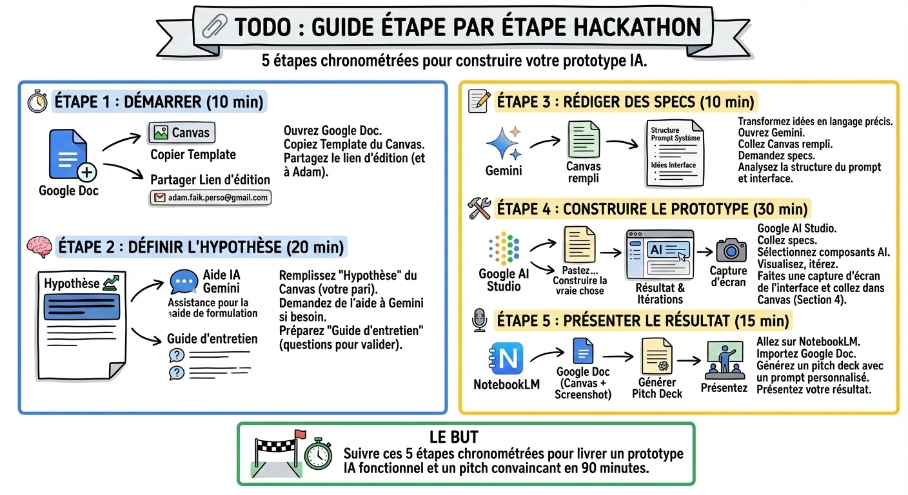

# ✅ Checklist du TP

## Objectif

Suivre pas à pas les étapes du travail pratique, du cadrage initial jusqu'au pitch final, sans rien oublier.

Mon conseil : cochez chaque case au fur et à mesure. J'ai conçu cette checklist pour que vous puissiez avancer en autonomie, même si vous êtes bloqués sur une étape. Si vous séchez, passez à la suivante et revenez-y après.

## Étape 1 : Démarrer (10 min)

- [ ] Ouvrez un nouveau Google Doc.
- [ ] Copiez le template. Allez sur la page [Canvas](canvas.md) de ce guide, copiez tout le texte du template, et collez-le dans votre Google Doc.
- [ ] Partagez le lien d'édition avec tous les membres du groupe.

## Étape 2 : Définir l'hypothèse (20 min)

- [ ] Remplissez la section "Hypothèse" du Canvas : définissez clairement votre pari sur le comportement utilisateur.
- [ ] Aide IA : si vous séchez sur la formulation, demandez à [Gemini](https://gemini.google.com/) de vous aider à reformuler votre hypothèse.
- [ ] Remplissez la section "Guide d'entretien". Préparez vos questions pour valider votre hypothèse auprès d'un testeur.

## Étape 3 : Rédiger des specs (10 min)

Transformez vos idées en langage précis pour l'IA. Les **specs** (spécifications) décrivent exactement ce que votre prototype doit faire.

- [ ] Ouvrez [Gemini](https://gemini.google.com/).
- [ ] Copiez votre Canvas rempli et demandez à Gemini de vous aider à rédiger des specs techniques pour votre system prompt.
- [ ] Analysez la réponse : Gemini va vous donner la structure du prompt système et des idées pour l'interface. Gardez ça sous le coude.

## Étape 4 : Construire le prototype (30 min)

C'est le moment de construire "la vraie chose" dans **Google AI Studio** (la plateforme de Google pour prototyper des applications IA).

- [ ] Connectez-vous à [Google AI Studio](https://aistudio.google.com/).
- [ ] Copiez-collez les specs de l'étape 3. Sélectionnez les composants IA dont vous avez besoin.
- [ ] Visualisez le résultat et réalisez des itérations. Mon conseil : testez avec des cas réels, pas des exemples inventés.
- [ ] Faites une capture d'écran de votre interface augmentée par l'IA et collez-la dans votre Canvas (section "Le prototype").

## Étape 5 : Préparer le pitch (15 min)

- [ ] Allez sur [NotebookLM](https://notebooklm.google.com/), un outil Google qui génère des présentations à partir de vos notes.
- [ ] Importez votre Google Doc (le Canvas rempli avec le screenshot).
- [ ] Utilisez NotebookLM pour générer un pitch deck. Rédigez un prompt pour personnaliser cette présentation à votre projet.
- [ ] Répétez votre pitch : 5 minutes maximum, démo incluse.

## Ce qu'il faut retenir

- Commencez toujours par l'hypothèse, jamais par le code : le Canvas vous force à réfléchir avant de construire.
- Utilisez l'IA comme accélérateur à chaque étape : formulation, specs, prototype, pitch.
- Un prototype imparfait mais testé vaut mieux qu'un prototype parfait jamais montré à un utilisateur.
- Le pitch final doit raconter une histoire : problème → solution → démo → métriques de succès.

## Pour aller plus loin

- [Google AI Studio — Documentation officielle](https://ai.google.dev/docs) — guide complet pour maîtriser la plateforme de prototypage IA
- [NotebookLM — Guide de démarrage](https://notebooklm.google/) — comment importer vos notes et générer du contenu structuré
- [L'art du pitch en 5 minutes (Harvard Business Review)](https://hbr.org/2018/10/what-it-takes-to-give-a-great-presentation) — les principes d'un pitch percutant et structuré
